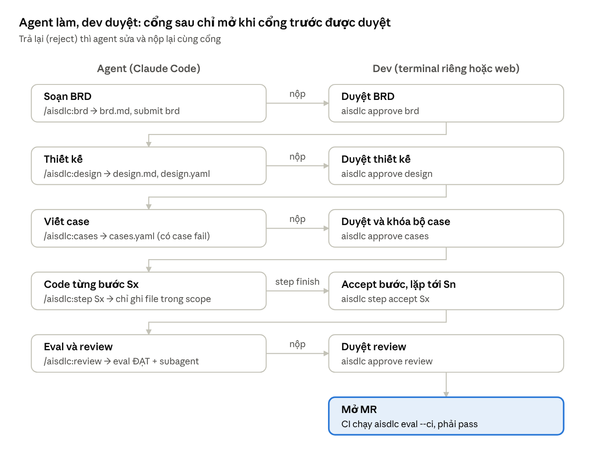
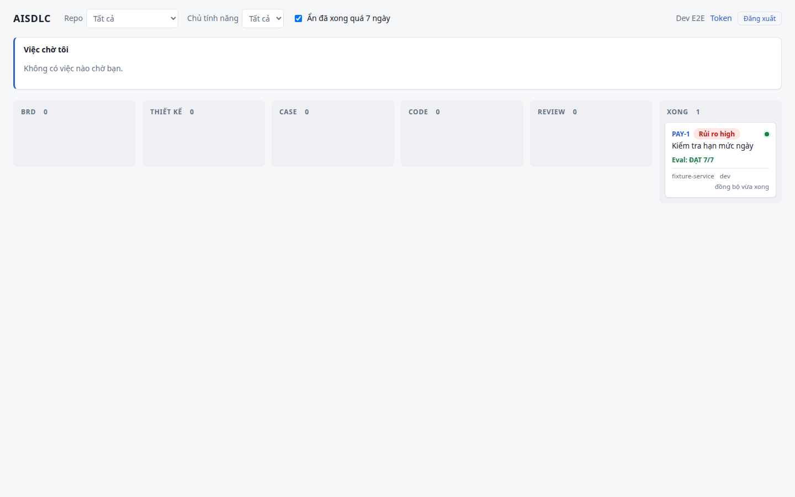

# AISDLC: để agent viết code, nhưng dev giữ cổng

Agent mở một merge request (MR): code build được, test xanh, diff vài trăm dòng. Câu hỏi của người review không còn là
"code có chạy không" mà là "code có làm đúng điều cần làm không, và mình dựa vào đâu để tin điều đó?".

AISDLC là một dự án mã nguồn mở trả lời câu hỏi đó cho các team viết dịch vụ Go (PostgreSQL, migration bằng goose)
cùng Claude Code. Agent viết tài liệu, case kiểm thử và code. Dev duyệt từng cổng. Hook chặn agent đi tắt, và CI chấm
lại mọi MR. Bài này giới thiệu bối cảnh ra đời của AISDLC, cách nó vận hành và cách bắt đầu dùng.

## Bối cảnh: dùng AI nhiều hơn, tin AI ít hơn

Vài số liệu đáng chú ý từ các khảo sát và nghiên cứu gần đây:

- **Khảo sát Stack Overflow 2025** (hơn 49.000 người trả lời): 84% lập trình viên đang dùng hoặc định dùng công cụ AI,
  nhưng tỷ lệ *không tin* độ chính xác của kết quả tăng lên 46% (năm trước là 31%). Chỉ khoảng 3% "rất tin". Với
  agent, 87% lo về độ chính xác và 81% lo về bảo mật, quyền riêng tư dữ liệu
  ([Stack Overflow](https://stackoverflow.co/company/press/archive/stack-overflow-2025-developer-survey/)).
- **Báo cáo DORA 2025 của Google** (gần 5.000 người làm công nghệ): khoảng 90% dùng AI trong công việc. Thông điệp
  chính của báo cáo là AI *khuếch đại* cả điểm mạnh lẫn điểm yếu sẵn có của tổ chức, chứ không tự sửa một quy trình
  giao hàng kém ([Google](https://blog.google/technology/developers/dora-report-2025/),
  [InfoQ](https://www.infoq.com/news/2025/09/dora-state-of-ai-in-dev-2025)).
- **Nghiên cứu ngẫu nhiên có đối chứng của METR** (16 lập trình viên open source giàu kinh nghiệm, 246 việc thật trên
  repo lớn): khi được dùng AI, họ mất thời gian **nhiều hơn khoảng 19%**, dù trước đó dự đoán sẽ nhanh hơn 24% và sau
  đó vẫn *cảm thấy* mình nhanh hơn 20%. Một phần thời gian bị tiêu vào việc đọc, sửa và loại bỏ code AI đề xuất
  ([InfoWorld](https://www.infoworld.com/article/4020931/ai-coding-tools-can-slow-down-seasoned-developers-by-19.html)).
  METR lưu ý kết quả gắn với công cụ đầu năm 2025 và bối cảnh repo lớn, chuẩn chất lượng cao.

Vấn đề còn nằm ngay trong hành vi của agent. Trong system card của Claude 4, Anthropic mô tả việc mô hình đời trước
(Claude 3.7 Sonnet) đôi khi **"special-case" để qua test** trong môi trường agentic coding như Claude Code: viết lời
giải chỉ đủ để test xanh thay vì giải đúng bài toán. Anthropic cũng ghi nhận các mô hình mới giảm mạnh hành vi này
([Anthropic, Claude 4 system card](https://www.anthropic.com/claude-4-system-card)). Bài học vẫn còn nguyên: **"test
xanh" chỉ có nghĩa khi agent không tự định nghĩa và tự sửa thước đo của chính nó**.

Ghép lại: dev dùng AI rất nhiều, ít tin kết quả, tốn nhiều công kiểm chứng, và agent có lúc "lách" thước đo. Bài toán
cần giải vì vậy không phải là làm agent viết nhanh hơn, mà là làm cho **niềm tin vào kết quả của agent có cơ sở**.

## Những ý tưởng đang định hình cách làm việc với agent

**Spec-driven development.** GitHub ra mắt
[Spec Kit](https://github.blog/ai-and-ml/generative-ai/spec-driven-development-with-ai-get-started-with-a-new-open-source-toolkit/)
(9/2025) với ý tưởng: viết đặc tả trước, rồi kế hoạch kỹ thuật, rồi chia thành các việc nhỏ kiểm thử được để agent
làm. AISDLC cùng tinh thần "tài liệu trước, code sau".

**Hook của Claude Code.** Claude Code cho phép cắm [hook](https://code.claude.com/docs/en/hooks) chạy trước và sau mỗi
lần agent dùng tool. Hook `PreToolUse` có thể chặn một lời gọi tool, và lý do chặn được đưa lại cho agent đọc. Đây là
lớp *tất định* bao quanh một agent vốn *xác suất*, và AISDLC dựng phần lớn cơ chế kiểm soát của mình trên đó.

**Minions của Stripe.** Stripe kể trong hai bài viết về "Minions", agent viết code chạy từ đầu đến cuối mỗi việc mà
không cần người trông ([phần 1](https://stripe.dev/blog/minions-stripes-one-shot-end-to-end-coding-agents),
[phần 2](https://stripe.dev/blog/minions-stripes-one-shot-end-to-end-coding-agents-part-2)). Mỗi tuần, hơn 1.300 PR
được merge ở Stripe là do minion viết; các PR đó vẫn được người review nhưng không chứa dòng code nào do người viết.
Vài lựa chọn thiết kế đáng chú ý:

- **Môi trường cô lập.** Minion chạy trên devbox sẵn sàng trong khoảng 10 giây, không chạm dữ liệu người dùng thật,
  dịch vụ production hay mạng tùy ý. Nhờ vậy minion chạy với đủ quyền mà không cần hỏi xác nhận, và mọi sai sót chỉ
  nằm trong một devbox.
- **"Blueprint": xen kẽ bước tất định và bước agentic.** Chạy linter hay đẩy code là code thường, không gọi LLM. Chỉ
  những việc như "implement task" hay "fix CI failures" mới giao cho agent. Stripe gọi đó là "đặt LLM vào những chiếc
  hộp có giới hạn".
- **Vòng phản hồi có trần.** CI chạy tối đa hai lượt; sau đó nhánh được trả về cho người.
- **Một lưới test lớn đứng sau:** hơn ba triệu test.

**"Harness" quanh agent.** Cách nhìn này được gọi chung là *harness*: model lo suy luận, còn lớp bao quanh quyết định
agent được thấy dữ liệu gì, được chạm vào hệ thống nào và kết quả được kiểm chứng ra sao. Một bài của XMPro tóm lại
thành công thức "Agent = Model + Harness", và nhấn mạnh rằng *ràng buộc làm tăng độ tin cậy*
([XMPro](https://xmpro.com/your-ai-agent-needs-a-harness-heres-what-that-means-for-industrial-operations/)).

AISDLC dựng trên chính những nguyên tắc đó: quy trình theo tài liệu, thước đo do người duyệt, và hook cùng CI để giữ
quy trình. Theo nghĩa đó, AISDLC là một harness cho agent viết code.

## AISDLC hoạt động thế nào

Một tính năng đi qua năm cổng. Agent làm, dev duyệt. Cổng sau chỉ mở khi cổng trước đã được duyệt:

```
BRD ──▶ Design ──▶ Cases ──▶ Code từng bước S1…Sn ──▶ Review ──▶ MR
 │         │         │                │                     │
 duyệt     duyệt     duyệt            accept từng bước       duyệt (eval phải ĐẠT)
```



1. **BRD**: yêu cầu nghiệp vụ, mỗi quy tắc có mã `BR-n`.
2. **Design**: sơ đồ tuần tự Mermaid chia thành các bước S1…Sn, bảng API, các giả định của agent và migration goose
   nháp. Khi nộp, migration nháp được chạy thử trên Postgres thật. File `design.yaml` khai báo **phạm vi file (glob) và
   ngân sách** (số file, số dòng) cho từng bước.
3. **Cases**: bộ case kiểm thử (HTTP, DB, message, stub) viết **trước khi có code**. Khi nộp, bộ case **phải có case
   fail**: nếu mọi case đã xanh khi chưa có dòng code nào, các case đó không kiểm tra được gì.
4. **Code từng bước**: agent chỉ được ghi file trong phạm vi của bước đang làm. Dev accept từng bước.
5. **Review**: eval phải ĐẠT, có review độc lập của một subagent, rồi dev duyệt và mở MR.

Tài liệu đã duyệt được **khóa bằng hash**; muốn sửa thì dev mở lại cổng (`aisdlc reopen`). Với sửa lỗi hay thay đổi
nhỏ không đụng DB/API, luồng nhẹ (`--lite`) bỏ qua BRD và Design, chỉ còn Cases → S1 → Review.

### Năm ý tưởng chính

**1. Thước đo do người duyệt, không do agent tự đặt.** Bộ case được khóa trước khi viết code và phải fail trước khi
code tồn tại. Harness `aisdlc-harness` chạy case như hộp đen trên dịch vụ thật, với Postgres (và Kafka nếu cần) dựng
bằng Docker qua testcontainers. Hook chặn agent sửa `cases.yaml` đã duyệt, và nếu file này đổi sau khi duyệt thì eval
fail ở `CASES_LOCKED`. Đây là câu trả lời trực tiếp cho hiện tượng special-casing ở trên.

**2. Phạm vi và ngân sách cho từng bước.** Hook `PreToolUse` chặn agent ghi ra ngoài glob của bước đang làm. Muốn ghi
thêm một file, dev cho phép đúng file đó (`aisdlc scope allow`). Khi kết thúc bước, `step finish` liệt kê file ngoài
phạm vi, và eval có kiểm tra cứng `SCOPE`. Một tính năng thêm hạn mức chuyển tiền vì thế không kéo theo một đợt
"tiện tay refactor" nửa codebase: diff nằm trong phạm vi đã duyệt từ thiết kế.

**3. Review card dẫn sự chú ý của người duyệt.** Ở mỗi cổng, dev nhận một thẻ tóm tắt có cờ đỏ: phạm vi các bước chồng
nhau, glob chạm migration cũ, thay đổi bảng đang có, quy tắc nghiệp vụ chưa có case… Thẻ còn có bản đồ bước, ER diff,
bảng API và **danh sách giả định agent tự chốt**. Phần tốn công nhất mà METR và Stack Overflow chỉ ra là kiểm chứng;
review card đưa người duyệt tới đúng chỗ cần soi.

**4. Rủi ro do một subagent độc lập xếp loại, kèm bằng chứng.** Mỗi repo có một chính sách rủi ro, các luật viết bằng
lời. Khi nộp cổng Design (luồng nhẹ: cổng Cases), subagent `aisdlc-risk-classifier`, chỉ có quyền đọc, đọc tài liệu
của tính năng và quyết định luật nào khớp. Mỗi luật khớp phải kèm **câu trích nguyên văn**, và CLI kiểm câu trích đó
có thật trong file. Mức rủi ro càng cao thì bộ case càng phải chặt (case gửi trùng, bất biến DB, coverage tối thiểu…).
Ở mức thấp, chính sách có thể cho hệ thống tự duyệt cổng Design, Cases và accept bước khi nộp sạch, trừ khi thẻ có cờ
đỏ HIGH. BRD và Review luôn do dev duyệt.

**5. CI chấm lại mọi MR.** Job CI chạy lại eval trên MR: build và `go test`, toàn bộ case, khóa của bộ case, schema
sau migration, phạm vi file, và kết quả xếp loại rủi ro còn khớp tài liệu hiện tại. Coverage dòng mới và kết quả review
của subagent nằm trong báo cáo. CI không gọi LLM. Ở chế độ duyệt trên web, CI còn hỏi server xem các cổng đã được
duyệt chưa, và **fail nếu code đổi sau lần duyệt Review**.

## Mô hình an toàn nhiều tầng

Mỗi tầng bảo vệ do code tất định đảm nhận:

- **Hook chặn** ghi vào file trạng thái và tài liệu đã duyệt, ghi ra ngoài phạm vi, sửa code khi cổng chưa mở, mọi
  tool chạm thư mục chứa token `~/.config/aisdlc`, lệnh in biến môi trường, và mọi lệnh ghi khi dev bấm tạm dừng trên
  web. Agent cũng không tự duyệt được: lệnh duyệt đòi console thật và bắt gõ lại mã tính năng.
- **Hook không bao giờ gọi mạng.** Hook chỉ đọc cache được server ký bằng Ed25519 và xác minh bằng public key đã ghim
  trên máy dev; cache bị sửa hay chép từ nơi khác bị coi là chưa duyệt. Nhờ vậy hook nhanh: E2E đo độ trễ và fail nếu
  p95 vượt 50 ms.
- **Token có kiểu** (`login`, `ingest`, `approve`, `ci`). Token mà CLI và hook dùng không duyệt được gì.
- **GitLab là tầng thực thi cuối cùng:** nhánh được bảo vệ, job eval phải pass thì MR mới merge được.

Đây cũng là tinh thần mà Stripe và các bài viết về harness nhấn mạnh: việc gì phải luôn đúng thì giao cho code tất
định (hook, linter, CI), không giao cho LLM.

## Một ví dụ: PAY-1 "Kiểm tra hạn mức ngày"

Hướng dẫn sử dụng đi trọn tính năng mẫu PAY-1, cũng là kịch bản E2E của dự án. Lệnh `/aisdlc:*` gõ trong Claude Code;
lệnh `aisdlc` do dev chạy ở terminal riêng:

```bash
/aisdlc:init PAY-1        # agent đề xuất luồng, tạo tính năng
/aisdlc:brd               # agent soạn brd.md, nộp cổng BRD
aisdlc approve brd        # dev xem review card, gõ lại PAY-1 để xác nhận
/aisdlc:design            # design.md, design.yaml, migration nháp; subagent xếp loại rủi ro
aisdlc approve design
/aisdlc:cases             # cases.yaml; khi nộp phải có case đang fail
aisdlc approve cases      # từ đây bộ case bị khóa
/aisdlc:step S1           # agent chỉ ghi được file trong phạm vi S1
aisdlc step accept S1
/aisdlc:step S2
aisdlc step accept S2
/aisdlc:review            # eval, review độc lập, nộp cổng Review
aisdlc approve review     # rồi mở MR
```

Mọi lệnh duyệt đều là việc của dev. Nếu repo bật `sessionApprove` (qua một MR đã merge), dev có thể yêu cầu duyệt ngay
trong Claude Code, và lệnh chỉ chạy khi dev tự bấm Yes trong hộp xác nhận quyền.

## Bảng web và điều khiển agent

`aisdlc-web` là thành phần tùy chọn. Nó có bảng theo dõi tính năng, màn xem agent chạy trực tiếp, nút tạm dừng agent,
ô gửi chỉ dẫn, và cho phép accept bước hay cho phép file ngay từ trình duyệt. Khi repo đặt `approvals: web`, dev duyệt
cổng trên web và bản ghi duyệt nằm trên server. Trang chính sách rủi ro cho phép chỉnh luật và xuất bản phiên bản mới,
có lịch sử để so sánh.



## Tiếng Việt và tiếng Anh

AISDLC hỗ trợ cả tiếng Anh và tiếng Việt. Mỗi repo chọn một ngôn ngữ bằng khóa `locale: en|vi` trong
`aisdlc/config.yaml`; CLI, hook, template, review card, báo cáo eval và tài liệu agent viết đều theo ngôn ngữ đó. Trên
web, mỗi người dùng tự chọn giao diện EN/VI. Repo không có khóa `locale` vẫn chạy bằng tiếng Việt, y như trước.

Việc chuyển ngữ cũng được kiểm chứng như mọi phần khác: mọi chuỗi tiếng Việt trong code Go phải đi qua catalog dịch, có
test quét toàn repo để giữ điều đó, và E2E chạy thêm một lượt trên repo tiếng Anh, kiểm output không còn ký tự tiếng
Việt.

## Lợi ích chính

- **Niềm tin có cơ sở:** bộ case được duyệt và khóa trước khi có code, chạy như hộp đen trên Postgres thật.
- **Diff dễ review:** mỗi bước có phạm vi và ngân sách rõ ràng, được duyệt từ thiết kế.
- **Review tập trung:** review card nêu cờ đỏ và giả định của agent, để người duyệt soi đúng chỗ.
- **Kiểm soát tương xứng với rủi ro:** tính năng rủi ro cao cần bộ case chặt hơn; tính năng rủi ro thấp đi nhanh hơn
  nhờ tự duyệt.
- **Thực thi bằng code tất định:** hook trên máy dev, eval trong CI và nhánh được bảo vệ trên GitLab.

## AISDLC dành cho ai

AISDLC dành cho các team viết dịch vụ Go với PostgreSQL và goose, dùng Claude Code, và cần một quy trình kiểm soát
được: ngân hàng, thanh toán, hay bất kỳ nơi nào một thay đổi DB sai có thể gây hậu quả thật.

Kết quả của METR và DORA gợi ý rằng phần tốn công nhất khi làm với AI nằm ở kiểm chứng, không nằm ở gõ code. AISDLC
dồn công sức vào đúng chỗ đó, và sớm nhất có thể: duyệt tài liệu và bộ case trước, để mỗi bước code sau đó đã có
thước đo rõ ràng.

## Bắt đầu

Máy dev cần Linux hoặc macOS, Go, Docker, git và Claude Code:

```bash
git clone https://github.com/hadtinfo/aisdlc-duck.git ~/aisdlc && ~/aisdlc/plugin/install.sh
```

Trong Claude Code:

```
/plugin marketplace add ~/aisdlc
/plugin install aisdlc@aisdlc
```

Rồi chạy `aisdlc setup --locale vi` (hoặc `en`) ở gốc repo dịch vụ và gõ `/aisdlc:init <mã ticket>` để bắt đầu tính
năng đầu tiên. Chi tiết xem [README](../../README.vi.md), [hướng dẫn sử dụng](../huong-dan-su-dung.md) và
[trang dự án](https://hadtinfo.github.io/aisdlc-duck/vi/). Dự án dùng giấy phép MIT, và đóng góp luôn được chào đón.

## Tài liệu tham khảo

- Stack Overflow, *2025 Developer Survey: trust in AI at an all-time low*,
  <https://stackoverflow.co/company/press/archive/stack-overflow-2025-developer-survey/>
- Google, *How are developers using AI? Inside our 2025 DORA report*,
  <https://blog.google/technology/developers/dora-report-2025/>; InfoQ,
  <https://www.infoq.com/news/2025/09/dora-state-of-ai-in-dev-2025>
- InfoWorld, *AI coding tools can slow down seasoned developers by 19%* (về nghiên cứu của METR),
  <https://www.infoworld.com/article/4020931/ai-coding-tools-can-slow-down-seasoned-developers-by-19.html>
- Anthropic, *System Card: Claude Opus 4 & Claude Sonnet 4* (mục reward hacking, special-casing),
  <https://www.anthropic.com/claude-4-system-card>
- GitHub Blog, *Spec-driven development with AI: Get started with a new open source toolkit*,
  <https://github.blog/ai-and-ml/generative-ai/spec-driven-development-with-ai-get-started-with-a-new-open-source-toolkit/>
- Claude Code docs, *Hooks reference*, <https://code.claude.com/docs/en/hooks>
- Alistair Gray (Stripe), *Minions: Stripe's one-shot, end-to-end coding agents* (09/02/2026),
  <https://stripe.dev/blog/minions-stripes-one-shot-end-to-end-coding-agents>
- Alistair Gray (Stripe), *Minions: Stripe's one-shot, end-to-end coding agents, Part 2* (19/02/2026),
  <https://stripe.dev/blog/minions-stripes-one-shot-end-to-end-coding-agents-part-2>
- Nic Gould (XMPro), *Your AI Agent Needs a Harness — Here's What That Means for Industrial Operations* (19/05/2026),
  <https://xmpro.com/your-ai-agent-needs-a-harness-heres-what-that-means-for-industrial-operations/>
