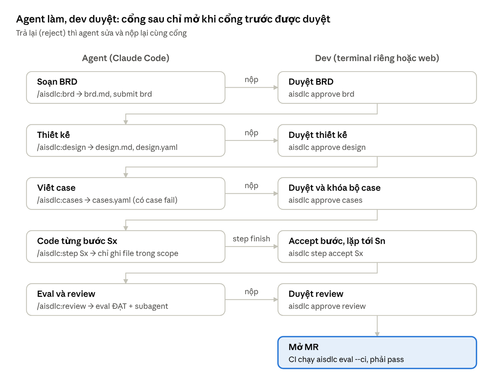
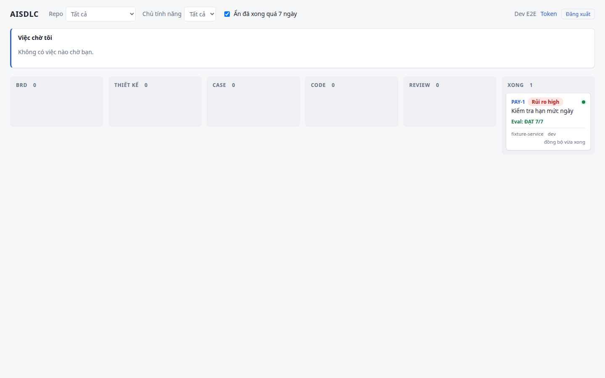
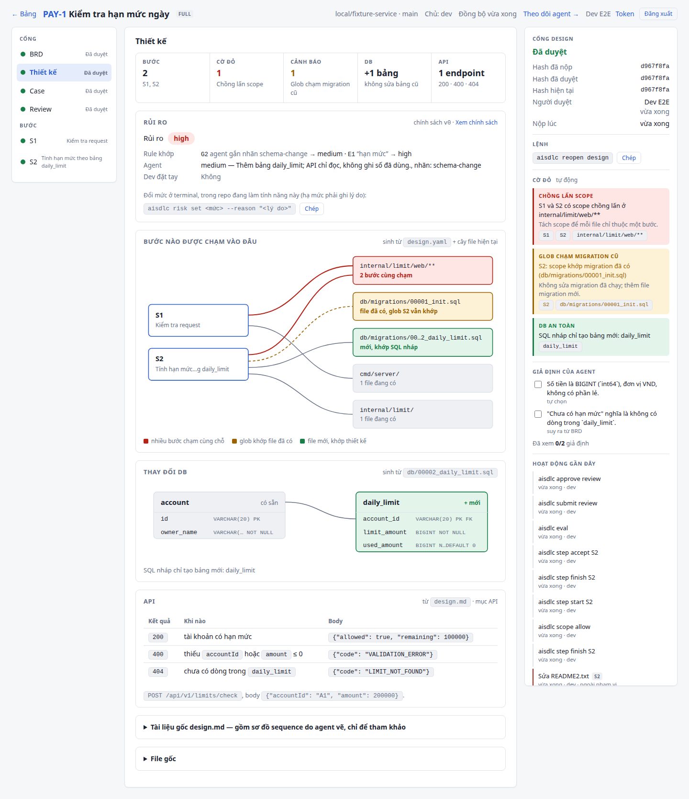
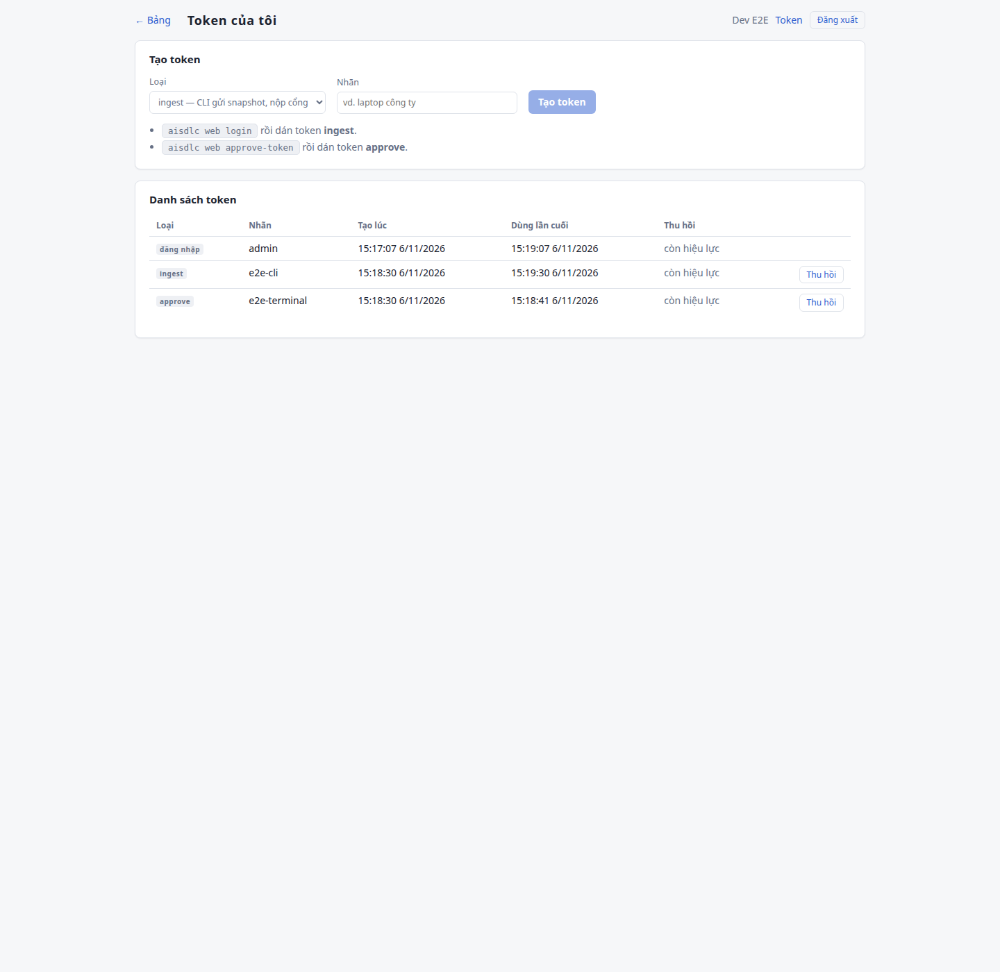
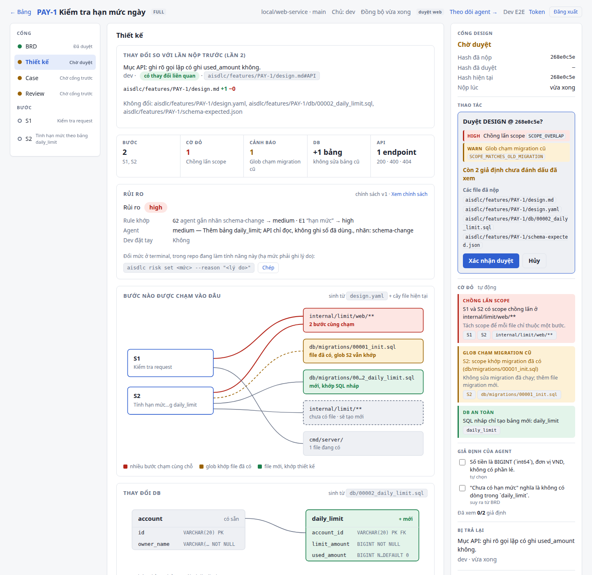
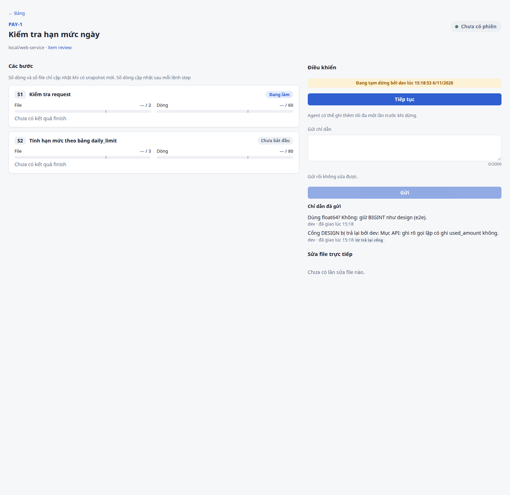
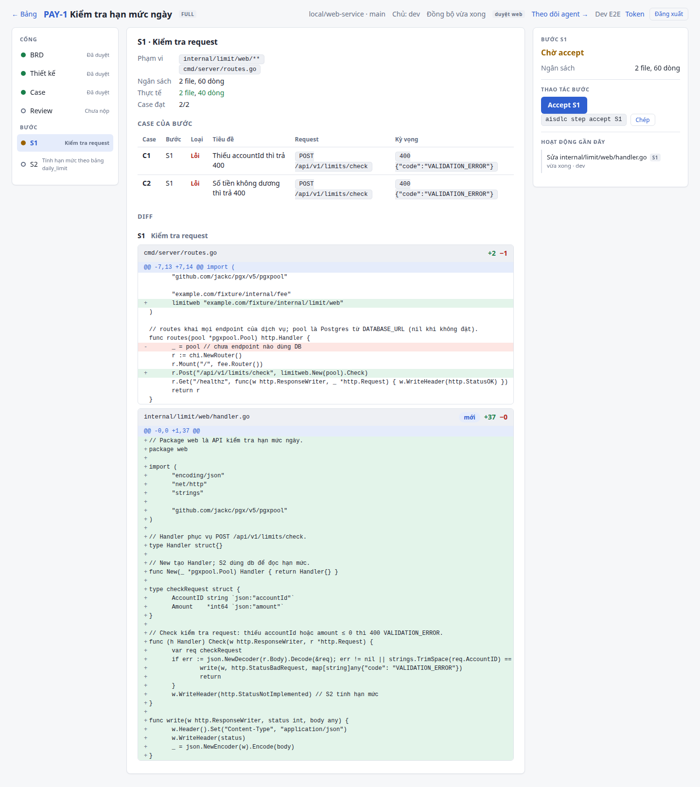
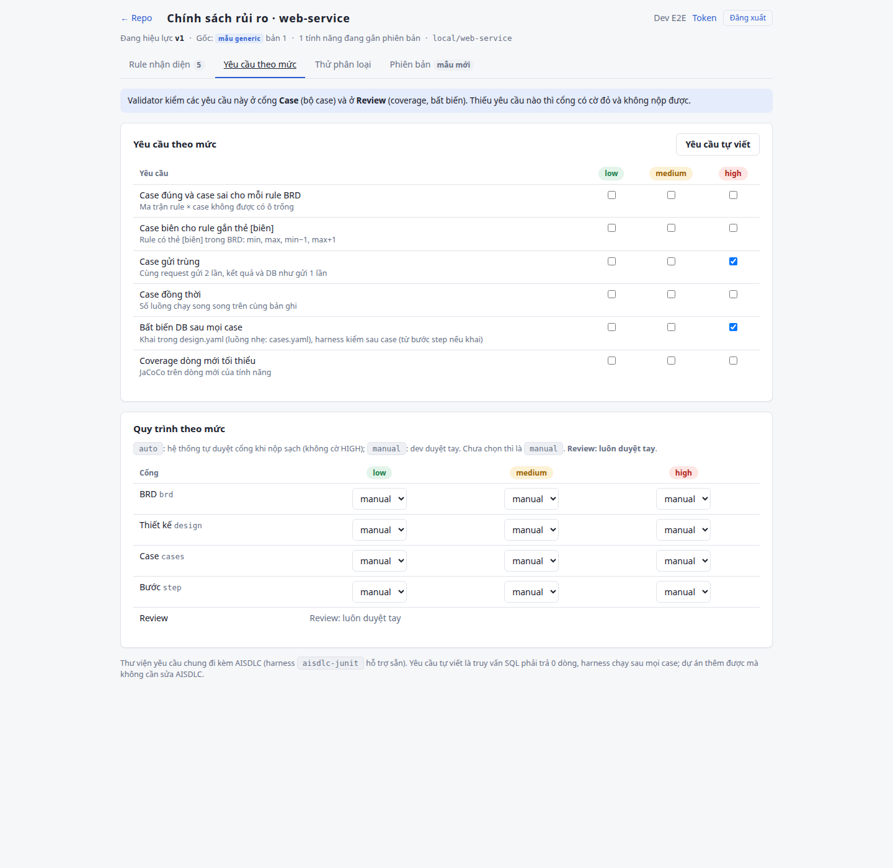
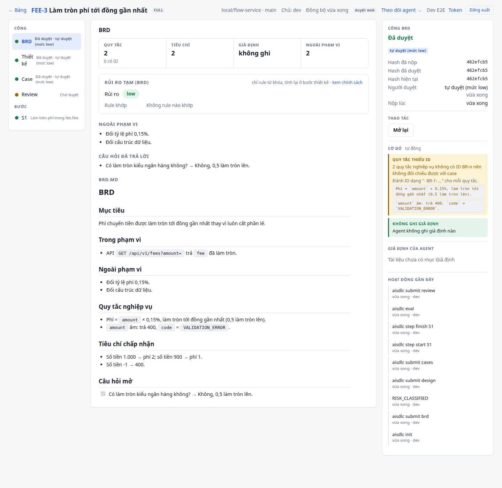

# Hướng dẫn sử dụng AISDLC

> English: [user-guide.md](user-guide.md).

Cập nhật: 2026-11-06

## 1. AISDLC là gì

AISDLC để agent Claude Code viết tài liệu, case và code, còn dev duyệt từng cổng. Hook của plugin chặn agent đi tắt, CI chấm lại mỗi MR. Dùng cho dịch vụ Go (chi/pgx hoặc tương tự) có migration goose và PostgreSQL.

Một tính năng đi qua 5 cổng, mỗi cổng phải được duyệt thì cổng sau mới mở:

1. **BRD**: yêu cầu nghiệp vụ, các rule `BR-n`.
2. **Thiết kế**: `design.md` (sequence Mermaid có S1…Sn, bảng API, giả định), `design.yaml` (scope và ngân sách từng bước, đánh giá tác động), migration goose nháp trong `db/`.
3. **Case**: `cases.yaml` (HTTP, DB, message, stub). Lúc nộp, bộ case phải có case fail vì chưa có code.
4. **Code từng bước S1…Sn**: agent chỉ ghi được file trong scope của bước; dev accept từng bước.
5. **Review**: eval phải ĐẠT, có review độc lập của subagent; dev duyệt rồi mở MR.

Artifact đã duyệt bị khóa bằng hash. Muốn sửa thì dev mở lại cổng (`aisdlc reopen <gate>`).



Mỗi mũi tên sang phải là một lần agent nộp; chỉ sau khi dev duyệt, agent mới được sang cổng kế tiếp.

**Ai làm gì.**

| | Agent (Claude Code) | Dev |
| --- | --- | --- |
| Viết | `brd.md`, `design.md`, `design.yaml`, migration, `cases.yaml`, code, `review-agent.json` (qua subagent) | Không bắt buộc viết gì; đọc review card, diff, report |
| Lệnh | `init`, `submit`, `step start`, `step finish`, `eval`, `review`, `status`, `diff`, `policy show` | `approve`, `reject`, `reopen`, `step accept`, `scope allow`, `risk set`, `risk reclassify`, `web login` |
| Không được | Duyệt, accept bước, cho phép file ngoài scope, sửa file trạng thái hay artifact đã duyệt | (không giới hạn; lệnh của dev đòi console thật hoặc hộp Yes/No trong Claude Code) |

**Luồng đầy đủ và luồng nhẹ.** FULL (mặc định) đi đủ 5 cổng, dùng cho thay đổi có DB, API hoặc dòng tiền. LITE (`aisdlc init <KEY> --lite`) cho sửa lỗi hay thay đổi nhỏ không đổi DB/API: bỏ BRD và thiết kế, còn Case → S1 → Review (mục 3.3).

**Mức rủi ro.** Mỗi repo có một chính sách rủi ro (`aisdlc/risk-policy.yaml` hoặc trên web). Mỗi tính năng được xếp một mức (mặc định `low < medium < high`); mức càng cao thì bộ case càng phải chặt, và chính sách có thể cho mức thấp **tự duyệt** các cổng BRD, Thiết kế, Case và accept bước khi nộp sạch. Review luôn do dev duyệt. Chi tiết: mục 7.

Các thành phần dev đụng tới:

| Thành phần | Vai trò |
| --- | --- |
| Plugin Claude Code (`plugin/`) | Slash command `/aisdlc:*`, hook, subagent `aisdlc-reviewer` |
| CLI `aisdlc` | Một binary Go: lệnh của agent và của dev; cũng là chương trình chạy hook |
| Harness `aisdlc-harness` | Binary thứ hai, `aisdlc` gọi khi chạy case (`submit design`/`submit cases`, `step finish`) và `eval`: dựng Postgres/Kafka bằng Docker (testcontainers), chạy dịch vụ và `cases.yaml` như hộp đen. Tách riêng để hook khởi động nhanh |
| Web `aisdlc-web` (tùy chọn) | Bảng theo dõi, duyệt cổng và điều khiển agent trên web |

Agent gọi plugin → `plugin/bin/aisdlc` chọn binary đúng nền tảng → CLI đọc/ghi file trạng thái trong repo. Eval build dịch vụ, chạy test cũ rồi chạy bộ case qua harness. Web là tùy chọn: CLI gửi lên `aisdlc-web` qua HTTPS kèm token.

Trạng thái của một tính năng nằm trong repo, ở `aisdlc/features/<KEY>/`:

| File | Ai ghi | Nội dung |
| --- | --- | --- |
| `feature.yaml` | CLI (`init`) | Key, tiêu đề, luồng, commit gốc |
| `brd.md`, `design.md`, `design.yaml`, `db/*.sql`, `cases.yaml` | Agent | Artifact của các cổng |
| `gates.json` | CLI | Bản nộp và bản duyệt từng cổng (chế độ `local`) |
| `steps.json`, `scope-extra.json` | CLI | Trạng thái bước, file được cho phép ngoài scope |
| `risk.yaml` | CLI | Mức rủi ro, chính sách đã dùng, yêu cầu của mức |
| `feedback.md` | CLI | Góp ý khi dev trả lại cổng |
| `review-agent.json` | Subagent `aisdlc-reviewer` | Kết quả review độc lập |
| `eval/report.md`, `eval/report.json`, `eval/diff-by-step.md` | CLI (`eval`) | Kết quả eval |

`.aisdlc/` (không commit, setup thêm vào `.gitignore`) giữ dữ liệu cục bộ: log chạy ở `.aisdlc/run/<KEY>/`, tính năng đang làm của từng session, hàng đợi và cache của web.

## 2. Cài đặt

Máy dev cần Linux hoặc macOS, Go, Docker (harness dùng cho Postgres/Kafka), git và Claude Code. Không cần công cụ build nào khác.

### 2.1. Cài plugin trên máy dev

```bash
git clone <repo aisdlc> ~/aisdlc && ~/aisdlc/plugin/install.sh
# build aisdlc và aisdlc-harness cho máy này vào plugin/lib/aisdlc{,-harness}-<os>-<arch>, symlink ~/.local/bin/aisdlc
# (thêm ~/.local/bin vào PATH)
```

Máy không có Go thì lấy repo đã chạy `make plugin-dist` (build sẵn linux/darwin × amd64/arm64 vào `plugin/lib/`); `install.sh` thấy đủ hai binary cho nền tảng của máy thì chỉ tạo symlink, thiếu thì báo `AISDLC: thiếu plugin/lib/<binary> cho <os>/<arch>` và thoát.

Trong Claude Code:

```
/plugin marketplace add ~/aisdlc
/plugin install aisdlc@aisdlc
```

- `plugin/lib/` không nằm trong git. Chạy `install.sh` (hoặc `make plugin-dist`) trước `/plugin install`; marketplace phải trỏ vào thư mục đã build, không dùng URL git.
- `aisdlc` tìm `aisdlc-harness` cùng thư mục với nó (không có mới tìm trên `PATH`; không biến môi trường nào đổi được đường dẫn này) và chỉ nhận kết quả khi hai binary cùng bản build. Thiếu thì mọi case ERROR "không tìm thấy aisdlc-harness: …"; lệch bản thì ERROR "aisdlc-harness khác bản build với aisdlc …". Vì vậy luôn build hai binary cùng lúc (`install.sh`, `make build`, `make plugin-dist` đều làm vậy).
- Cập nhật binary xong thì cài lại plugin.
- Thiếu binary cho nền tảng này: trong repo AISDLC, hook chặn mọi công cụ ghi (Edit, Write, Bash…) tới khi sửa xong; `Read`, `Grep`, `Glob` vẫn dùng được. Ở repo khác plugin im lặng, không làm gì.

Plugin đăng ký hook `SessionStart` (nạp quy tắc và trạng thái vào ngữ cảnh, đặt `AISDLC_SESSION`), `PreToolUse` (chặn ghi sai quy trình), `PostToolUse` (gửi event sửa file lên web, giao chỉ dẫn), `UserPromptSubmit` (làm mới điều khiển từ web) và `Stop` (không cho agent dừng giữa bước).

### 2.2. Gắn vào repo dịch vụ (một MR riêng)

Chạy ở gốc repo dịch vụ Go (có `go.mod`, thường có `cmd/<tên>/main.go` và thư mục migration goose):

```bash
# chạy-được
aisdlc setup --preset generic
git status --short
```

(Thêm `--preset banking` nếu muốn mẫu chính sách rủi ro ngân hàng. Repo đã có file nào thì `setup` giữ nguyên file đó và in `Giữ nguyên <file> (đã có).`; chạy lại không đổi gì. Thư mục chưa nằm trong repo git nào thì `setup` chạy `git init -b main` trước và in `Đã tạo git repo …`; thêm remote sau bằng `git remote add origin <url>`.)

Lệnh tạo `aisdlc/config.yaml`, `aisdlc/risk-policy.yaml`, `aisdlc/gitlab-ci.aisdlc.yml`, nối mục AISDLC vào `CLAUDE.md` và thêm `.aisdlc/` vào `.gitignore`. Nó dò `service.main` (đúng một `cmd/*/main.go`) và thư mục migration (`db/migrations`, `migrations`, `db/migration`, `sql/migrations`, theo thứ tự đó); dò không ra thì in lời nhắc để bạn tự sửa `aisdlc/config.yaml`.

Chế độ duyệt: mặc định `web` nếu máy chạy `setup` đã `aisdlc web login` (mục 6), ngược lại `local`. Chọn hẳn bằng `--approvals web` hoặc `--approvals local`. `config.yaml` đã có thì setup không đổi chế độ.

Các khóa chính của `aisdlc/config.yaml` (mẫu đầy đủ, có chú thích: `templates/config.yaml`):

| Khóa | Mặc định | Ý nghĩa |
| --- | --- | --- |
| `service.main` | `./cmd/server` | Package main để build |
| `service.buildFlags` | `[]` | Thêm cho `go build`, ví dụ `["-tags=prod"]` |
| `service.healthPath` | `/healthz` | Trả 2xx khi dịch vụ sẵn sàng |
| `service.startTimeoutSeconds` | `60` | Chờ health check tối đa |
| `service.shutdownTimeoutSeconds` | `15` | Sau `SIGTERM` chờ chừng này giây, quá thì `SIGKILL` (coverage là N/A) |
| `service.env.port`, `.databaseUrl`, `.kafkaBrokers` | `PORT`, `DATABASE_URL`, (tắt) | **Tên** biến môi trường dịch vụ đọc; harness điền giá trị. Kafka chỉ khởi động khi `kafkaBrokers` có giá trị |
| `service.env.externalBaseUrls` | `[]` | Biến trỏ tới hệ thống ngoài; harness điền URL của stub server |
| `service.extraEnv` | `{}` | Giá trị cố định thêm vào môi trường dịch vụ |
| `service.postgres.image`, `service.kafka.image` | `postgres:16-alpine`, `apache/kafka:3.8.0` | Image cho harness |
| `migrations.dir`, `migrations.tool` | `db/migrations`, `goose` | Thư mục migration chính; bản đầu chỉ có goose |
| `unitTest.packages`, `unitTest.flags` | `["./..."]`, `[]` | Test cũ eval chạy |
| `timeoutMinutes` | `30` | Quá thời gian thì dừng build + test + case và coi là lỗi |
| `alwaysAllowed`, `unmanaged` | `[]`, `["*.md", "docs/**"]` | Path luôn được sửa; path không tính vào phạm vi và ngân sách |
| `checks` | `[]` | Lệnh lint/quét thêm, ví dụ `{ name: vet, cmd: "go vet ./..." }`; mỗi lệnh thành check cứng `CHECK:<tên>` |
| `baseRef` | `origin/main` | Nhánh gốc để tính diff và đọc `sessionApprove` |
| `sessionApprove` | (tắt) | Cho duyệt ngay trong Claude Code (mục 3.1) |
| `ciRequireFeature` | `true` | CI fail khi code đổi mà không thuộc tính năng nào |
| `approvals` | `local` | `web` để duyệt trên web (mục 6.3) |
| `review.*` | | Ngưỡng của review card (scope quá rộng, ngân sách lớn, trường tiền/hạn mức để soát số liệu) |

Sau đó kiểm dịch vụ đáp ứng hợp đồng với harness:

1. **Biến môi trường**: dịch vụ đọc cổng, URL DB (và broker Kafka nếu có) từ các biến khai ở `service.env`, và nghe đúng cổng được cấp.
2. **Health check**: `service.healthPath` trả 2xx khi dịch vụ sẵn sàng, trong `startTimeoutSeconds`.
3. **Tắt êm**: dịch vụ thoát sau khi nhận `SIGTERM` trong `shutdownTimeoutSeconds` (ví dụ `http.Server.Shutdown`). Nếu không, harness `SIGKILL` và coverage dòng mới là N/A kèm lý do trong report. Mẫu: `e2e/fixture-service/cmd/server/main.go`.
4. **Migration goose**: tên `NNNNN_ten.sql` (ví dụ `00002_daily_limit.sql`), có `-- +goose Up`, đặt trong `migrations.dir`.
5. Build và `go test` trên `unitTest.packages` phải chạy sạch ở gốc repo.

Merge MR setup trước, rồi mới bật CI ở MR sau (mục 5). MR setup sửa `config.yaml` mà không thuộc tính năng nào, nên job eval sẽ đánh fail nó.

## 3. Làm một tính năng

Agent chạy slash command trong Claude Code. Dev duyệt bằng lệnh ở một terminal riêng, trên web (mục 6), hoặc ngay trong Claude Code nếu repo bật `sessionApprove` (mục 3.1). Không dùng `!` trong Claude Code cho lệnh duyệt: chế độ đó không có console nên lệnh bị từ chối.

| Việc | Agent (Claude Code) | Dev (terminal riêng, hoặc mục 3.1) |
| --- | --- | --- |
| Khởi tạo | `/aisdlc:init PAY-123`: đề xuất luồng đầy đủ hay nhẹ, hỏi dev, chạy `aisdlc init` | Chọn luồng |
| BRD | `/aisdlc:brd`: soạn `brd.md`, `aisdlc submit brd` | `aisdlc approve brd` hoặc `aisdlc reject brd -m "..."` |
| Thiết kế | `/aisdlc:design`: `design.md`, `design.yaml`, migration goose nháp trong `db/`; submit chạy thử migration trên Postgres thật | `aisdlc approve design` |
| Case | `/aisdlc:cases`: `cases.yaml`; submit chạy bộ case, phải có case fail | `aisdlc approve cases` (khóa bộ case) |
| Code | `/aisdlc:step S1`: `step start`, code trong scope, `step finish`, rồi dừng | `aisdlc step accept S1`; file ngoài scope: `aisdlc scope allow <path>` |
| Eval | `/aisdlc:eval`: build, test cũ và bộ case, ghi `eval/report.md` | Đọc report |
| Review | `/aisdlc:review`: eval, subagent `aisdlc-reviewer` ghi `review-agent.json`, `aisdlc submit review` | `aisdlc approve review`, rồi mở MR |

Lệnh duyệt (`approve`, `reject -m`, `reopen`, `step accept`, `scope allow`, `risk set`, `risk reclassify`) mặc định đòi console thật và bắt gõ lại feature key (`Gõ lại feature key (PAY-123) để xác nhận:`). Không có console thì lệnh in `Lệnh này chỉ dev được chạy, trong terminal thật (không tìm thấy console). Agent không được chạy lệnh này.` và thoát 3 (`risk` thoát 2). Không có cờ hay biến môi trường nào để bỏ qua; cách khác duy nhất là bật `sessionApprove` (mục 3.1).

`aisdlc approve <gate>` in thông tin bản nộp (hash, file, phát hiện lúc nộp) và review card trước khi hỏi: cờ đỏ (HIGH, WARN, NA, INFO), giả định agent tự chốt, bản đồ bước, bảng DB, API, độ phủ case. Xem trước bằng `aisdlc review <brd|design|cases|review>` (chỉ đọc, agent cũng chạy được; `--json` in JSON). Cờ chỉ là gợi ý để dev soi nhanh, không chặn cổng.

Ticket Jira chỉ để lấy tiêu đề: chưa đặt `JIRA_URL` và `JIRA_TOKEN` thì `init` cảnh báo `Cảnh báo: chưa đặt JIRA_URL và JIRA_TOKEN, bỏ qua kiểm tra ticket Jira.` rồi dùng `--title`.

Mã thoát chung của CLI: `0` thành công, `1` có phát hiện (nộp bị từ chối, eval KHÔNG ĐẠT, bước có case fail), `2` lỗi dùng lệnh hay trạng thái không cho phép, `3` lệnh chỉ dev chạy không có console hay phiếu xác nhận.

### 3.1. Duyệt ngay trong Claude Code (`sessionApprove`)

Mặc định tắt. Bật bằng `sessionApprove: true` trong `aisdlc/config.yaml`, ở MR riêng. Giá trị được đọc từ `baseRef` (thường `origin/main`), không đọc working tree, nên chỉ có hiệu lực sau khi MR đã merge và agent không tự bật được. Repo không có `origin` hoặc chưa fetch thì coi như tắt. Kiểm tra bằng `aisdlc status`: dòng `Duyệt trong Claude Code: bật|tắt (<lý do>)` (`--json` có trường `sessionApprove`).

Khi bật, dev yêu cầu agent trong Claude Code:

| Slash command | Lệnh agent chạy |
| --- | --- |
| `/aisdlc:approve <cổng>` | `aisdlc review <cổng>` (in review card), rồi `aisdlc approve <cổng>` |
| `/aisdlc:reject <cổng> <lý do>` | `aisdlc reject <cổng> -m "<lý do>"` |
| `/aisdlc:accept <Sx>` | `aisdlc step accept <Sx>` |
| `/aisdlc:accept --file <path>` | `aisdlc scope allow <path>` |

Hook trả `ask`, Claude Code hiện hộp Yes/No; chỉ khi dev bấm Yes lệnh mới chạy (cấp một phiếu dùng một lần, hạn 60 giây, khớp session, tính năng, lệnh và hash cổng). Bấm No thì không duyệt; lần sau hỏi lại. Bản duyệt ghi kênh `claude-code`: `status` hiện "duyệt trong Claude Code (<dev>)", web hiện "(trong Claude Code)".

Lưu ý:

- Lệnh duyệt phải là lệnh đơn gọi thẳng `aisdlc <lệnh>`. Dạng gián tiếp (`bash -c`, `eval`, biến, đường dẫn tới launcher, ghép `&&`/`;`/`|`…) bị từ chối với lý do "… gọi thẳng `aisdlc <lệnh>` để hiện hộp xác nhận …".
- Lệnh duyệt phải chạy một mình: tool khác chạy giữa chừng sẽ xóa phiếu, lệnh báo `… Chạy lại lệnh duyệt một mình, không kèm lệnh khác.` và thoát 3.
- Chỉ các chế độ quyền còn hỏi người (`default`, `acceptEdits`, `plan`) mới hiện hộp. Chế độ khác (`bypassPermissions`, `dontAsk`, `auto`, hoặc không rõ) thì lệnh duyệt bị chặn: duyệt ở terminal riêng hoặc web.
- **Không** thêm quy tắc allow cho lệnh duyệt vào `permissions.allow` của Claude Code (ví dụ `Bash(aisdlc:*)`, `Bash(aisdlc approve:*)`). Chưa kiểm chứng hộp Yes/No vẫn hiện khi có quy tắc allow khớp, nên quy tắc như vậy có thể để agent tự duyệt mà dev không được hỏi.
- Terminal riêng và web vẫn dùng được như cũ.

### 3.2. Nhiều tính năng song song

Mỗi session Claude Code nhớ tính năng riêng của mình: hook SessionStart đặt `AISDLC_SESSION`, và `/aisdlc:init` hoặc `aisdlc use <KEY>` trong session nào thì gắn tính năng cho session đó; hook kiểm tra scope theo đúng tính năng đó. Hai session cùng thư mục không ghi đè nhau. Mọi lệnh theo tính năng in `[KEY]` ở dòng đầu.

- Terminal ngoài Claude Code: có từ 2 tính năng đang mở thì CLI hỏi chọn, hoặc báo lỗi kèm danh sách. Ghi rõ bằng `--feature <KEY>` (hoặc `-f`), ví dụ `aisdlc approve brd --feature PAY-1`.
- "Đang mở" là tính năng có trong checkout, chưa có ở `baseRef` và cổng REVIEW chưa duyệt. Tính năng đã merge mà vẫn làm tiếp thì chạy `aisdlc use <KEY>` hoặc dùng `--feature`.
- Session mới (hoặc sau `/clear`) chưa gắn tính năng mà có nhiều tính năng mở: hook chặn Edit/Write và nhắc agent chạy `aisdlc use <KEY>`.
- Chạy `init`/`use` trong Claude Code mà thiếu `AISDLC_SESSION` thì CLI cảnh báo tính năng không được gắn riêng cho session; khởi động lại session Claude Code hoặc thêm `--feature`.
- Hook chặn agent gán hay export `AISDLC_SESSION` (để session này không đổi tính năng của session khác).
- Làm nhiều tính năng trên cùng nhánh thì diff, bước và MR lẫn nhau; CLI cảnh báo một lần. Nên dùng mỗi tính năng một nhánh hoặc `git worktree add`.

### 3.3. Luồng đầy đủ (FULL) và luồng nhẹ (LITE)

**FULL** (mặc định): BRD → Thiết kế → Case → Code từng bước → Review, như mục 3. Ví dụ trọn vẹn ở mục 3.4.

**LITE** (`--lite`): cho sửa lỗi hoặc thay đổi nhỏ, không đổi DB hay API. Bỏ BRD và thiết kế; còn ba cổng CASES → code → REVIEW. `cases.yaml` tự khai `scope`, `budget` (và `impact`, `invariants` khi repo có chính sách rủi ro) và có đúng một bước `S1`. Mẫu: `templates/cases.lite.yaml`; ví dụ thật: `e2e/solutions/FIX-2/cases.yaml`.

```bash
# chạy-được
aisdlc init DOC-1 --lite --title "Sửa lỗi thiếu accountId"
aisdlc status
```

Ví dụ `status` sau lệnh trên: cổng `CASES` là `NOT_SUBMITTED`, `REVIEW` là `LOCKED_BY_PREVIOUS`, bước `S1` là `NOT_STARTED`. Làm tiếp một tính năng LITE từ đầu đến cuối:

1. `/aisdlc:cases`: agent sửa `aisdlc/features/DOC-1/cases.yaml` (scope Go như `internal/fee/**`, ngân sách, `impact`, case thật), chạy `aisdlc submit cases`. Submit chạy bộ case trên dịch vụ hiện có nên phải có ít nhất một case fail.
2. Dev `aisdlc approve cases`. Từ giờ `cases.yaml` bị khóa.
3. `/aisdlc:step S1`: agent code trong scope, `aisdlc step finish S1` chạy các case của bước. Dev `aisdlc step accept S1`.
4. `/aisdlc:review`: eval, review độc lập, `aisdlc submit review`. Dev `aisdlc approve review`, rồi mở MR.

Hook chặn sửa code khi cổng chưa mở. Ví dụ mô phỏng agent ghi `internal/fee/fee.go` ngay sau `init`:

```bash
# chạy-được
echo '{"tool_name":"Write","tool_input":{"file_path":"'"$PWD"'/internal/fee/fee.go","content":"x"},"session_id":"s1","cwd":"'"$PWD"'"}' \
  | aisdlc hook pre-tool-use | grep '"permissionDecision":"deny"' >/dev/null
```

### 3.4. Ví dụ đầu-cuối: PAY-1 "Kiểm tra hạn mức ngày"

Ví dụ này đi lại đúng kịch bản mà E2E chạy (`e2e/run-e2e.sh`) trên dịch vụ mẫu `e2e/fixture-service`; mọi artifact có sẵn trong `e2e/solutions/PAY-1/`. Dịch vụ mẫu có bảng `account` và chính sách rủi ro `aisdlc/risk-policy.yaml` với rule `E1`: từ khóa `hạn mức` → mức `high`; mức `high` đòi case gửi trùng (`idempotent`) và bất biến DB (`invariant`).

**Khởi tạo.** Trong Claude Code, dev gõ `/aisdlc:init PAY-1`; agent đề xuất luồng FULL và chạy:

```
$ aisdlc init PAY-1 --title "Kiểm tra hạn mức ngày"
Đã tạo tính năng PAY-1 (luồng FULL): Kiểm tra hạn mức ngày
  aisdlc/features/PAY-1/brd.md
  aisdlc/features/PAY-1/design.md
  aisdlc/features/PAY-1/design.yaml
  aisdlc/features/PAY-1/cases.yaml
  aisdlc/features/PAY-1/db/
Tiếp theo: soạn brd.md rồi chạy `aisdlc submit brd`.
```

`aisdlc status` lúc này: `BRD NOT_SUBMITTED`, ba cổng sau `LOCKED_BY_PREVIOUS`, các bước `NOT_STARTED`, dòng cuối `Cổng kế tiếp cần xử lý: BRD`.

**BRD.** `/aisdlc:brd`: agent viết `brd.md` (mục tiêu, trong/ngoài phạm vi, quy tắc nghiệp vụ, tiêu chí chấp nhận, câu hỏi mở) và nộp. `submit brd` in thêm mức rủi ro tạm tính từ rule từ khóa (`Rủi ro tạm (từ khóa): …`; ở đây là `high` vì BRD có chữ "hạn mức"):

```
$ aisdlc submit brd
...
Đã nộp cổng BRD, không có phát hiện. Dev duyệt bằng `aisdlc approve brd` ở terminal của mình.
```

Agent thử tự duyệt thì bị từ chối (exit 3). Hook cũng chặn agent ghi `internal/limit/web/handler.go` vì cổng code chưa mở. Dev duyệt ở terminal riêng:

```
$ aisdlc approve brd
[PAY-1]
Tính năng PAY-1 — cổng BRD (AWAITING_APPROVAL)
...
Review card — PAY-1 · cổng BRD
Cờ đỏ (2)
  [WARN] BRD_RULE_NO_ID: 4 quy tắc nghiệp vụ không có ID BR-n nên không đối chiếu được với case
...
Gõ lại feature key (PAY-1) để xác nhận: PAY-1
Đã duyệt cổng BRD bởi <tên dev> (hash …).
```

Muốn agent sửa thì dùng `aisdlc reject brd -m "Đánh ID BR-n cho từng quy tắc"`: góp ý ghi vào `feedback.md`, agent sửa và nộp lại.

**Thiết kế.** `/aisdlc:design`: agent viết `design.md` (sequence Mermaid với ghi chú S1, S2; bảng API 200/400/404; mục DB; giả định), `design.yaml` và migration nháp `db/00002_daily_limit.sql`:

```yaml
steps:
  - id: S1
    title: Kiểm tra request
    scope: ["internal/limit/web/**", "cmd/server/routes.go"]
    budget: { files: 2, lines: 60 }
  - id: S2
    title: Tính hạn mức theo bảng daily_limit
    scope: ["internal/limit/**", "db/migrations/**"]
    budget: { files: 3, lines: 80 }
invariants:
  - name: Số đã dùng không vượt hạn mức
    sql: "SELECT account_id FROM daily_limit WHERE used_amount < 0 OR used_amount > limit_amount"
    step: S2
impact:
  level: medium
  labels: [schema-change]
  reason: "Thêm bảng daily_limit; API chỉ đọc, không ghi số đã dùng."
```

`aisdlc submit design` chạy thử migration chính cộng migration nháp trên Postgres thật, ghi `schema-expected.json` (schema mà eval sẽ so), tính mức rủi ro đầy đủ và ghi `risk.yaml`: ở đây in `Rủi ro: high` (rule `E1` khớp từ khóa trong BRD, cao hơn `medium` agent tự đánh giá). `aisdlc review design` hiện cờ `SCOPE_OVERLAP` (HIGH: S1 và S2 cùng chạm `internal/limit/web/**`) và `SCOPE_MATCHES_OLD_MIGRATION` (WARN: glob `db/migrations/**` của S2 khớp cả migration cũ). Dev đọc thẻ rồi `aisdlc approve design` (cờ không chặn).

**Case.** `/aisdlc:cases`: agent viết `cases.yaml` (C1–C2 cho S1, C3–C7 cho S2). Bản đầu thiếu case gửi trùng nên bị chặn theo mức `high`:

```
$ aisdlc submit cases
RISK_REQ: Mức high yêu cầu Case gửi trùng: … POST /api/v1/limits/check
(exit 1)
```

Agent thêm C7 (`when.repeat: 2`, kiểm `used_amount` không đổi) và nộp lại. Submit chạy bộ case trên schema đã thiết kế; vì chưa có code nên có case fail, điều kiện bắt buộc để nộp được. Dev `aisdlc approve cases`: từ đây `cases.yaml` bị khóa, hook chặn cả `sed -i` vào file này.

**Code S1.** `/aisdlc:step S1`: agent chạy `aisdlc step start S1`, sửa `internal/limit/web/handler.go` và `cmd/server/routes.go` (trong scope), rồi `aisdlc step finish S1`: build, chạy migration có trong `db/migrations`, chạy case của các bước ≤ S1 và in `2/2 pass`. Bước chuyển sang `AWAITING_DEV`; agent dừng. Dev xem `aisdlc diff --by-step --patch` rồi `aisdlc step accept S1`.

**Code S2, file ngoài scope.** Ở S2 agent chép migration vào `db/migrations/00002_daily_limit.sql`, viết `internal/limit/service.go`, và lỡ tạo `README2.txt`. `aisdlc step finish S2` in `Ngoài phạm vi: README2.txt` và thoát 1. Dev quyết định: xóa file, hoặc cho phép bằng `aisdlc scope allow README2.txt`. Sau khi cho phép, agent `step start S2` rồi `step finish S2` lại: `7/7 pass`, `Ngoài phạm vi: không có`. Dev `aisdlc step accept S2`.

**Eval và review.** `/aisdlc:review`: agent chạy `aisdlc eval` (ghi `eval/report.md`, dòng đầu `Eval PAY-1: ĐẠT`, có mục `## Rủi ro`), gọi subagent `aisdlc-reviewer` ghi `review-agent.json` (5 tiêu chí: sequence, error-handling, over-engineering, naming, security), rồi `aisdlc submit review` (cập nhật dòng `AGENT_REVIEW` trong report). Dev `aisdlc approve review`: lệnh in thêm `Agent review: …` và các issue `high` nếu có.

**MR.** Commit toàn bộ (code, migration, `aisdlc/features/PAY-1/`) và mở MR. Job CI chạy `aisdlc eval --ci --base origin/<nhánh đích>` và in `Eval PAY-1: ĐẠT`. Nếu ai đó sửa `cases.yaml` sau khi duyệt, eval fail ở `CASES_LOCKED`.

Cùng dịch vụ đó, `FIX-2` (LITE, `e2e/solutions/FIX-2/`) đi Case → S1 (`3/3 pass`) → Review; còn `FEE-3` (`e2e/solutions/FEE-3/`) là tính năng mức `low` chạy một mạch nhờ tự duyệt (mục 7.2).

### 3.5. Lệnh hay dùng khác

- `aisdlc status` hoặc `/aisdlc:status`: cổng nào đang chờ, trạng thái bước, tạm dừng từ web (`--json` cho máy đọc).
- `aisdlc use <KEY>`: đổi tính năng đang làm (của session Claude Code hiện tại).
- `--feature <KEY>` (`-f`): chỉ định tính năng cho một lệnh, không đổi tính năng đang làm.
- `aisdlc review cases`: xem trước review card của một cổng.
- `aisdlc policy show`: thang mức rủi ro, rule và yêu cầu theo mức.
- `aisdlc diff --by-step --patch`: diff theo từng bước.
- `aisdlc reopen <gate>`: mở lại cổng để sửa artifact đã duyệt (xóa bản nộp và bản duyệt). Sửa thẳng làm cổng thành STALE và các cổng sau coi như đóng.

```bash
# chạy-được
aisdlc review cases
aisdlc use DOC-1
aisdlc policy show
```

### 3.6. Viết `cases.yaml`

Một case gồm `given` (SQL dọn và nạp dữ liệu, tên stub), `when` (một request HTTP), `then` (status, body, DB, message). Mẫu đầy đủ: `templates/cases.full.yaml`. Ví dụ thật trong repo: `e2e/solutions/PAY-1` (luồng FULL: BRD, thiết kế, `cases.yaml`, code từng bước), `e2e/solutions/FIX-2` (LITE: `cases.yaml` và code) và `e2e/solutions/FEE-3` (BRD, thiết kế, `cases.yaml`).

```yaml
reset_sql: ["DELETE FROM account"]
stubs:
  - id: core-balance-ok
    request:  { method: GET, urlPath: /accounts/123/balance }
    response: { status: 200, jsonBody: { balance: 5000000 } }
cases:
  - id: C1
    step: S1
    kind: happy
    title: Tạo tài khoản mới
    given: { sql: [], stubs: [core-balance-ok] }
    when:  { method: POST, path: /api/v1/accounts, body: { id: "A1", ownerName: "An" } }
    then:
      status: 201
      db:
        - query: "SELECT id, owner_name FROM account"
          rows: [ { id: "A1", owner_name: "An" } ]
```

Quy tắc:

- `kind` là `happy`, `error` hoặc `boundary`; `step` là bước mà case thuộc về (`step finish Sx` chạy case của các bước ≤ Sx).
- `submit cases` chạy trên schema đã thiết kế (migration chính + `db/*.sql` nháp trong `aisdlc/features/<KEY>/db/`), nên case được dùng bảng mới. Khi `step` và `eval` chạy thì **chỉ** migration chính được dùng, không có nháp: bước nào chưa chép migration vào `migrations.dir` thì case của bước đó fail, giống CI và production.
- `reset_sql` chạy trước mọi case, nên chỉ dùng bảng có từ bước đầu; bảng tạo ở bước sau thì dọn trong `given.sql` (nếu không: `CASES_SETUP_NEEDS_LATER_TABLE`).
- Không hỗ trợ anchor/alias YAML (`&a`, `*a`): viết `given` đầy đủ cho từng case.
- Stub dùng cú pháp kiểu WireMock, chỉ một tập con: `request` (`method`, `url`, `urlPath`, `urlPathPattern`, `queryParameters`, `headers` với `equalTo`/`matches`, `bodyPatterns` với `equalToJson`/`contains`), `response` (`status`, `headers`, `body`, `jsonBody`, `fixedDelayMilliseconds`). Khóa ngoài tập này bị `submit cases` từ chối. Harness điền URL của stub server vào các biến ở `service.env.externalBaseUrls`.
- `then.body` so JSON theo cấu trúc. `then.messages` (`topic`, `value`) kiểm message Kafka, cần `service.env.kafkaBrokers`.
- `when.repeat: n`: gửi cùng request n lần tuần tự; `then` áp cho lần cuối, `then.db` kiểm sau lần cuối.
- `when.parallel: n`: n request cùng lúc. Khai `then.statusCounts` (ví dụ `{200: 1, 409: 7}`, tổng phải bằng n) hoặc `then.status` (mọi request phải trả đúng mã đó); `then.db` kiểm sau khi tất cả xong.
- Mức rủi ro cao có thể đòi case gửi trùng (`when.repeat`), song song (`when.parallel`) và bất biến DB; thiếu thì `submit cases` báo `RISK_REQ` (mục 7). Xem chính sách bằng `aisdlc policy show`.

**So khớp `then.db`** (harness đọc DB bằng pgx và chuẩn hóa theo kiểu cột):

| Kiểu cột | Viết trong `rows` | Ví dụ |
| --- | --- | --- |
| Số (int, numeric, float) | So theo **giá trị** | `100` khớp `100.00`; `0.5` khớp `0.50` |
| Bool | `true` / `false` | `active: true` |
| `NULL` | `null` | `closed_at: null` |
| timestamp, timestamptz, date | Chuỗi RFC 3339 ở UTC; date là `YYYY-MM-DD` | `created_at: "2026-11-06T03:00:00Z"`, `due: "2026-11-06"` |
| json, jsonb | So theo **cấu trúc** (thứ tự khóa không quan trọng) | `meta: { a: 1 }` |
| uuid, text, các kiểu còn lại | So dạng text của Postgres | `id: "0b8e…"` |

Cách so dòng:

- Các dòng so **theo thứ tự** và số dòng phải khớp đúng; lệch thì báo "số dòng: mong đợi N, nhận M". Vì vậy `query` nhiều dòng phải có `ORDER BY`.
- Chỉ so các cột có trong `rows`; cột khác của câu `SELECT` bị bỏ qua.
- Tên cột (hoặc alias) không phân biệt hoa thường.

## 4. Code theo bước

Mỗi bước Sx có scope (glob file) và ngân sách (số file, số dòng) khai trong `design.yaml`, hoặc trong `cases.yaml` ở luồng nhẹ. Hook chặn agent ghi file ngoài scope của bước đang mở.

1. Agent chạy `/aisdlc:step S1`, tức `aisdlc step start S1`, đọc scope và case của bước.
2. Agent chỉ sửa file trong scope (code Go, và migration goose nếu bước có). Cần file ngoài scope thì agent dừng và nhờ dev.
3. Agent chạy `aisdlc step finish S1`: chạy migration đã có trong `migrations.dir` và các case của bước ≤ S1, kiểm phạm vi và ngân sách, rồi bước chuyển sang chờ dev (`AWAITING_DEV`). Hook Stop không cho agent dừng giữa một bước đang mở.
4. Dev xem diff (`aisdlc diff --by-step --patch`) rồi chạy `aisdlc step accept S1` ở terminal riêng, `/aisdlc:accept S1` khi bật `sessionApprove`, hoặc bấm **Accept S1** trên web (mục 6.4). Agent không tự accept.

Cho phép một file ngoài scope: `aisdlc scope allow <path>` (từng file, ghi vào `scope-extra.json`; ở terminal riêng, `/aisdlc:accept --file <path>` khi bật `sessionApprove`, hoặc nút **Cho phép** trên web). Case fail mà muốn sửa tiếp thì agent chạy lại `aisdlc step start S1` (bước đang chờ dev được phép mở lại), sửa, rồi `finish`.

Ở mức rủi ro có `flow.step: auto` (mục 7.2), `step finish` tự accept khi mọi case của bước pass, không vượt ngân sách hay ra ngoài phạm vi và dev chưa `scope allow` file nào; CLI in `Đã chấp nhận bước S1: tự duyệt (mức low).`

Vượt 1,5 lần ngân sách (`budgetWarnFactor`) chỉ bị cảnh báo (`BUDGET:Sx` trong eval), không chặn. Ngược lại, file đổi nằm ngoài mọi scope (kể cả `scope allow`) làm eval FAIL (`SCOPE`).

Mỗi MR chỉ một tính năng: MR chứa hai tính năng thì `SCOPE` của tính năng này báo nhầm file của tính năng kia.

## 5. Eval, report và CI

`aisdlc eval` (hoặc `/aisdlc:eval`) chạy trọn bộ trên máy dev:

1. Build dịch vụ có đo coverage (`go build -cover`).
2. Chạy test cũ (`go test` trên `unitTest.packages`, có coverprofile).
3. Dựng Postgres (và Kafka nếu `env.kafkaBrokers` có giá trị) bằng Docker, chạy migration goose, khởi động dịch vụ, chờ `healthPath`.
4. Chạy từng case của `cases.yaml` như hộp đen, kiểm schema, tắt dịch vụ bằng `SIGTERM` và gộp coverage của test cũ với coverage lúc chạy case.
5. Chạy các lệnh `checks`, tính scope, ngân sách, coverage dòng mới, đọc `review-agent.json` nếu có.

**Eval cần Docker** (testcontainers). Container được dọn khi eval xong, kể cả khi lỗi hay Ctrl-C. Không khởi động được container (Docker không chạy, không có quyền socket) thì harness báo lỗi khởi động như "không khởi động được Postgres: …", mọi case ở trạng thái ERROR và `eval` (hoặc `step finish`) thoát khác 0. Dịch vụ không lên (sai `healthPath`, sai tên biến, quá `startTimeoutSeconds`) thì các case là `NOT_RUN` và report kèm 50 dòng log cuối của dịch vụ. Kết quả nằm ở `aisdlc/features/<KEY>/eval/report.json` và `report.md`, log harness ở `.aisdlc/run/<KEY>/harness.log`.

Eval ghi `eval/report.md`, dòng đầu là `Eval <KEY>: ĐẠT` hoặc `KHÔNG ĐẠT`; có thể dán nguyên file làm mô tả MR. Chỉ cần một kiểm tra cứng fail là eval fail; chỉ số mềm chỉ cảnh báo (`WARN`, còn `NA` là không đo được).

| Mã | Loại | Kiểm gì |
| --- | --- | --- |
| `CASES_ALL_PASS` | Cứng | Mọi case trong `cases.yaml` pass |
| `CASES_LOCKED` | Cứng | Bộ case khớp hash lúc duyệt |
| `BUILD_AND_TESTS` | Cứng | Build pass, test cũ không fail |
| `SCHEMA_MATCH` | Cứng | Schema sau migration khớp `schema-expected.json` của thiết kế |
| `SCOPE` | Cứng | Mọi file đổi so với lúc `init` nằm trong scope các bước (cộng `scope allow`) |
| `CHECK:<tên>` | Cứng | Lệnh khai trong `checks` của `config.yaml` (ví dụ `go vet ./...`) |
| `RISK_COVERAGE` | Cứng | Coverage dòng mới ≥ `min` khi mức rủi ro yêu cầu `coverage` |
| `RISK_FILE` | Cứng | `risk.yaml` hỏng, hoặc thiếu trong khi `design.yaml` có `impact` |
| `GATE_AUTO:<cổng>` | Cứng | Cổng tự duyệt phải khớp `flow` đã chụp trong `risk.yaml` (mục 7.2) |
| `BUDGET:Sx` | Mềm | Vượt 1,5 lần ngân sách bước |
| `COVERAGE_CHANGED_LINES` | Mềm | Coverage dòng mới dưới 80% (`coverageWarn`), khi mức rủi ro không yêu cầu `coverage` |
| `AGENT_REVIEW` | Mềm | Subagent báo tiêu chí `NGHIEM_TRONG` hoặc issue `high`; `submit review` cập nhật dòng này từ `review-agent.json` |
| `GATE:<cổng>` | Mềm, chỉ CI | Cổng chưa duyệt hoặc artifact đổi sau khi duyệt |

- Mục `## Rủi ro` (tính năng có `risk.yaml`): mức, phiên bản chính sách, rule đã khớp, mức đổi tay, và từng yêu cầu `[x]` đạt / `[ ]` thiếu / `[~]` kiểm sau.
- `Case không pass` liệt kê lý do từng case. Chi tiết nằm ở `eval/report.json`, diff theo bước ở `eval/diff-by-step.md`, log build và dịch vụ ở `.aisdlc/run/<KEY>/`.
- Coverage "N/A" kèm lý do khi dịch vụ không tắt êm (không thoát sau `SIGTERM` trong `shutdownTimeoutSeconds`).
- `aisdlc submit review` đòi eval ĐẠT và còn mới: code đổi sau lần eval thì báo `REVIEW_EVAL_STALE` (chạy lại `aisdlc eval`); còn bước chưa accept thì báo `REVIEW_STEPS_NOT_ACCEPTED`.

### Bật CI GitLab (MR sau MR setup)

1. Thêm vào `.gitlab-ci.yml`: `include: { local: aisdlc/gitlab-ci.aisdlc.yml }`.
2. Đặt biến CI/CD `AISDLC_BIN` và `AISDLC_HARNESS_BIN` = URL tải binary `aisdlc` và `aisdlc-harness` linux/amd64 (`plugin/lib/aisdlc-linux-amd64`, `plugin/lib/aisdlc-harness-linux-amd64` từ **cùng một lần** `make plugin-dist`, đưa lên registry nội bộ). Thiếu biến thì job dừng với `Thiếu biến AISDLC_BIN …`.
3. Runner phải chạy được `docker:dind` (privileged). Template đã khai service `docker:dind`, `DOCKER_HOST: tcp://docker:2375`, `TESTCONTAINERS_HOST_OVERRIDE: docker` và tắt Ryuk (dind bị hủy cùng job). Template cũng đặt `GIT_DEPTH: "0"` để tính được merge-base; đừng ghi đè các biến này.
4. Bật protected branch cho nhánh chính với "Pipelines must succeed": job `aisdlc-eval` phải pass mới merge được. Hook chỉ bảo vệ trên máy dev; chặn merge do GitLab làm.

Job (image `golang:1.26`, chạy cho merge request) chạy `aisdlc eval --ci --base origin/<nhánh đích>` cho mọi tính năng có thay đổi trong MR, và giữ `aisdlc/features/*/eval/` làm artifact. Bộ case chưa duyệt hoặc đã sửa sau khi duyệt thì fail (`CASES_LOCKED`); ở chế độ `local`, cổng khác chưa duyệt hoặc lệch hash chỉ cảnh báo (`GATE:<cổng>`). Runner không có Docker thì harness báo "không khởi động được Postgres: …", mọi case ERROR và job thoát khác 0.

- Sửa `aisdlc/config.yaml` phải nằm ở MR riêng; eval luôn đánh fail thay đổi kèm sửa cấu hình. MR cấu hình cần tech lead duyệt và merge theo ngoại lệ của team.
- MR đổi code không thuộc tính năng nào (ví dụ nâng dependency) bị fail: tạo một tính năng `--lite`, hoặc đặt `ciRequireFeature: false` ở MR riêng.
- Chế độ duyệt web cần thêm `AISDLC_WEB_URL` và `AISDLC_CI_TOKEN` (mục 6.3).

## 6. Web (tùy chọn)

Web cho bảng theo dõi, xem agent chạy trực tiếp, duyệt cổng, tạm dừng agent và gửi chỉ dẫn. Ở chế độ mặc định `local`, web chỉ xem và điều khiển; duyệt cổng vẫn bằng terminal (hoặc trong Claude Code, mục 3.1). Bản duyệt ghi kênh: `web`, `terminal`, `claude-code` (hiện "(trong Claude Code)") hoặc `auto` (tự duyệt theo mức rủi ro).



Trang tính năng (`/f/<repo>/<key>`, mở thẳng một cổng bằng `?g=DESIGN` hay `?g=CASES`) hiện review card do CLI tính: số bước, cờ đỏ, panel Rủi ro, bản đồ "bước nào chạm vào đâu", thay đổi DB, bảng API, giả định của agent và hoạt động gần đây. Tick giả định chỉ lưu trên trình duyệt, không thay cho việc duyệt.



### 6.1. Chạy web

Server là binary Go `aisdlc-web` kèm UI React nhúng, đóng gói bằng `Dockerfile.web` (distroless). Chi tiết triển khai, biến môi trường và vận hành: [van-hanh-web.md](van-hanh-web.md). Chạy thử trên máy dev:

```
docker build -f Dockerfile.web -t aisdlc-web .
docker run -d --name aisdlc-db -e POSTGRES_USER=aisdlc -e POSTGRES_PASSWORD=doi-mat-khau -e POSTGRES_DB=aisdlc postgres:16-alpine
docker run -d --name aisdlc-web -p 127.0.0.1:8080:8080 --link aisdlc-db \
  -e AISDLC_DB_URL=postgres://aisdlc-db:5432/aisdlc -e AISDLC_DB_PASSWORD=doi-mat-khau \
  -v aisdlc-data:/data aisdlc-web
```

Server tự chạy migration lúc khởi động. Sao lưu file khóa ký `/data/signing-key` (volume `aisdlc-data`): mất file thì mọi CLI phải `aisdlc web login` lại.

### 6.2. Tài khoản và token

1. Admin tạo user (email trùng `git config user.email` để mục "Việc chờ tôi" hiện việc của bạn), lệnh in `Token: <token login>` một lần:

   ```
   docker exec aisdlc-web /aisdlc-web user add dev "Tên Dev" --email dev@example.com
   ```
   (Thêm `--role lead` cho trưởng nhóm. Còn `user role <login> dev|lead`, `user login-token <login>`, `user ci-token <tên>`, `user list`.)
2. Dev mở web, dán token login để đăng nhập, mở trang `/me` (link **Token**) và tạo token **ingest**.
3. Chạy `aisdlc web login` trong terminal thật: nhập URL và token ingest (không hiện chữ gõ). CLI ghim khóa ký của web và lưu `~/.config/aisdlc/web.json` (quyền 600).
4. Muốn duyệt từ terminal ở chế độ web: tạo token **approve** ở `/me`, chạy `aisdlc web approve-token`.



| Token | Dùng cho | Không làm được |
| --- | --- | --- |
| `login` | Đăng nhập web | CLI dùng bị từ chối (403) |
| `ingest` | CLI và hook gửi snapshot, tải trạng thái, nộp cổng | Đăng nhập web, duyệt |
| `approve` | Duyệt, trả lại, mở lại từ terminal | Gửi snapshot |
| `ci` | `aisdlc eval --ci` hỏi bản duyệt | Duyệt |

Hai lệnh `web login` và `web approve-token` chỉ chạy được trong terminal thật (agent không chạy được), và hook chặn agent đọc hay chạm `~/.config/aisdlc/`. Không đặt token vào biến môi trường `AISDLC_WEB_TOKEN`: agent đọc được biến môi trường. Có `web.json` thì CLI bỏ qua `AISDLC_WEB_URL`/`AISDLC_WEB_TOKEN`. Lỗi 401: `Token không còn hiệu lực, chạy lại aisdlc web login`; 403: `Token không đúng loại (cần token ingest cho CLI, approve cho duyệt)`. Lộ token thì thu hồi ở `/me` (có hiệu lực ngay) rồi tạo token mới.

Sau khi login, CLI tự gửi snapshot sau mỗi lệnh và hook PostToolUse ghi event sửa file vào hàng đợi `.aisdlc/web/` để một tiến trình nền gửi, nên hook không chờ mạng. Web tắt thì bản tin nằm lại hàng đợi, không làm lỗi lệnh nào; sau một lần không kết nối được, CLI và hook thôi gửi 60 giây.

- `aisdlc web status`: web đã bật chưa, `Đang chờ gửi`, `Bị từ chối` (web trả 400/413, nằm ở `.aisdlc/web/rejected/`), lần gửi thành công cuối.
- `aisdlc web push`: dựng lại snapshot mọi tính năng và gửi cả hàng đợi (bỏ qua thời gian chờ 60 giây).

### 6.3. Duyệt trên web (chế độ `approvals: web`)

Bật bằng `approvals: web` trong `aisdlc/config.yaml` (MR cấu hình riêng; `aisdlc setup` tự ghi dòng này nếu máy đã login). Khi đó bản ghi duyệt nằm trên server, không ở `gates.json`: agent không thể sửa file trong repo để "duyệt", và CI hỏi web thay vì tin repo. Lần đầu CLI báo chế độ này, web ghim repo ở `web`; chỉ người `lead` chuyển lại `local` được, ở trang `/repos`.

- `aisdlc submit <gate>` nộp nội dung artifact lên web. Web không trả lời thì lệnh báo `Không nộp được lên web: …`, exit 2 và không ghi gì; nộp lại khi web sống.
- Trên trang tính năng `/f/<repo>/<key>?g=<GATE>`, chủ tính năng hoặc `lead` bấm **Duyệt**, **Trả lại**, **Mở lại**. Hộp **Xác nhận duyệt** liệt kê cờ HIGH/WARN, số giả định chưa đánh dấu đã xem và các file đã nộp.
- Hoặc duyệt từ terminal: `aisdlc approve <gate>` (vẫn gõ lại feature key) gửi lên web bằng token approve, in `Đã duyệt cổng <GATE> trên web (hash …).`; bản ghi có kênh `terminal`.
- Từ lần nộp thứ hai, trang cổng có mục **Thay đổi so với lần nộp trước** kèm diff và trạng thái từng góp ý (`có thay đổi liên quan`, `chưa thấy thay đổi`…). Nhắc đúng tên mục (`## API`) hay tên file trong lý do trả lại để web khớp được.
- Hook không gọi mạng: nó đọc trạng thái cổng đã ký trong `.aisdlc/web/gates/<KEY>.json`. Cache bị sửa hay chép từ nơi khác thì coi như chưa duyệt; `aisdlc status` tải lại bản đúng. Trả lại / mở lại trên web được ghi vào `feedback.md` khi cache làm mới.
- Repo đang dùng `local`: chạy `aisdlc web migrate` (gửi các bản duyệt còn khớp nội dung trong `gates.json` lên web dưới dạng chờ xác nhận), rồi bấm **Xác nhận** trên trang tính năng **theo thứ tự cổng** (sai thứ tự thì web báo `Xác nhận cổng trước trước`). Cổng REVIEW không nhập được: nộp và duyệt lại trên web. `gates.json` không bị sửa.
- Chính sách rủi ro ở chế độ web: `aisdlc policy pull` lấy chính sách từ web (lần đầu web nhập `aisdlc/risk-policy.yaml` làm bản v1); `submit design`/`submit cases` dừng và nhắc lệnh này khi cache chính sách thiếu hoặc sai chữ ký (mục 7).
- CI: thêm biến `AISDLC_WEB_URL` và `AISDLC_CI_TOKEN` (Masked, Protected); token CI do admin cấp bằng `user ci-token <tên>`. CI FAIL khi cổng chưa duyệt, nội dung lệch hash, code đổi sau khi duyệt REVIEW (`REVIEW đã đổi sau duyệt …`), thiếu biến, hoặc web không trả lời.



**Web chết thì sao.** Cổng đã duyệt vẫn còn trong cache đã ký, nên agent vẫn code được trong phạm vi; `step`, `eval` chạy bình thường, bản tin nằm lại hàng đợi. Chỉ việc cần web mới dừng: `submit`, `approve`/`reject`/`reopen` báo lỗi và không ghi gì, CI FAIL. Web sống lại: `aisdlc web push` rồi làm tiếp.

### 6.4. Điều khiển agent từ web

Dùng được ở cả hai chế độ duyệt, miễn máy dev đã `aisdlc web login`. Thao tác chỉ qua phiên trình duyệt của chủ tính năng hoặc `lead`, và mỗi thao tác ghi một dòng audit. Hook vẫn không gọi mạng: CLI và tiến trình gửi nền tải trạng thái điều khiển đã ký về `.aisdlc/web/control/<KEY>.json`, hook chỉ đọc file này.

- **Tạm dừng** (màn **Theo dõi agent**, `/f/<repo>/<key>/live`): hook chặn mọi lệnh ghi của agent với lý do `Dev đã tạm dừng tại web: <tên>…`. Cờ tới máy dev ở lần làm mới kế tiếp, nên agent có thể ghi thêm tối đa một lần trước khi dừng. Sau khi bấm **Tiếp tục**, dev gõ một prompt trong Claude Code (ví dụ `tiếp đi`) để agent chạy lại. Web chết khi đang tạm dừng thì cờ giữ nguyên; `aisdlc status` in `Đang tạm dừng từ web (<tên>, <giờ>) …`.
- **Chỉ dẫn**: 1–2000 ký tự, gửi rồi không sửa hay xóa được. Agent nhận ở lần gọi tool kế tiếp hoặc prompt kế tiếp của dev, dạng `Chỉ dẫn của dev (HH:mm): <nội dung>`, mỗi chỉ dẫn đúng một lần; web hiện `đã giao lúc HH:mm`. Trả lại / mở lại cổng trên web cũng thành một chỉ dẫn (`Cổng <GATE> bị trả lại bởi <login>: <góp ý>`).
- **Accept bước và Cho phép file** (trang tính năng, chọn bước): bước `AWAITING_DEV` có nút **Accept Sx**; file agent ghi ngoài phạm vi có nút **Cho phép**. Web tạo lệnh có chữ ký; lệnh `aisdlc` hoặc hook kế tiếp trên máy dev áp dụng vào `steps.json` / `scope-extra.json` và in `Áp dụng từ web: …`. Lệnh hết hiệu lực nếu bước đã đổi sau khi dev bấm hoặc sau 7 ngày (`Lệnh từ web hết hiệu lực: <lý do>`); trang hiện `Bước đã đổi kể từ lúc bạn xem; tải lại trang` nếu agent làm lại bước sau khi trang tải. Đã accept trên web mà dev chạy thêm `aisdlc step accept S1` thì lệnh in `Bước S1 đã được accept từ web (<login>).`





## 7. Chính sách rủi ro và quy trình theo mức

Mỗi repo có một **chính sách rủi ro**: thang mức (mặc định `low < medium < high`), các **rule** nhận diện tính năng rủi ro, **yêu cầu case theo mức** và khối `flow` (cổng nào tự duyệt ở mức nào). Lõi AISDLC không biết nghiệp vụ: từ khóa, đường dẫn, tên bảng đều do dự án khai.

**Khởi tạo.** `aisdlc setup --preset <generic|banking>` chép mẫu vào `aisdlc/risk-policy.yaml` (mặc định `generic`; chạy lại không ghi đè file đã có). `generic` có rule theo nhãn tác động (`money-movement`, `schema-change`, `auth`, `external-api`); `banking` thêm rule nghiệp vụ ngân hàng.

**Sửa chính sách ở đâu.**

- Chưa `aisdlc web login`: nguồn là `aisdlc/risk-policy.yaml`. Sửa file và đưa vào qua MR như mọi file khác. `aisdlc policy show` in `(file)`.
- Đã `aisdlc web login`: nguồn là web, trang `/risk/<repo>` (mở từ `/repos` hay link "Xem chính sách" trên trang tính năng). Lần đầu CLI kéo chính sách (`aisdlc policy pull`, hoặc tự động khi `submit`, `status`) mà web chưa có thì web nhập file trong repo làm **v1**. Trang có 4 tab: **Rule nhận diện** (`#rules`), **Yêu cầu theo mức** (`#levels`), **Thử phân loại** (`#try`), **Phiên bản** (`#history`). Sửa nằm trong nháp tới khi bấm **Xuất bản** (bắt ghi lý do; nới yêu cầu thì hộp xác nhận liệt kê phần bị nới). CLI lưu bản đã ký vào `.aisdlc/web/policy.json`; hook và validator chỉ đọc cache. Cache thiếu hay sai chữ ký thì `submit design`/`submit cases` dừng và nhắc `aisdlc policy pull`.
- `aisdlc policy show` in thang mức, rule, nhãn mà rule `label` dùng và yêu cầu theo mức (agent dùng để điền `impact`). `aisdlc policy diff-preset` so chính sách với bản mới nhất của mẫu gốc (không tự áp dụng).



**Rule** có 5 loại: `keyword` (regex, so với tiêu đề, `brd.md`, `design.md`), `path` (glob, so với `scope` các bước), `table` (glob tên bảng/cột trong migration mới), `endpoint` (`METHOD /path/**` trong bảng API của `design.md`), `label` (nhãn agent ghi trong `impact`). Luồng nhẹ chỉ dùng `keyword` (tiêu đề và `title` các case), `path` và `label`.

**Agent đánh giá tác động.** Ở bước thiết kế agent ghi `impact` (mức, nhãn, lý do) và `invariants` vào `design.yaml` (ví dụ ở mục 3.4); luồng nhẹ ghi vào `cases.yaml`. Có chính sách mà thiếu `impact` (hoặc `level` lạ) là lỗi ở `submit design` (luồng nhẹ: `IMPACT_LEVEL` ở `submit cases`). Bất biến là truy vấn phải trả 0 dòng; không khai `step` thì chạy sau mọi case, có `step: Sx` thì chỉ chạy sau case của Sx và các bước sau (bước không có là lỗi `DESIGN_INVARIANT_STEP`). Vi phạm làm case đó FAIL, kèm tên bất biến và tối đa 5 dòng vi phạm.

**Phân loại.** Mức = cao nhất trong: `default`, các rule đang bật mà khớp, `impact.level` của agent (khi `classification.agent: raise`), mức dev nâng tay. Agent chỉ nâng được, không hạ được. `submit brd` in mức tạm (chỉ rule `keyword`, ví dụ `Rủi ro tạm (từ khóa): low`). `submit design` tính đầy đủ và ghi `aisdlc/features/<KEY>/risk.yaml`. `submit cases` tính lại nếu chính sách hay thiết kế đã đổi. Duyệt cổng Case thì `risk.yaml` bị khóa theo hash cổng: đổi chính sách sau đó không đổi yêu cầu của tính năng đang làm. Chỉ CLI ghi `risk.yaml`; hook chặn agent ghi file này, `.aisdlc/web/policy.json` và `aisdlc/risk-policy.yaml`.

**Đổi mức (chỉ dev, terminal thật, gõ lại feature key như `approve`).**

- `aisdlc risk set <mức> [--reason "…"]`: nâng thì lý do tùy chọn; **hạ thì bắt buộc** lý do (chính sách đặt `devLower: never` thì không cho hạ). Chạy được khi đã có `risk.yaml` và cổng Case chưa duyệt; cổng Case đã duyệt thì `aisdlc reopen cases` trước. Chính sách đã đổi kể từ lần phân loại thì lệnh dừng (exit 2) và nhắc chạy `aisdlc risk reclassify` trước.
- `aisdlc risk reclassify`: tính lại theo chính sách hiện tại (bỏ mức đổi tay).

Trên web, panel **Rủi ro** ở trang tính năng hiện mức, rule khớp, đánh giá của agent và trạng thái từng yêu cầu; bảng có pill mức trên thẻ tính năng. Đổi mức vẫn bằng lệnh ở terminal.

### 7.1. Thư viện yêu cầu

Dự án chọn yêu cầu và đặt tham số cho từng mức; mức không liệt kê thì không thêm gì.

| id | Tham số | Ý nghĩa | Kiểm ở |
|---|---|---|---|
| `rule-pos-neg` | — | Mỗi rule `BR-n` trong BRD có ≥ 1 case `happy` và ≥ 1 case `error`/`boundary` | cổng Case |
| `boundary` | `min` (mặc định 1) | Mỗi rule BRD gắn thẻ `[biên]` ở cuối dòng có ≥ `min` case `boundary` | cổng Case |
| `idempotent` | — | Mỗi endpoint POST/PUT/PATCH/DELETE trong bảng API có ≥ 1 case `when.repeat ≥ 2` | cổng Case; harness chạy |
| `concurrent` | `threads` | Có ≥ 1 case `when.parallel ≥ threads` | cổng Case; harness chạy |
| `invariant` | `min` (mặc định 1) | `design.yaml` (luồng nhẹ: `cases.yaml`) khai ≥ `min` bất biến | cổng Case; harness chạy sau case |
| `coverage` | `min` (%) | Coverage dòng mới ≥ `min` | eval (`RISK_COVERAGE`, kiểm tra cứng) |
| `sql-zero` | `name`, `sql` | Truy vấn dự án tự viết (`SELECT`/`WITH`) phải trả 0 dòng sau mỗi case của bước cuối | harness; eval |

Thiếu yêu cầu thì `submit cases` báo `RISK_REQ` (ví dụ `Mức high yêu cầu Case gửi trùng: …`) và exit 1. Ví dụ: `e2e/fixture-service/aisdlc/risk-policy.yaml` và case `C7` (`repeat: 2`) trong `e2e/solutions/PAY-1/cases.yaml`.

### 7.2. Quy trình theo mức (tự duyệt)

Khối `flow` quyết định cổng nào hệ thống **tự duyệt** khi nộp sạch (không có phát hiện), cổng nào để dev duyệt tay. Có 4 cổng khai được: `brd`, `design`, `cases`, `step` (accept bước), giá trị `auto` hoặc `manual`. Mẫu `generic` mới nhất:

```yaml
flow:
  low:    { brd: auto,   design: auto,   cases: auto,   step: auto }
  medium: { brd: manual, design: manual, cases: manual, step: auto }
  high:   { brd: manual, design: manual, cases: manual, step: manual }
```

- Mức hay cổng không khai thì là `manual`. Repo chưa có chính sách (hoặc chưa kéo chính sách từ web) thì mọi cổng là `manual`.
- **Review luôn duyệt tay**: khóa `flow.<mức>.review` làm chính sách không hợp lệ.
- Tự duyệt in `Đã nộp cổng <GATE>, không có phát hiện: tự duyệt (mức low).`; `status` và web hiện `tự duyệt (mức low)`, người duyệt ghi là `auto`. Agent vẫn không duyệt được gì.
- Cổng BRD dùng mức cao hơn trong mức tạm và `default`. Cờ đỏ HIGH trên review card thì luôn chờ dev, dù flow ghi `auto`.
- **Nâng mức thì duyệt lại.** Khi mức tăng (`submit design` ra mức cao hơn, hoặc `aisdlc risk set`) mà flow của mức mới là `manual` cho cổng đã tự duyệt, bản tự duyệt đó bị thay thế: CLI in `Mức tăng low → high: cổng BRD, … cần dev duyệt lại.` và web hiện `đã thay thế`. Nội dung không đổi nên dev chỉ cần `aisdlc approve <cổng>`, không phải nộp lại.
- **CI: `GATE_AUTO`.** Mỗi cổng đang tự duyệt phải khớp `flow` đã chụp trong `risk.yaml`; không khớp (ví dụ sửa tay `gates.json`) thì check `GATE_AUTO:<cổng>` fail và chặn merge.

Ví dụ `FEE-3` "Làm tròn phí tới đồng gần nhất" (mức `low`): `submit brd`, `submit design`, `submit cases` đều tự duyệt, `step finish S1` tự accept, `eval` ĐẠT; chỉ còn cổng Review chờ dev.



## 8. Mô hình an toàn

AISDLC giả định agent có thể nhầm lẫn, không giả định agent cố ý tấn công. Hook chặn lỗi thật thà trên máy dev; GitLab (protected branch + job eval) mới là lớp cưỡng chế.

Hook `PreToolUse` chặn:

- ghi file trạng thái (`.aisdlc/`, `gates.json`, `steps.json`, `scope-extra.json`, `risk.yaml`…), `aisdlc/config.yaml`, `aisdlc/risk-policy.yaml` và artifact đã duyệt;
- ghi ngoài phạm vi bước đang mở, hoặc sửa code khi cổng chưa mở;
- mọi tool chạm `~/.config/aisdlc`, nơi lưu token và khóa ghim;
- lệnh Bash nêu `AISDLC_WEB_TOKEN`, đọc `/proc/*/environ` hay in cả môi trường (`env`, `printenv` không đối số, `export -p`, `set`/`declare` không đối số);
- mọi lệnh ghi khi dev đã bấm Tạm dừng trên web;
- gán hoặc export `AISDLC_SESSION`;
- lệnh duyệt khi chưa bật `sessionApprove`. Khi bật, lệnh duyệt gọi thẳng thì phải qua hộp Yes/No của Claude Code; dạng gián tiếp và chế độ quyền không hỏi người thì bị chặn.

Hook không bao giờ gọi mạng: nó chỉ đọc cache có chữ ký Ed25519 của server, xác minh bằng khóa công khai ghim trên máy dev. Cache bị sửa hay chép từ nơi khác thì coi như chưa duyệt; `aisdlc status` tải lại bản đúng. Mỗi lần gọi hook dưới 50 ms (p95), E2E đo và fail khi vượt.

### 8.1. Giới hạn đã biết

**Chặn ghi qua Bash chỉ dựa trên heuristic.** Hook chặn lệnh Bash chuyển hướng `>` vào file được bảo vệ, hoặc có lệnh ghi (`sed -i`, `rm`, `cp`, `mv`, `tee`, `git checkout`…) **và** nhắc đúng tên file được bảo vệ. `2>&1`, `>/dev/null` và việc đọc `.aisdlc/run/**` không bị chặn. Mục tiêu là chặn lỗi thật thà, không chống được người cố tình lách. Các đường vòng đã biết (không chặn được):

- Chuỗi lệnh lồng: `sh -c '…'`, `bash -c`, `eval "…"` nhận cả câu lệnh dưới dạng chuỗi.
- Tự viết một script rồi chạy sau: nội dung script không bị soi.
- `git -C <thư mục> …` ghi vào thư mục khác.
- `ln` (tạo liên kết rồi ghi qua liên kết) và `install`.
- `cp` sang một **thư mục** đích (tên file đích không nằm trong lệnh).
- `rm -rf` thư mục cha của file được bảo vệ.
- Chạy `python` hoặc `make` rồi để chúng ghi.
- `cd` thất bại giữa chuỗi lệnh `cd … && …` (lệnh sau chạy ở thư mục khác dự định), và biến `CDPATH`.

Dù lọt qua hook, sửa file đã khóa **vẫn lộ ra** ở `git diff` và ở hash trong `CASES_LOCKED`/`GATE:*`, nên eval trong CI đánh fail: GitLab mới là lớp cưỡng chế.

Các giới hạn khác:

- Kiểm phiên bản `aisdlc-harness` (phải cùng bản build với `aisdlc`) và việc `aisdlc` chỉ tìm harness cạnh nó chỉ chặn nhầm lẫn, **không phải ranh giới an ninh**. Biến `CLAUDECODE` chỉ dùng để cảnh báo thiếu `AISDLC_SESSION`, không phải cơ chế bảo vệ. Lớp cưỡng chế là job eval trong CI với binary ghim phiên bản.
- `aisdlc` bị `SIGKILL` (không kịp dọn) thì `aisdlc-harness` con vẫn chạy tới hết `timeoutMinutes`. Ctrl-C thì được dọn: lần đầu harness dừng dịch vụ và container, lần hai dừng ngay.
- Kiểm Mermaid chỉ ở mức nhẹ: có khối `sequenceDiagram` và các bước S1…Sn khớp `design.yaml`. Không parse cú pháp đầy đủ.
- Chưa có job theo lịch (eval định kỳ, báo cáo tổng hợp). Chưa gọi GitLab/Confluence; Jira chỉ để lấy tiêu đề.
- **Mỗi MR một tính năng.**
- Chỉ có adapter Go (chi/pgx/goose hoặc tương tự) và PostgreSQL qua Docker. Adapter cho ngôn ngữ khác là việc tương lai.
- Mới chạy trên Linux và macOS.

## 9. Xử lý sự cố và tra cứu nhanh

### Sự cố thường gặp

| Triệu chứng | Nguyên nhân | Cách xử lý |
| --- | --- | --- |
| Lệnh duyệt bị từ chối khi chạy bằng `!` trong Claude Code | Không có console thật | Chạy ở một terminal riêng, trong thư mục repo, hoặc bật `sessionApprove` (mục 3.1) |
| `/aisdlc:approve` báo "gọi thẳng `aisdlc <lệnh>`" | Lệnh gọi gián tiếp (`bash -c`, biến, đường dẫn, ghép lệnh) | Gọi đúng một lệnh `aisdlc approve <cổng>` |
| Lệnh duyệt báo "Chạy lại lệnh duyệt một mình" | Tool khác chạy giữa chừng xóa phiếu, hoặc phiếu quá 60 giây | Chạy lại lệnh duyệt, không kèm tool khác |
| Lệnh duyệt bị chặn vì chế độ quyền | Claude Code đang ở `bypassPermissions`, `dontAsk` hoặc `auto` | Đổi về chế độ thường, hoặc duyệt ở terminal/web |
| `status` báo `Duyệt trong Claude Code: tắt (không đọc được … ở origin/main)` | Repo chưa có `origin` hoặc chưa fetch, hoặc MR bật chưa merge | `git fetch`, kiểm tra `baseRef` trong config |
| "Có nhiều tính năng đang mở…" | Từ 2 tính năng mở, lệnh không biết chọn cái nào | Thêm `--feature <KEY>`, hoặc `aisdlc use <KEY>` trong session |
| Hook chặn Edit/Write, nhắc `aisdlc use` | Session chưa gắn tính năng, có nhiều tính năng mở | Agent chạy `aisdlc use <KEY>`; vẫn chặn thì mở lại session Claude Code |
| Case ERROR "không tìm thấy aisdlc-harness: …" | Chưa có `plugin/lib/aisdlc-harness-<os>-<arch>` (bản cài cũ) hoặc CI thiếu `AISDLC_HARNESS_BIN` | Chạy `plugin/install.sh` hoặc `make plugin-dist`; ở CI đặt `AISDLC_HARNESS_BIN` |
| Case ERROR "aisdlc-harness khác bản build với aisdlc …" | Hai binary build từ hai bản code khác nhau (cài lại một nửa, CI tải hai URL lệch bản) | Chạy lại `plugin/install.sh` hoặc `make plugin-dist`; ở CI cho `AISDLC_BIN` và `AISDLC_HARNESS_BIN` trỏ cùng một lần build |
| Hook chặn mọi lệnh ghi, báo thiếu binary | Chưa có `plugin/lib/aisdlc-<os>-<arch>` cho nền tảng này | Chạy `plugin/install.sh` hoặc `make plugin-dist`, cài lại plugin |
| Cổng chuyển STALE | Artifact đã duyệt bị sửa trực tiếp | `aisdlc reopen <gate>`, sửa, nộp và duyệt lại |
| Eval báo "không khởi động được Postgres: …", mọi case ERROR | Docker không chạy, hoặc CI không có `docker:dind` / `DOCKER_HOST` | Bật Docker; ở CI giữ service `docker:dind` của template |
| Coverage "N/A" trong report | Dịch vụ không thoát sau `SIGTERM` kịp `shutdownTimeoutSeconds` | Sửa dịch vụ tắt êm (`http.Server.Shutdown`), hoặc tăng timeout |
| Dịch vụ không lên: mọi case `NOT_RUN` | Sai `healthPath`, sai tên biến cổng/DB, hoặc quá `startTimeoutSeconds` | Đọc 50 dòng log cuối trong report, sửa `service` trong `config.yaml` |
| `step finish` báo `Ngoài phạm vi: <file>`, exit 1 | Agent ghi file ngoài scope của bước | Xóa file, hoặc dev `aisdlc scope allow <file>` rồi agent `step start`/`finish` lại |
| `REVIEW_EVAL_STALE` khi `submit review` | Code đổi sau lần eval | Chạy lại `aisdlc eval` |
| `CASES_SETUP_NEEDS_LATER_TABLE` | `reset_sql` dùng bảng tạo ở bước sau | Dọn bảng đó trong `given.sql` của case bước đó |
| `RISK_REQ` khi `submit cases` | Mức rủi ro đòi case mà bộ case chưa có | Thêm case theo thông báo (`repeat`, `parallel`, bất biến) |
| `submit design`/`submit cases` dừng, nhắc `aisdlc policy pull` | Cache chính sách thiếu hoặc sai chữ ký | Chạy `aisdlc policy pull` |
| `Không nộp được lên web: …`, exit 2 | Chế độ web mà web không trả lời | Nộp lại khi web sống; `aisdlc web status` |
| Web trả 401 | Token hết hiệu lực | Chạy lại `aisdlc web login` |
| Web trả 403 | Sai loại token | CLI dùng token ingest, duyệt dùng token approve |
| Agent đứng sau khi bấm Tiếp tục | Agent chờ prompt mới | Gõ một prompt (ví dụ `tiếp đi`) |
| CI fail với MR chỉ nâng dependency | MR không thuộc tính năng nào | Tạo tính năng `--lite` cho thay đổi đó |

### Lệnh của dev (terminal thật, gõ lại feature key; hoặc trong Claude Code khi bật `sessionApprove`)

| Lệnh | Việc |
| --- | --- |
| `aisdlc approve <gate>` | Duyệt cổng `brd`, `design`, `cases`, `review` |
| `aisdlc reject <gate> -m "..."` | Trả lại kèm lý do (ghi vào `feedback.md`) |
| `aisdlc reopen <gate>` | Mở lại cổng đã duyệt |
| `aisdlc step accept Sx` | Accept một bước |
| `aisdlc scope allow <path>` | Cho phép một file ngoài scope |
| `aisdlc risk set <mức> --reason "..."` | Đổi mức rủi ro (hạ mức bắt buộc lý do) |
| `aisdlc risk reclassify` | Phân loại lại theo chính sách hiện tại |
| `aisdlc web login` / `aisdlc web approve-token` | Lưu token ingest / approve (chỉ terminal thật, không qua `sessionApprove`) |
| `aisdlc web migrate` | Đưa bản duyệt cục bộ lên web (chờ chủ tính năng xác nhận) |

### Lệnh chỉ đọc hoặc của agent

| Lệnh | Việc |
| --- | --- |
| `aisdlc setup [--preset generic\|banking] [--approvals web\|local]` | Cài AISDLC vào repo dịch vụ |
| `aisdlc init <KEY> [--lite] [--title "..."]` | Tạo tính năng mới |
| `aisdlc submit brd\|design\|cases\|review` | Kiểm tự động rồi nộp cổng |
| `aisdlc step start Sx` / `aisdlc step finish Sx` | Mở bước / chạy case của bước và kiểm phạm vi |
| `aisdlc status [--json]` | Trạng thái cổng, bước, tạm dừng từ web |
| `aisdlc review <gate> [--json]` | In review card |
| `aisdlc diff --by-step --patch` | Diff theo từng bước |
| `aisdlc policy show` / `pull` / `diff-preset` | Xem chính sách / lấy từ web / so với mẫu mới |
| `aisdlc web status` / `aisdlc web push` | Kiểm hàng đợi gửi web / gửi bù |
| `aisdlc eval [--ci --base <ref>]` | Chạy eval (cần Docker) |

Mọi lệnh theo tính năng nhận `--feature <KEY>` (`-f`). `aisdlc help <lệnh>` hoặc `aisdlc <lệnh> --help` in trợ giúp tiếng Việt.

Vận hành server web: [van-hanh-web.md](van-hanh-web.md).
