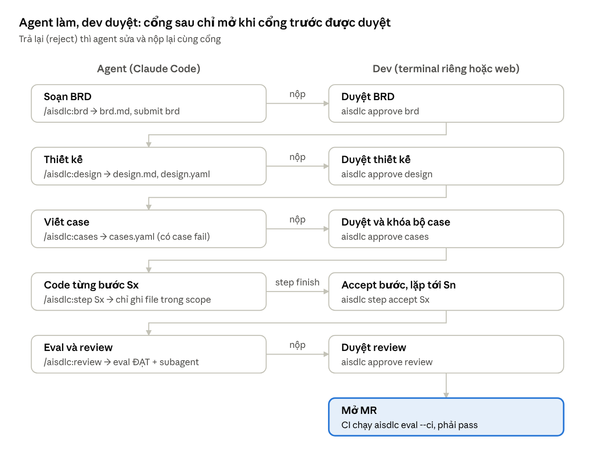
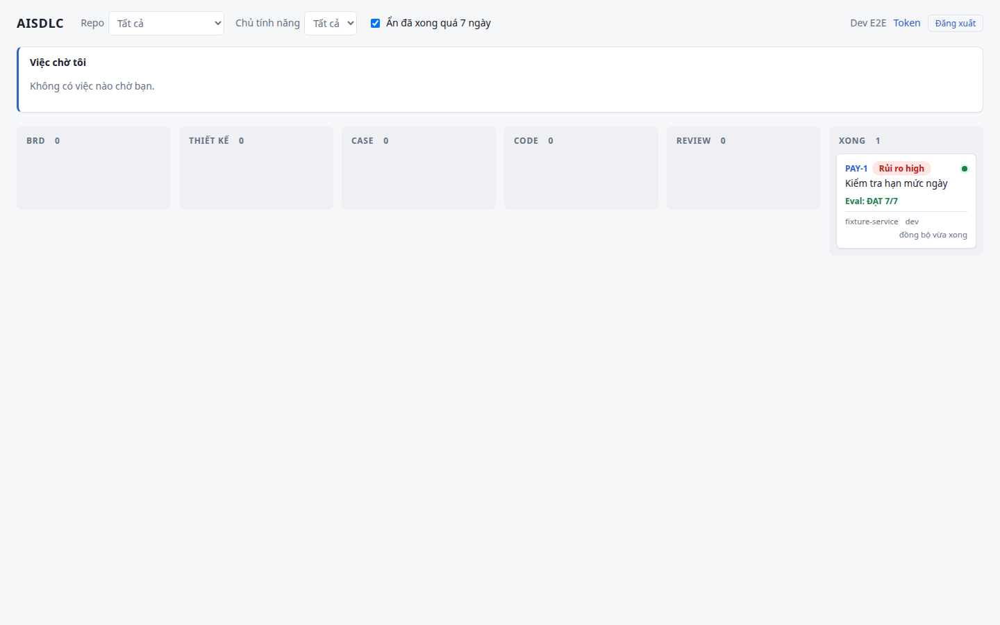
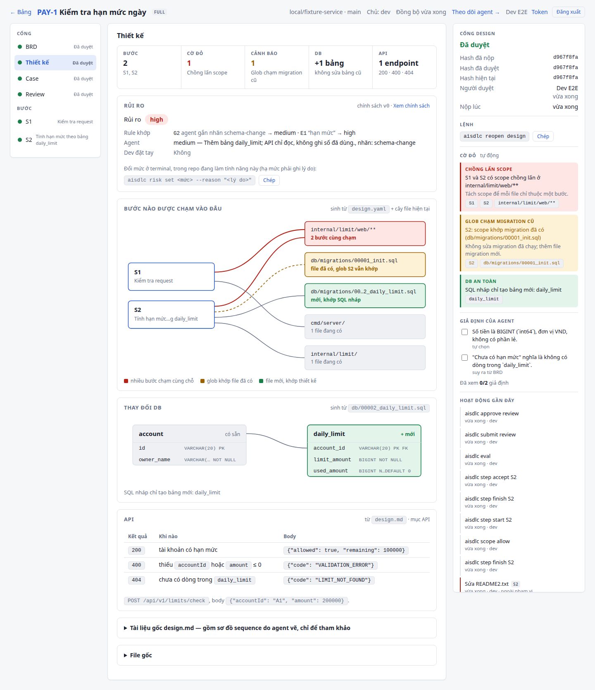
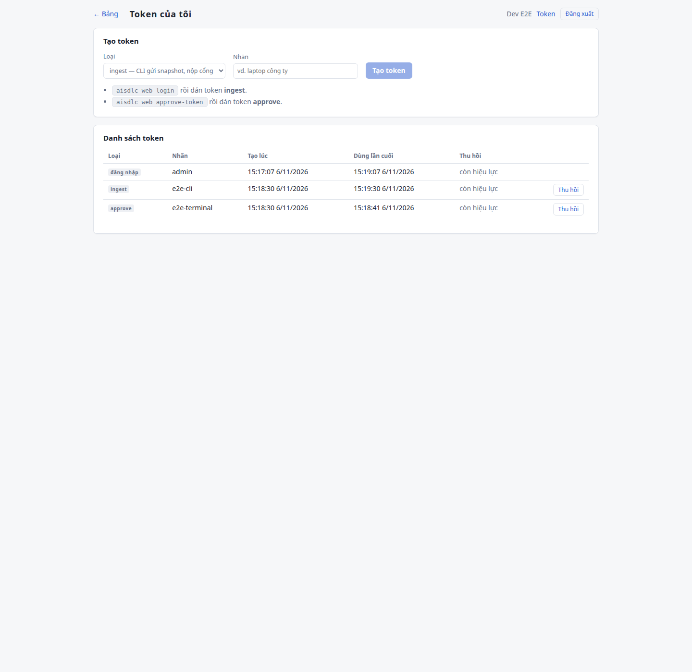
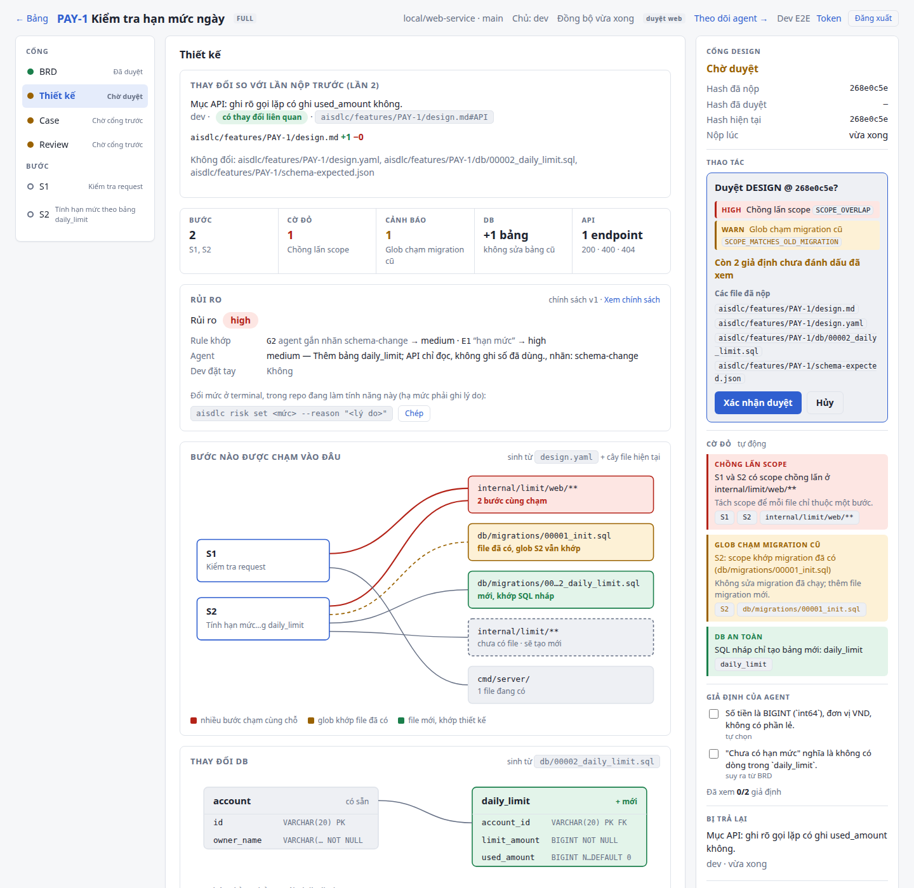
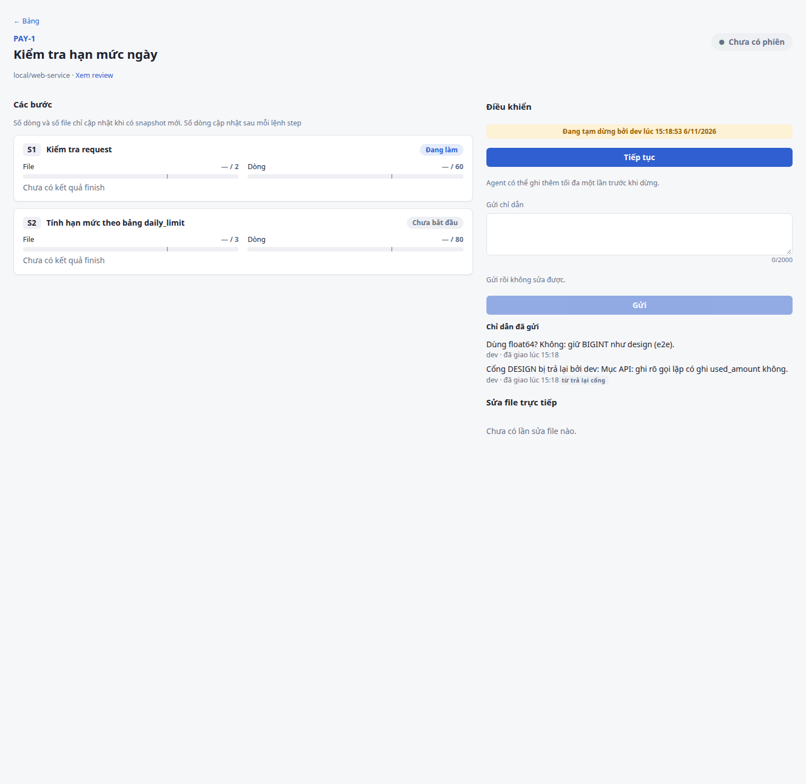
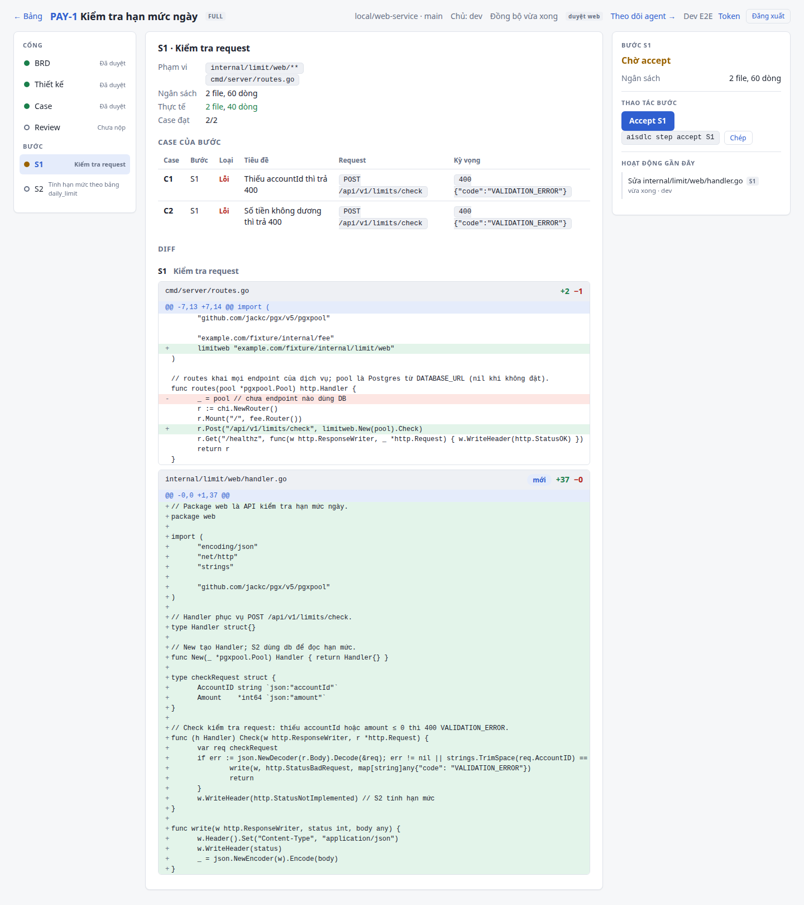
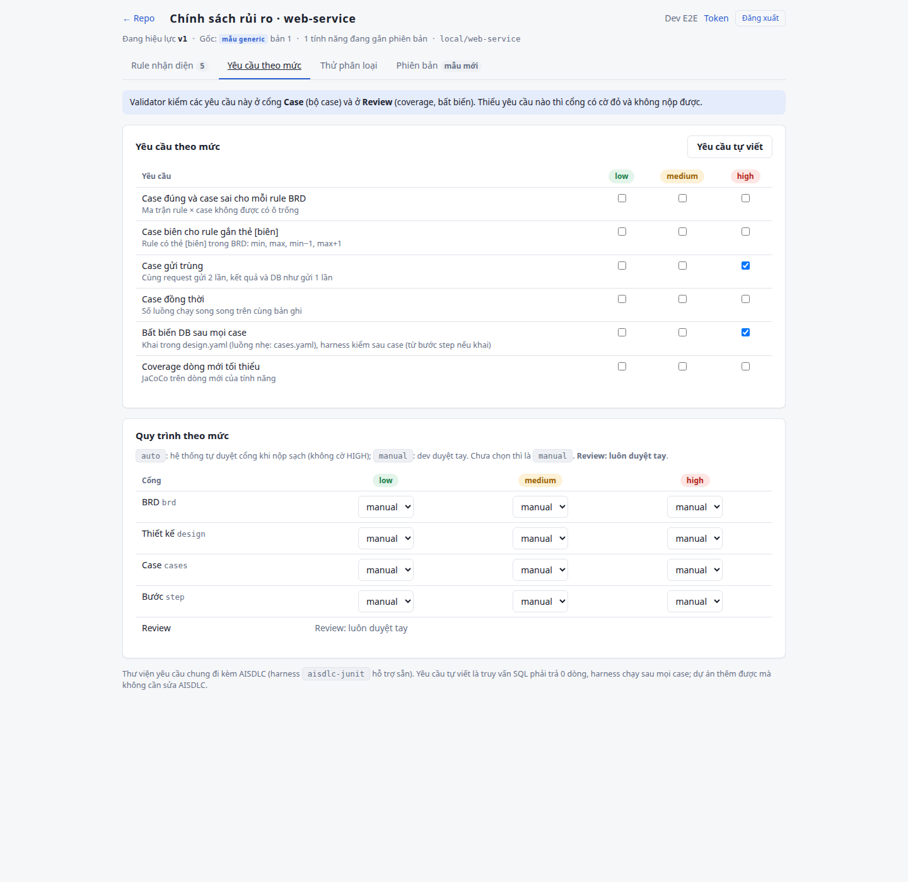
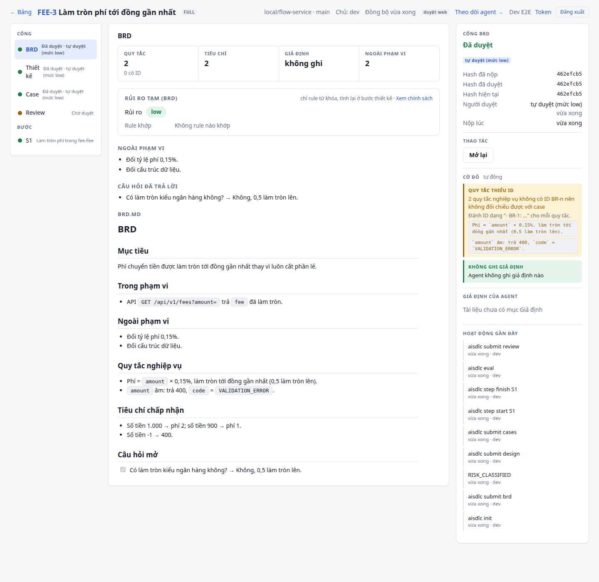

# AISDLC user guide

> Tiếng Việt: [huong-dan-su-dung.md](huong-dan-su-dung.md).

Updated: 2026-11-11

## 1. What AISDLC is

AISDLC lets a Claude Code agent write the documents, cases and code while the dev approves each gate. Plugin hooks stop the agent from taking shortcuts, and CI re-checks every MR. It targets Go services (chi/pgx or similar) with goose migrations and PostgreSQL.

A feature passes through 5 gates. Each gate must be approved before the next one opens:

1. **BRD**: business requirements, rules `BR-n`.
2. **Design**: `design.md` (Mermaid sequence with S1…Sn, API table, assumptions), `design.yaml` (scope and budget per step, invariants), draft goose migrations in `db/`.
3. **Cases**: `cases.yaml` (HTTP, DB, message, stub). At submission, the case set must contain cases that fail because the code does not exist yet.
4. **Code, step by step S1…Sn**: the agent can only write files in the step's scope; the dev accepts each step.
5. **Review**: eval must PASS and include an independent subagent review; the dev approves, then opens the MR.

Approved artifacts are locked by hash. To change one, the dev reopens the gate (`aisdlc reopen <gate>`).



Each arrow to the right is one agent submission; the agent moves on to the next gate only after the dev approves.

**Who does what.**

| | Agent (Claude Code) | Dev |
| --- | --- | --- |
| Writes | `brd.md`, `design.md`, `design.yaml`, migrations, `cases.yaml`, code, `risk-agent.json` and `review-agent.json` (via subagents) | Nothing required; reads the review card, diff, report |
| Commands | `init`, `submit`, `step start`, `step finish`, `eval`, `review`, `status`, `diff`, `policy show`, `risk inputs` | `approve`, `reject`, `reopen`, `step accept`, `scope allow`, `risk set`, `risk reclassify`, `web login` |
| Cannot | Approve, accept steps, allow out-of-scope files, edit state files or approved artifacts | (no limits; dev commands require a real console or the Yes/No dialog in Claude Code) |

**Full and lite flow.** FULL (default) goes through all 5 gates and is meant for changes touching the DB, APIs or money movement. LITE (`aisdlc init <KEY> --lite`) is for bug fixes or small changes that do not alter the DB/API: it skips BRD and Design, leaving Cases → S1 → Review (section 3.3).

**Risk level.** Each repo has a risk policy (`aisdlc/risk-policy.yaml` or on the web). Each feature is assigned a level (default `low < medium < high`). The rules are written in plain words, and an independent subagent (`aisdlc-risk-classifier`) decides which ones apply by reading the feature's documents at `submit design` (lite flow: `submit cases`). The higher the level, the stricter the case set must be, and the policy can let low levels **auto-approve** the Design and Cases gates and step acceptance when a submission is clean. BRD and Review are always approved by the dev. Details: section 7.

Components the dev deals with:

| Component | Role |
| --- | --- |
| Claude Code plugin (`plugin/`) | Slash commands `/aisdlc:*`, hooks, subagents `aisdlc-reviewer` and `aisdlc-risk-classifier` |
| CLI `aisdlc` | A single Go binary: agent and dev commands; also the program that runs the hooks |
| Harness `aisdlc-harness` | A second binary that `aisdlc` calls when running cases (`submit design`/`submit cases`, `step finish`) and `eval`: it starts Postgres/Kafka in Docker (testcontainers) and runs the service and `cases.yaml` as a black box. Kept separate so hooks start fast |
| Web `aisdlc-web` (optional) | Board, gate approval and agent control on the web |

The agent calls the plugin → `plugin/bin/aisdlc` picks the binary for the platform → the CLI reads/writes state files in the repo. Eval builds the service, runs the existing tests, then runs the case set through the harness. The web is optional: the CLI sends data to `aisdlc-web` over HTTPS with a token.

A feature's state lives in the repo, under `aisdlc/features/<KEY>/`:

| File | Written by | Contents |
| --- | --- | --- |
| `feature.yaml` | CLI (`init`) | Key, title, flow, base commit, `riskSchema: 2` (risk classified by the subagent) |
| `brd.md`, `design.md`, `design.yaml`, `db/*.sql`, `cases.yaml` | Agent | Gate artifacts |
| `gates.json` | CLI | Submission and approval records per gate (`local` mode) |
| `steps.json`, `scope-extra.json` | CLI | Step state, files allowed outside scope |
| `risk-agent.json` | Subagent `aisdlc-risk-classifier` | Risk classification: level, matched rules with quotes, unmatched rules with reasons, `inputsHash` of the documents read |
| `risk.yaml` | CLI | Risk level, policy used, the applied classification (`llm`), level requirements |
| `feedback.md` | CLI | Feedback when the dev rejects a gate |
| `review-agent.json` | Subagent `aisdlc-reviewer` | Independent review result |
| `eval/report.md`, `eval/report.json`, `eval/diff-by-step.md` | CLI (`eval`) | Eval results |

`.aisdlc/` (not committed; setup adds it to `.gitignore`) holds local data: run logs in `.aisdlc/run/<KEY>/`, the current feature of each session, and the web queue and cache.

## 2. Installation

The dev machine needs Linux or macOS, Go, Docker (the harness uses it for Postgres/Kafka), git and Claude Code. No other build tools are required.

### 2.1. Install the plugin on the dev machine

```bash
git clone <repo aisdlc> ~/aisdlc && ~/aisdlc/plugin/install.sh
# builds aisdlc and aisdlc-harness for this machine into plugin/lib/aisdlc{,-harness}-<os>-<arch>, symlinks ~/.local/bin/aisdlc
# (add ~/.local/bin to PATH)
```

On a machine without Go, use a repo where `make plugin-dist` has been run (prebuilt linux/darwin × amd64/arm64 in `plugin/lib/`). If `install.sh` finds both binaries for the machine's platform it only creates the symlink; otherwise it prints `AISDLC: thiếu plugin/lib/<binary> cho <os>/<arch>` (missing binary for this platform) and exits.

In Claude Code:

```
/plugin marketplace add ~/aisdlc
/plugin install aisdlc@aisdlc
```

- `plugin/lib/` is not in git. Run `install.sh` (or `make plugin-dist`) before `/plugin install`; the marketplace must point at the built directory, not a git URL.
- `aisdlc` looks for `aisdlc-harness` in its own directory (falling back to `PATH` only if not found; no environment variable changes this path) and only accepts results when both binaries come from the same build. If the harness is missing, every case is ERROR "không tìm thấy aisdlc-harness: …" (aisdlc-harness not found); if the builds differ, ERROR "aisdlc-harness khác bản build với aisdlc …" (build mismatch). So always build both binaries together (`install.sh`, `make build` and `make plugin-dist` all do).
- After updating the binaries, reinstall the plugin.
- Missing binary for this platform: in an AISDLC repo, the hook blocks every write tool (Edit, Write, Bash…) until it is fixed; `Read`, `Grep`, `Glob` still work. In other repos the plugin stays silent and does nothing.

The plugin registers the hooks `SessionStart` (loads rules and state into context, sets `AISDLC_SESSION`), `PreToolUse` (blocks writes that break the process), `PostToolUse` (sends file-edit events to the web, delivers instructions), `UserPromptSubmit` (refreshes web control state) and `Stop` (keeps the agent from stopping mid-step).

### 2.2. Attach to a service repo (a separate MR)

Run at the root of a Go service repo (with `go.mod`, usually `cmd/<name>/main.go` and a goose migration directory):

```bash
# runnable
aisdlc setup --preset generic
git status --short
```

(Use `--preset banking` for the banking risk policy template. If a file already exists, `setup` keeps it and prints `Giữ nguyên <file> (đã có).` (kept, already exists); running it again changes nothing. If the directory is not inside a git repository yet, `setup` runs `git init -b main` first and prints `Đã tạo git repo …` (git repo created); add the remote later with `git remote add origin <url>`.)

The command creates `aisdlc/config.yaml`, `aisdlc/risk-policy.yaml`, `aisdlc/gitlab-ci.aisdlc.yml`, appends an AISDLC section to `CLAUDE.md` and adds `.aisdlc/` to `.gitignore`. It detects `service.main` (exactly one `cmd/*/main.go`) and the migration directory (`db/migrations`, `migrations`, `db/migration`, `sql/migrations`, in that order); if detection fails it prints a reminder to edit `aisdlc/config.yaml` yourself.

Approval mode: defaults to `web` if the machine running `setup` has done `aisdlc web login` (section 6), otherwise `local`. Set it explicitly with `--approvals web` or `--approvals local`. If `config.yaml` already exists, setup does not change the mode.

Main keys of `aisdlc/config.yaml` (full annotated template: `templates/config.yaml`):

| Key | Default | Meaning |
| --- | --- | --- |
| `service.main` | `./cmd/server` | Main package to build |
| `service.buildFlags` | `[]` | Extra `go build` flags, e.g. `["-tags=prod"]` |
| `service.healthPath` | `/healthz` | Returns 2xx when the service is ready |
| `service.startTimeoutSeconds` | `60` | Maximum wait for the health check |
| `service.shutdownTimeoutSeconds` | `15` | Seconds to wait after `SIGTERM` before `SIGKILL` (coverage then N/A) |
| `service.env.port`, `.databaseUrl`, `.kafkaBrokers` | `PORT`, `DATABASE_URL`, (off) | **Names** of the environment variables the service reads; the harness fills in values. Kafka starts only when `kafkaBrokers` is set |
| `service.env.externalBaseUrls` | `[]` | Variables pointing at external systems; the harness fills in the stub server URL |
| `service.extraEnv` | `{}` | Fixed values added to the service environment |
| `service.postgres.image`, `service.kafka.image` | `postgres:16-alpine`, `apache/kafka:3.8.0` | Images used by the harness |
| `migrations.dir`, `migrations.tool` | `db/migrations`, `goose` | Main migration directory; only goose for now |
| `unitTest.packages`, `unitTest.flags` | `["./..."]`, `[]` | Existing tests that eval runs |
| `timeoutMinutes` | `30` | Build + tests + cases are stopped and treated as failed after this |
| `alwaysAllowed`, `unmanaged` | `[]`, `["*.md", "docs/**"]` | Paths always editable; paths not counted toward scope and budget |
| `checks` | `[]` | Extra lint/scan commands, e.g. `{ name: vet, cmd: "go vet ./..." }`; each becomes a hard check `CHECK:<name>` |
| `baseRef` | `origin/main` | Base branch for diffs and for reading `sessionApprove` |
| `sessionApprove` | (off) | Allow approving inside Claude Code (section 3.1) |
| `ciRequireFeature` | `true` | CI fails when code changes do not belong to any feature |
| `approvals` | `local` | `web` to approve on the web (section 6.3) |
| `review.*` | | Review card thresholds (overly broad scope, large budget, money/limit fields for number checks) |

Then verify that the service meets the harness contract:

1. **Environment variables**: the service reads the port, DB URL (and Kafka brokers if any) from the variables declared in `service.env`, and listens on the assigned port.
2. **Health check**: `service.healthPath` returns 2xx when the service is ready, within `startTimeoutSeconds`.
3. **Graceful shutdown**: the service exits after `SIGTERM` within `shutdownTimeoutSeconds` (e.g. `http.Server.Shutdown`). Otherwise the harness sends `SIGKILL` and new-line coverage is N/A, with the reason in the report. Example: `e2e/fixture-service/cmd/server/main.go`.
4. **Goose migrations**: named `NNNNN_name.sql` (e.g. `00002_daily_limit.sql`), contain `-- +goose Up`, placed in `migrations.dir`.
5. Build and `go test` on `unitTest.packages` must run cleanly from the repo root.

Merge the setup MR first, then enable CI in a later MR (section 5). The setup MR changes `config.yaml` without belonging to any feature, so the eval job would fail it.

## 3. Working on a feature

The agent runs slash commands in Claude Code. The dev approves with commands in a separate terminal, on the web (section 6), or inside Claude Code if the repo enables `sessionApprove` (section 3.1). Do not use `!` in Claude Code for approval commands: that mode has no console, so the command is refused.

| Task | Agent (Claude Code) | Dev (separate terminal, or section 3.1) |
| --- | --- | --- |
| Initialize | `/aisdlc:init PAY-123`: proposes full or lite flow, asks the dev, runs `aisdlc init` | Choose the flow |
| BRD | `/aisdlc:brd`: writes `brd.md`, `aisdlc submit brd` | `aisdlc approve brd` or `aisdlc reject brd -m "..."` |
| Design | `/aisdlc:design`: `design.md`, `design.yaml`, draft goose migrations in `db/`; submit test-runs the migrations on a real Postgres | `aisdlc approve design` |
| Cases | `/aisdlc:cases`: `cases.yaml`; submit runs the case set, some cases must fail | `aisdlc approve cases` (locks the case set) |
| Code | `/aisdlc:step S1`: `step start`, code within scope, `step finish`, then stop | `aisdlc step accept S1`; out-of-scope file: `aisdlc scope allow <path>` |
| Eval | `/aisdlc:eval`: build, existing tests and case set, writes `eval/report.md` | Read the report |
| Review | `/aisdlc:review`: eval, subagent `aisdlc-reviewer` writes `review-agent.json`, `aisdlc submit review` | `aisdlc approve review`, then open the MR |

Approval commands (`approve`, `reject -m`, `reopen`, `step accept`, `scope allow`, `risk set`, `risk reclassify`) require a real console by default and ask you to retype the feature key (`Gõ lại feature key (PAY-123) để xác nhận:`, "retype the feature key to confirm"). Without a console the command prints `Lệnh này chỉ dev được chạy, trong terminal thật (không tìm thấy console). Agent không được chạy lệnh này.` (only the dev may run this, in a real terminal) and exits 3 (`risk` exits 2). No flag or environment variable bypasses this; the only alternative is enabling `sessionApprove` (section 3.1).

`aisdlc approve <gate>` prints the submission details (hash, files, findings at submission) and the review card before asking: red flags (HIGH, WARN, NA, INFO), assumptions the agent settled on its own, step map, DB tables, APIs, case coverage. Preview it with `aisdlc review <brd|design|cases|review>` (read-only, the agent can run it too; `--json` prints JSON). Flags are hints to help the dev scan quickly; they do not block the gate.

The Jira ticket is only used for the title: if `JIRA_URL` and `JIRA_TOKEN` are not set, `init` warns `Cảnh báo: chưa đặt JIRA_URL và JIRA_TOKEN, bỏ qua kiểm tra ticket Jira.` (Jira ticket check skipped) and uses `--title`.

Common CLI exit codes: `0` success, `1` findings (submission rejected, eval FAIL (`KHÔNG ĐẠT`), step with failing cases), `2` usage error or disallowed state, `3` dev-only command without a console or confirmation ticket.

### 3.1. Approving inside Claude Code (`sessionApprove`)

Off by default. Enable it with `sessionApprove: true` in `aisdlc/config.yaml`, in a separate MR. The value is read from `baseRef` (usually `origin/main`), not the working tree, so it only takes effect once the MR is merged and the agent cannot turn it on itself. If the repo has no `origin` or has not been fetched, it counts as off. Check with `aisdlc status`: the line `Duyệt trong Claude Code: bật|tắt (<lý do>)` (approve in Claude Code: on|off (reason); `--json` has a `sessionApprove` field).

When enabled, the dev asks the agent in Claude Code:

| Slash command | Command the agent runs |
| --- | --- |
| `/aisdlc:approve <gate>` | `aisdlc review <gate>` (prints the review card), then `aisdlc approve <gate>` |
| `/aisdlc:reject <gate> <reason>` | `aisdlc reject <gate> -m "<reason>"` |
| `/aisdlc:accept <Sx>` | `aisdlc step accept <Sx>` |
| `/aisdlc:accept --file <path>` | `aisdlc scope allow <path>` |

The hook returns `ask` and Claude Code shows a Yes/No dialog; the command runs only if the dev clicks Yes (this issues a single-use ticket, valid for 60 seconds, bound to the session, feature, command and gate hash). Clicking No does not approve; the next attempt asks again. The approval is recorded with channel `claude-code`: `status` shows "duyệt trong Claude Code (<dev>)" (approved in Claude Code), the web shows "(trong Claude Code)".

Notes:

- The approval command must be a single direct call to `aisdlc <command>`. Indirect forms (`bash -c`, `eval`, variables, a path to the launcher, chaining with `&&`/`;`/`|`…) are refused with the reason "… gọi thẳng `aisdlc <lệnh>` để hiện hộp xác nhận …" (call `aisdlc <command>` directly to show the confirmation dialog).
- The approval command must run alone: another tool running in between clears the ticket, and the command reports `… Chạy lại lệnh duyệt một mình, không kèm lệnh khác.` (rerun the approval command on its own) and exits 3.
- Only permission modes that still ask a human (`default`, `acceptEdits`, `plan`) show the dialog. In other modes (`bypassPermissions`, `dontAsk`, `auto`, or unknown) approval commands are blocked: approve in a separate terminal or on the web.
- **Do not** add allow rules for approval commands to Claude Code's `permissions.allow` (e.g. `Bash(aisdlc:*)`, `Bash(aisdlc approve:*)`). It has not been verified that the Yes/No dialog still appears when a matching allow rule exists, so such a rule could let the agent approve without asking the dev.
- The separate terminal and the web still work as before.

### 3.2. Parallel features

Each Claude Code session remembers its own feature: the SessionStart hook sets `AISDLC_SESSION`, and `/aisdlc:init` or `aisdlc use <KEY>` binds the feature to the session it runs in; the hook checks scope against that feature. Two sessions in the same directory do not overwrite each other. Every feature-specific command prints `[KEY]` on its first line.

- Terminal outside Claude Code: with 2 or more open features the CLI asks you to choose, or errors with the list. Specify it with `--feature <KEY>` (or `-f`), e.g. `aisdlc approve brd --feature PAY-1`.
- "Open" means a feature present in the checkout, not yet in `baseRef`, and whose REVIEW gate is not approved. To keep working on a feature that has been merged, run `aisdlc use <KEY>` or pass `--feature`.
- A new session (or after `/clear`) with no bound feature while several features are open: the hook blocks Edit/Write and tells the agent to run `aisdlc use <KEY>`.
- Running `init`/`use` inside Claude Code without `AISDLC_SESSION` makes the CLI warn that the feature is not bound to the session; restart the Claude Code session or add `--feature`.
- The hook blocks the agent from assigning or exporting `AISDLC_SESSION` (so one session cannot change another session's feature).
- Working on several features on the same branch mixes their diffs, steps and MRs; the CLI warns once. Use one branch per feature or `git worktree add`.

### 3.3. Full flow (FULL) and lite flow (LITE)

**FULL** (default): BRD → Design → Cases → Code step by step → Review, as in section 3. A complete example is in section 3.4.

**LITE** (`--lite`): for bug fixes or small changes that do not alter the DB or API. It skips BRD and Design, leaving three gates: CASES → code → REVIEW. `cases.yaml` declares its own `scope`, `budget` (plus `invariants` when the repo has a risk policy) and has exactly one step `S1`. Template: `templates/cases.lite.yaml`; real example: `e2e/solutions/FIX-2/cases.yaml`.

```bash
# runnable
aisdlc init DOC-1 --lite --title "Sửa lỗi thiếu accountId"
aisdlc status
```

`status` after the commands above: gate `CASES` is `NOT_SUBMITTED`, `REVIEW` is `LOCKED_BY_PREVIOUS`, step `S1` is `NOT_STARTED`. Continuing a LITE feature end to end:

1. `/aisdlc:cases`: the agent edits `aisdlc/features/DOC-1/cases.yaml` (Go scope such as `internal/fee/**`, budget, real cases), has the subagent `aisdlc-risk-classifier` classify the risk from the title and `cases.yaml` (writes `risk-agent.json`, section 7) and runs `aisdlc submit cases`. Submit runs the case set against the current service, so at least one case must fail.
2. The dev runs `aisdlc approve cases`. From now on `cases.yaml` is locked.
3. `/aisdlc:step S1`: the agent codes within scope; `aisdlc step finish S1` runs the step's cases. The dev runs `aisdlc step accept S1`.
4. `/aisdlc:review`: eval, independent review, `aisdlc submit review`. The dev runs `aisdlc approve review`, then opens the MR.

The hook blocks code edits while the gate is not open. Example simulating the agent writing `internal/fee/fee.go` right after `init`:

```bash
# runnable
echo '{"tool_name":"Write","tool_input":{"file_path":"'"$PWD"'/internal/fee/fee.go","content":"x"},"session_id":"s1","cwd":"'"$PWD"'"}' \
  | aisdlc hook pre-tool-use | grep '"permissionDecision":"deny"' >/dev/null
```

### 3.4. End-to-end example: PAY-1 "Kiểm tra hạn mức ngày" (daily limit check)

This example follows the same scenario the E2E test runs (`e2e/run-e2e.sh`) on the sample service `e2e/fixture-service`; all artifacts are in `e2e/solutions/PAY-1/`. The sample service has an `account` table and a risk policy `aisdlc/risk-policy.yaml` (schema 2) with rule `E1`, described as `Chặn giao dịch theo hạn mức (E2E)` (blocking transactions by a limit) → level `high`; level `high` requires a duplicate-request case (`idempotent`) and a DB invariant (`invariant`).

**Initialize.** In Claude Code, the dev types `/aisdlc:init PAY-1`; the agent proposes the FULL flow and runs:

```
$ aisdlc init PAY-1 --title "Kiểm tra hạn mức ngày"
Đã tạo tính năng PAY-1 (luồng FULL): Kiểm tra hạn mức ngày
  aisdlc/features/PAY-1/brd.md
  aisdlc/features/PAY-1/design.md
  aisdlc/features/PAY-1/design.yaml
  aisdlc/features/PAY-1/cases.yaml
  aisdlc/features/PAY-1/db/
Tiếp theo: soạn brd.md rồi chạy `aisdlc submit brd`.
```

`aisdlc status` at this point: `BRD NOT_SUBMITTED`, the next three gates `LOCKED_BY_PREVIOUS`, steps `NOT_STARTED`, and the last line `Cổng kế tiếp cần xử lý: BRD` (next gate to handle: BRD).

**BRD.** `/aisdlc:brd`: the agent writes `brd.md` (goals, in/out of scope, business rules, acceptance criteria, open questions) and submits. `submit brd` does not compute a risk level (the level is classified once, at `submit design`), and the BRD gate always waits for the dev:

```
$ aisdlc submit brd
...
Đã nộp cổng BRD, không có phát hiện. Dev duyệt bằng `aisdlc approve brd` ở terminal của mình.
```

If the agent tries to approve, it is refused (exit 3). The hook also blocks the agent from writing `internal/limit/web/handler.go` because the code gate is not open. The dev approves in a separate terminal:

```
$ aisdlc approve brd
[PAY-1]
Tính năng PAY-1 — cổng BRD (AWAITING_APPROVAL)
...
Review card — PAY-1 · cổng BRD
Cờ đỏ (2)
  [WARN] BRD_RULE_NO_ID: 4 quy tắc nghiệp vụ không có ID BR-n nên không đối chiếu được với case
...
Gõ lại feature key (PAY-1) để xác nhận: PAY-1
Đã duyệt cổng BRD bởi <tên dev> (hash …).
```

To have the agent revise, use `aisdlc reject brd -m "Đánh ID BR-n cho từng quy tắc"`: the feedback goes into `feedback.md`, and the agent revises and resubmits.

**Design.** `/aisdlc:design`: the agent writes `design.md` (Mermaid sequence with S1, S2 notes; API table 200/400/404; DB section; assumptions), `design.yaml` and the draft migration `db/00002_daily_limit.sql`:

```yaml
steps:
  - id: S1
    title: Kiểm tra request
    scope: ["internal/limit/web/**", "cmd/server/routes.go"]
    budget: { files: 2, lines: 60 }
  - id: S2
    title: Tính hạn mức theo bảng daily_limit
    scope: ["internal/limit/**", "db/migrations/**"]
    budget: { files: 3, lines: 80 }
invariants:
  - name: Số đã dùng không vượt hạn mức
    sql: "SELECT account_id FROM daily_limit WHERE used_amount < 0 OR used_amount > limit_amount"
    step: S2
```

Before submitting, the agent asks for the classifier's inputs:

```
$ aisdlc risk inputs
[PAY-1]
aisdlc/features/PAY-1/brd.md
aisdlc/features/PAY-1/db/00002_daily_limit.sql
aisdlc/features/PAY-1/design.md
aisdlc/features/PAY-1/design.yaml
policy: .aisdlc/risk/policy-effective.yaml
inputsHash: 5c0e…
```

It passes these paths and the `inputsHash` to the subagent `aisdlc-risk-classifier` (read-only), which decides rule by rule and returns JSON; the agent writes it verbatim to `risk-agent.json` (`e2e/solutions/PAY-1/risk-agent.json`):

```json
{"inputsHash": "5c0e…", "level": "high",
 "matched": [{"rule": "E1", "evidence": "App chặn sớm giao dịch chuyển tiền vượt hạn mức ngày của tài khoản", "file": "aisdlc/features/PAY-1/brd.md"},
             {"rule": "G2", "evidence": "CREATE TABLE daily_limit (", "file": "aisdlc/features/PAY-1/db/00002_daily_limit.sql"}],
 "notMatched": [{"rule": "G1", "reason": "API chỉ kiểm tra hạn mức, không chuyển tiền …"}, …],
 "override": null, "summary": "…"}
```

`aisdlc submit design` test-runs the main migrations plus the draft migration on a real Postgres, writes `schema-expected.json` (the schema eval will compare against), checks `risk-agent.json` (the hash must match the current documents and policy, every enabled rule must appear once, each quote must exist in its file) and writes `risk.yaml`: here it prints `Rủi ro: high …` (risk: high; rules `E1` and `G2` match). Without a valid `risk-agent.json` the submission is blocked (`RISK_AGENT_MISSING`, `RISK_AGENT_INVALID`); if the agent edits a document afterwards, the hash no longer matches and the subagent must run again. `aisdlc review design` shows the flags `SCOPE_OVERLAP` (HIGH: S1 and S2 both touch `internal/limit/web/**`) and `SCOPE_MATCHES_OLD_MIGRATION` (WARN: S2's glob `db/migrations/**` also matches old migrations). The dev reads the card, then runs `aisdlc approve design` (flags do not block).

**Cases.** `/aisdlc:cases`: the agent writes `cases.yaml` (C1–C2 for S1, C3–C7 for S2). The first version lacks a duplicate-request case, so it is blocked under level `high`:

```
$ aisdlc submit cases
RISK_REQ: Mức high yêu cầu Case gửi trùng: … POST /api/v1/limits/check
(exit 1)
```

The agent adds C7 (`when.repeat: 2`, checks that `used_amount` does not change) and resubmits. Submit runs the case set on the designed schema; since there is no code yet, some cases fail, which is required for the submission to go through. The dev runs `aisdlc approve cases`: from here `cases.yaml` is locked, and the hook even blocks `sed -i` on this file.

**Code S1.** `/aisdlc:step S1`: the agent runs `aisdlc step start S1`, edits `internal/limit/web/handler.go` and `cmd/server/routes.go` (within scope), then `aisdlc step finish S1`: build, run the migrations in `db/migrations`, run the cases of steps ≤ S1, and print `2/2 pass`. The step moves to `AWAITING_DEV`; the agent stops. The dev reviews `aisdlc diff --by-step --patch`, then runs `aisdlc step accept S1`.

**Code S2, out-of-scope file.** In S2 the agent copies the migration to `db/migrations/00002_daily_limit.sql`, writes `internal/limit/service.go`, and accidentally creates `README2.txt`. `aisdlc step finish S2` prints `Ngoài phạm vi: README2.txt` (out of scope) and exits 1. The dev decides: delete the file, or allow it with `aisdlc scope allow README2.txt`. After allowing it, the agent runs `step start S2` and `step finish S2` again: `7/7 pass`, `Ngoài phạm vi: không có` (out of scope: none). The dev runs `aisdlc step accept S2`.

**Eval and review.** `/aisdlc:review`: the agent runs `aisdlc eval` (writes `eval/report.md`, first line `Eval PAY-1: ĐẠT` (PASS), with a `## Rủi ro` (Risk) section), calls the subagent `aisdlc-reviewer` to write `review-agent.json` (5 criteria: sequence, error-handling, over-engineering, naming, security), then `aisdlc submit review` (updates the `AGENT_REVIEW` line in the report). The dev runs `aisdlc approve review`: the command also prints `Agent review: …` and any `high` issues.

**MR.** Commit everything (code, migrations, `aisdlc/features/PAY-1/`) and open the MR. The CI job runs `aisdlc eval --ci --base origin/<target branch>` and prints `Eval PAY-1: ĐẠT`, including `RISK_LLM` (the classification in `risk.yaml` still matches the current documents and policy; CI never calls an LLM). If someone edits `cases.yaml` after approval, eval fails at `CASES_LOCKED`.

On the same service, `FIX-2` (LITE, `e2e/solutions/FIX-2/`) goes Cases → S1 (`3/3 pass`) → Review, while `FEE-3` (`e2e/solutions/FEE-3/`) is a `low` level feature that, once the dev approves its BRD, runs straight through thanks to auto-approve (section 7.2).

### 3.5. Other common commands

- `aisdlc status` or `/aisdlc:status`: which gate is waiting, step state, pause from the web (`--json` for machines).
- `aisdlc use <KEY>`: switch the current feature (of the current Claude Code session).
- `--feature <KEY>` (`-f`): choose the feature for one command without changing the current feature.
- `aisdlc review cases`: preview a gate's review card.
- `aisdlc policy show`: risk level scale, rules and requirements per level.
- `aisdlc risk inputs`: the input files and `inputsHash` for the risk classifier subagent.
- `aisdlc diff --by-step --patch`: diff per step.
- `aisdlc reopen <gate>`: reopen a gate to change an approved artifact (removes the submission and approval). Editing directly makes the gate STALE and the later gates count as closed.

```bash
# runnable
aisdlc review cases
aisdlc use DOC-1
aisdlc policy show
```

### 3.6. Writing `cases.yaml`

A case has `given` (SQL to clean and load data, stub names), `when` (one HTTP request), `then` (status, body, DB, messages). Full template: `templates/cases.full.yaml`. Real examples in the repo: `e2e/solutions/PAY-1` (FULL flow: BRD, design, `cases.yaml`, step-by-step code), `e2e/solutions/FIX-2` (LITE: `cases.yaml` and code) and `e2e/solutions/FEE-3` (BRD, design, `cases.yaml`).

```yaml
reset_sql: ["DELETE FROM account"]
stubs:
  - id: core-balance-ok
    request:  { method: GET, urlPath: /accounts/123/balance }
    response: { status: 200, jsonBody: { balance: 5000000 } }
cases:
  - id: C1
    step: S1
    kind: happy
    title: Tạo tài khoản mới
    given: { sql: [], stubs: [core-balance-ok] }
    when:  { method: POST, path: /api/v1/accounts, body: { id: "A1", ownerName: "An" } }
    then:
      status: 201
      db:
        - query: "SELECT id, owner_name FROM account"
          rows: [ { id: "A1", owner_name: "An" } ]
```

Rules:

- `kind` is `happy`, `error` or `boundary`; `step` is the step the case belongs to (`step finish Sx` runs the cases of steps ≤ Sx).
- `submit cases` runs on the designed schema (main migrations + draft `db/*.sql` in `aisdlc/features/<KEY>/db/`), so cases can use new tables. When `step` and `eval` run, **only** the main migrations are used, without drafts: if a step has not copied its migration into `migrations.dir`, that step's cases fail, just like in CI and production.
- `reset_sql` runs before every case, so only use tables that exist from the first step; clean up tables created in later steps in `given.sql` (otherwise: `CASES_SETUP_NEEDS_LATER_TABLE`).
- YAML anchors/aliases (`&a`, `*a`) are not supported: write the full `given` for each case.
- Stubs use WireMock-style syntax, a subset only: `request` (`method`, `url`, `urlPath`, `urlPathPattern`, `queryParameters`, `headers` with `equalTo`/`matches`, `bodyPatterns` with `equalToJson`/`contains`), `response` (`status`, `headers`, `body`, `jsonBody`, `fixedDelayMilliseconds`). Keys outside this subset are rejected by `submit cases`. The harness fills the stub server URL into the variables in `service.env.externalBaseUrls`.
- `then.body` compares JSON structurally. `then.messages` (`topic`, `value`) checks Kafka messages and requires `service.env.kafkaBrokers`.
- `when.repeat: n`: send the same request n times sequentially; `then` applies to the last one, `then.db` is checked after the last one.
- `when.parallel: n`: n concurrent requests. Declare `then.statusCounts` (e.g. `{200: 1, 409: 7}`, which must sum to n) or `then.status` (every request must return that code); `then.db` is checked after all finish.
- High risk levels can require duplicate-request cases (`when.repeat`), concurrent cases (`when.parallel`) and DB invariants; if missing, `submit cases` reports `RISK_REQ` (section 7). See the policy with `aisdlc policy show`.

**Matching `then.db`** (the harness reads the DB with pgx and normalizes by column type):

| Column type | How to write it in `rows` | Example |
| --- | --- | --- |
| Number (int, numeric, float) | Compared by **value** | `100` matches `100.00`; `0.5` matches `0.50` |
| Bool | `true` / `false` | `active: true` |
| `NULL` | `null` | `closed_at: null` |
| timestamp, timestamptz, date | RFC 3339 string in UTC; date is `YYYY-MM-DD` | `created_at: "2026-11-06T03:00:00Z"`, `due: "2026-11-06"` |
| json, jsonb | Compared by **structure** (key order does not matter) | `meta: { a: 1 }` |
| uuid, text, all other types | Compared as Postgres text | `id: "0b8e…"` |

How rows are compared:

- Rows are compared **in order** and the row count must match exactly; a mismatch reports "số dòng: mong đợi N, nhận M" (row count: expected N, got M). So a multi-row `query` must have `ORDER BY`.
- Only columns listed in `rows` are compared; other columns of the `SELECT` are ignored.
- Column names (or aliases) are case-insensitive.

## 4. Coding step by step

Each step Sx has a scope (file globs) and a budget (number of files, number of lines) declared in `design.yaml`, or in `cases.yaml` for the lite flow. The hook blocks the agent from writing files outside the scope of the open step.

1. The agent runs `/aisdlc:step S1`, i.e. `aisdlc step start S1`, and reads the step's scope and cases.
2. The agent edits only files in scope (Go code, and goose migrations if the step has any). If it needs a file outside scope, the agent stops and asks the dev.
3. The agent runs `aisdlc step finish S1`: it runs the migrations already in `migrations.dir` and the cases of steps ≤ S1, checks scope and budget, and the step moves to waiting for the dev (`AWAITING_DEV`). The Stop hook keeps the agent from stopping in the middle of an open step.
4. The dev reviews the diff (`aisdlc diff --by-step --patch`) and then runs `aisdlc step accept S1` in a separate terminal, `/aisdlc:accept S1` when `sessionApprove` is enabled, or clicks **Accept S1** on the web (section 6.4). The agent does not accept on its own.

To allow a file outside scope: `aisdlc scope allow <path>` (one file at a time, recorded in `scope-extra.json`; in a separate terminal, `/aisdlc:accept --file <path>` when `sessionApprove` is enabled, or the **Cho phép** (Allow) button on the web). If cases fail and the agent needs to keep fixing, it runs `aisdlc step start S1` again (a step waiting for the dev may be reopened), edits, then `finish`.

At a risk level with `flow.step: auto` (section 7.2), `step finish` auto-accepts when all of the step's cases pass, the budget and scope are not exceeded, and the dev has not run `scope allow` on any file; the CLI prints `Đã chấp nhận bước S1: tự duyệt (mức low).` (step S1 accepted: auto-approved, level low).

Exceeding the budget by 1.5× (`budgetWarnFactor`) only warns (`BUDGET:Sx` in eval) and does not block. In contrast, a changed file outside every scope (including `scope allow`) makes eval FAIL (`SCOPE`).

One feature per MR: if an MR contains two features, one feature's `SCOPE` check flags the other feature's files.

## 5. Eval, report and CI

`aisdlc eval` (or `/aisdlc:eval`) runs the full suite on the dev machine:

1. Build the service with coverage instrumentation (`go build -cover`).
2. Run existing tests (`go test` on `unitTest.packages`, with coverprofile).
3. Start Postgres (and Kafka if `env.kafkaBrokers` is set) in Docker, run goose migrations, start the service, wait for `healthPath`.
4. Run each case in `cases.yaml` as a black box, check the schema, stop the service with `SIGTERM` and merge coverage from existing tests with coverage from the case run.
5. Run the `checks` commands, compute scope, budget, new-line coverage, and read `review-agent.json` if present.

**Eval requires Docker** (testcontainers). Containers are cleaned up when eval finishes, including on errors or Ctrl-C. If containers cannot start (Docker not running, no socket permission), the harness reports a startup error such as "không khởi động được Postgres: …" (could not start Postgres), every case is ERROR and `eval` (or `step finish`) exits non-zero. If the service does not come up (wrong `healthPath`, wrong variable names, exceeds `startTimeoutSeconds`), cases are `NOT_RUN` and the report includes the last 50 lines of the service log. Results are in `aisdlc/features/<KEY>/eval/report.json` and `report.md`, the harness log in `.aisdlc/run/<KEY>/harness.log`.

Eval writes `eval/report.md`, whose first line is `Eval <KEY>: ĐẠT` (PASS) or `KHÔNG ĐẠT` (FAIL); you can paste the whole file as the MR description. A single failing hard check fails eval; soft metrics only warn (`WARN`, while `NA` means not measurable).

| Code | Type | Checks |
| --- | --- | --- |
| `CASES_ALL_PASS` | Hard | Every case in `cases.yaml` passes |
| `CASES_LOCKED` | Hard | The case set matches the hash at approval |
| `BUILD_AND_TESTS` | Hard | Build passes, existing tests do not fail |
| `SCHEMA_MATCH` | Hard | Schema after migrations matches the design's `schema-expected.json` |
| `SCOPE` | Hard | Every file changed since `init` is within the steps' scopes (plus `scope allow`) |
| `CHECK:<name>` | Hard | Commands declared in `checks` in `config.yaml` (e.g. `go vet ./...`) |
| `RISK_COVERAGE` | Hard | New-line coverage ≥ `min` when the risk level requires `coverage` |
| `RISK_FILE` | Hard | `risk.yaml` is broken, or missing in a feature that needs one (created with `riskSchema: 2`, FULL or LITE, or an older FULL feature whose `design.yaml` still has `impact`) |
| `RISK_LLM` | Hard, CI only | Features with `riskSchema: 2`: `llm.inputsHash` in `risk.yaml` matches the current documents and the effective policy (in web mode, the live policy fetched with the CI token), and `level` equals `llm.level` raised to `default` unless the dev changed it by hand (`override`). No LLM call |
| `GATE_AUTO:<gate>` | Hard | An auto-approved gate must match the `flow` snapshotted in `risk.yaml` (section 7.2) |
| `BUDGET:Sx` | Soft | Step budget exceeded by 1.5× |
| `COVERAGE_CHANGED_LINES` | Soft | New-line coverage below 80% (`coverageWarn`), when the risk level does not require `coverage` |
| `AGENT_REVIEW` | Soft | The subagent reports a criterion as `NGHIEM_TRONG` (severe) or a `high` issue; `submit review` updates this line from `review-agent.json` |
| `GATE:<gate>` | Soft, CI only | Gate not approved or artifact changed after approval |

- The `## Rủi ro` (Risk) section (features with `risk.yaml`): level, policy version, matched rules, manual level change, and each requirement as `[x]` met / `[ ]` missing / `[~]` checked later.
- `Case không pass` (cases not passing) lists the reason for each case. Details are in `eval/report.json`, the per-step diff in `eval/diff-by-step.md`, and build and service logs in `.aisdlc/run/<KEY>/`.
- Coverage is "N/A" with a reason when the service does not shut down gracefully (does not exit after `SIGTERM` within `shutdownTimeoutSeconds`).
- `aisdlc submit review` requires a passing and fresh eval: if code changed after the last eval it reports `REVIEW_EVAL_STALE` (rerun `aisdlc eval`); if some steps are not accepted it reports `REVIEW_STEPS_NOT_ACCEPTED`.

### Enabling GitLab CI (in an MR after the setup MR)

1. Add to `.gitlab-ci.yml`: `include: { local: aisdlc/gitlab-ci.aisdlc.yml }`.
2. Set the CI/CD variables `AISDLC_BIN` and `AISDLC_HARNESS_BIN` to download URLs for the linux/amd64 `aisdlc` and `aisdlc-harness` binaries (`plugin/lib/aisdlc-linux-amd64`, `plugin/lib/aisdlc-harness-linux-amd64` from **the same** `make plugin-dist` run, uploaded to an internal registry). If a variable is missing the job stops with `Thiếu biến AISDLC_BIN …` (missing variable).
3. The runner must be able to run `docker:dind` (privileged). The template already declares the `docker:dind` service, `DOCKER_HOST: tcp://docker:2375`, `TESTCONTAINERS_HOST_OVERRIDE: docker` and disables Ryuk (dind is torn down with the job). The template also sets `GIT_DEPTH: "0"` so the merge-base can be computed; do not override these variables.
4. Enable a protected branch on the main branch with "Pipelines must succeed": the `aisdlc-eval` job must pass before merging. Hooks only protect the dev machine; GitLab is what blocks the merge.

The job (image `golang:1.26`, runs for merge requests) runs `aisdlc eval --ci --base origin/<target branch>` for every feature changed in the MR and keeps `aisdlc/features/*/eval/` as artifacts. A case set that is unapproved or was edited after approval fails (`CASES_LOCKED`); in `local` mode, other gates that are unapproved or have a hash mismatch only warn (`GATE:<gate>`). If the runner has no Docker, the harness reports "không khởi động được Postgres: …", every case is ERROR and the job exits non-zero.

- Changes to `aisdlc/config.yaml` must be in a separate MR; eval always fails changes bundled with config edits. A config MR needs tech lead approval and is merged under the team's exception process.
- An MR that changes code not belonging to any feature (e.g. a dependency bump) fails: create a `--lite` feature, or set `ciRequireFeature: false` in a separate MR.
- Web approval mode additionally needs `AISDLC_WEB_URL` and `AISDLC_CI_TOKEN` (section 6.3). The CI token can also read the live risk policy (`GET /api/cli/policy`) for `RISK_LLM`.

## 6. Web (optional)

The web provides a board, a live view of the agent, gate approval, pausing the agent and sending instructions. In the default `local` mode the web only views and controls; gates are still approved in the terminal (or inside Claude Code, section 3.1). Approvals record a channel: `web`, `terminal`, `claude-code` (shown as "(trong Claude Code)") or `auto` (auto-approved by risk level).



The feature page (`/f/<repo>/<key>`, open a gate directly with `?g=DESIGN` or `?g=CASES`) shows the review card computed by the CLI: number of steps, red flags, the Risk panel, the "which step touches what" map, DB changes, API table, agent assumptions and recent activity. Ticking assumptions is stored only in the browser and does not replace approval.



### 6.1. Running the web

The server is the Go binary `aisdlc-web` with an embedded React UI, packaged with `Dockerfile.web` (distroless). Deployment details, environment variables and operations: [web-operations.md](web-operations.md). To try it on a dev machine:

```
docker build -f Dockerfile.web -t aisdlc-web .
docker run -d --name aisdlc-db -e POSTGRES_USER=aisdlc -e POSTGRES_PASSWORD=doi-mat-khau -e POSTGRES_DB=aisdlc postgres:16-alpine
docker run -d --name aisdlc-web -p 127.0.0.1:8080:8080 --link aisdlc-db \
  -e AISDLC_DB_URL=postgres://aisdlc-db:5432/aisdlc -e AISDLC_DB_PASSWORD=doi-mat-khau \
  -v aisdlc-data:/data aisdlc-web
```

The server runs migrations automatically on startup. Back up the signing key file `/data/signing-key` (volume `aisdlc-data`): if it is lost, every CLI must run `aisdlc web login` again.

### 6.2. Accounts and tokens

1. An admin creates the user (with the email matching `git config user.email` so that "Việc chờ tôi" (waiting on me) shows your items); the command prints `Token: <login token>` once:

   ```
   docker exec aisdlc-web /aisdlc-web user add dev "Tên Dev" --email dev@example.com
   ```
   (Add `--role lead` for team leads. Also available: `user role <login> dev|lead`, `user login-token <login>`, `user ci-token <name>`, `user list`.)
2. The dev opens the web, pastes the login token to sign in, opens the `/me` page (the **Token** link) and creates an **ingest** token.
3. Run `aisdlc web login` in a real terminal: enter the URL and the ingest token (input is hidden). The CLI pins the web's signing key and saves `~/.config/aisdlc/web.json` (mode 600).
4. To approve from the terminal in web mode: create an **approve** token at `/me` and run `aisdlc web approve-token`.



| Token | Used for | Cannot |
| --- | --- | --- |
| `login` | Web sign-in | Refused when used by the CLI (403) |
| `ingest` | CLI and hooks sending snapshots, fetching state, submitting gates | Web sign-in, approving |
| `approve` | Approve, reject, reopen from the terminal | Sending snapshots |
| `ci` | `aisdlc eval --ci` querying approvals | Approving |

The `web login` and `web approve-token` commands only run in a real terminal (the agent cannot run them), and the hook blocks the agent from reading or touching `~/.config/aisdlc/`. Do not put tokens in the `AISDLC_WEB_TOKEN` environment variable: the agent can read environment variables. When `web.json` exists, the CLI ignores `AISDLC_WEB_URL`/`AISDLC_WEB_TOKEN`. Error 401: `Token không còn hiệu lực, chạy lại aisdlc web login` (token no longer valid); 403: `Token không đúng loại (cần token ingest cho CLI, approve cho duyệt)` (wrong token type). If a token leaks, revoke it at `/me` (takes effect immediately) and create a new one.

After login, the CLI sends a snapshot after every command, and the PostToolUse hook writes file-edit events to the `.aisdlc/web/` queue for a background process to send, so the hook never waits on the network. If the web is down, messages stay in the queue and no command fails; after one failed connection, the CLI and hook stop sending for 60 seconds.

- `aisdlc web status`: whether the web is enabled, `Đang chờ gửi` (pending), `Bị từ chối` (rejected: the web returned 400/413, stored in `.aisdlc/web/rejected/`), last successful send.
- `aisdlc web push`: rebuild snapshots for every feature and send the whole queue (skipping the 60-second wait).

### 6.3. Approving on the web (`approvals: web` mode)

Enable with `approvals: web` in `aisdlc/config.yaml` (separate config MR; `aisdlc setup` writes this line automatically if the machine is logged in). Approval records then live on the server, not in `gates.json`: the agent cannot edit repo files to "approve", and CI asks the web instead of trusting the repo. The first time the CLI reports this mode, the web pins the repo to `web`; only a `lead` can switch it back to `local`, on the `/repos` page.

- `aisdlc submit <gate>` submits the artifact contents to the web. If the web does not respond, the command reports `Không nộp được lên web: …` (could not submit to the web), exits 2 and writes nothing; resubmit when the web is back.
- On the feature page `/f/<repo>/<key>?g=<GATE>`, the feature owner or a `lead` clicks **Duyệt** (Approve), **Trả lại** (Reject), **Mở lại** (Reopen). The **Xác nhận duyệt** (Confirm approval) dialog lists HIGH/WARN flags, the number of assumptions not yet marked as seen, and the submitted files.
- Or approve from the terminal: `aisdlc approve <gate>` (still retyping the feature key) sends it to the web with the approve token and prints `Đã duyệt cổng <GATE> trên web (hash …).` (gate approved on the web); the record has channel `terminal`.
- From the second submission on, the gate page has a **Thay đổi so với lần nộp trước** (Changes since previous submission) section with a diff and the status of each piece of feedback (`có thay đổi liên quan` (related changes), `chưa thấy thay đổi` (no changes yet)…). Mention the exact section name (`## API`) or file name in the rejection reason so the web can match it.
- The hook does not call the network: it reads the signed gate state in `.aisdlc/web/gates/<KEY>.json`. A cache that has been edited or copied from elsewhere counts as not approved; `aisdlc status` fetches the correct one again. Rejects / reopens on the web are written to `feedback.md` when the cache refreshes.
- Repo currently on `local`: run `aisdlc web migrate` (sends the approvals in `gates.json` that still match the content to the web as pending confirmation), then click **Xác nhận** (Confirm) on the feature page **in gate order** (out of order, the web reports `Xác nhận cổng trước trước` (confirm the earlier gate first)). The REVIEW gate cannot be imported: submit and approve it again on the web. `gates.json` is not modified.
- Risk policy in web mode: `aisdlc policy pull` fetches the policy from the web (the first time, the web imports `aisdlc/risk-policy.yaml` as v1; it must be schema 2); `submit design`/`submit cases` stop and point to this command when the policy cache is missing or has a bad signature (section 7).
- CI: add the variables `AISDLC_WEB_URL` and `AISDLC_CI_TOKEN` (Masked, Protected); the CI token is issued by an admin with `user ci-token <name>`. CI FAILs when a gate is not approved, content does not match the hash, code changed after REVIEW approval (`REVIEW đã đổi sau duyệt …`), a variable is missing, or the web does not respond.



**What if the web is down.** Approved gates remain in the signed cache, so the agent can still code within scope; `step` and `eval` run normally and messages stay in the queue. Only actions that need the web stop: `submit`, `approve`/`reject`/`reopen` report an error and write nothing, and CI FAILs. When the web is back: `aisdlc web push`, then continue.

### 6.4. Controlling the agent from the web

Works in both approval modes, as long as the dev machine has run `aisdlc web login`. Actions are only available through the browser session of the feature owner or a `lead`, and each action writes an audit line. The hook still does not call the network: the CLI and the background sender fetch the signed control state into `.aisdlc/web/control/<KEY>.json`, and the hook only reads this file.

- **Pause** (the **Theo dõi agent** (Agent monitor) screen, `/f/<repo>/<key>/live`): the hook blocks every agent write with the reason `Dev đã tạm dừng tại web: <tên>…` (dev paused on the web). The flag reaches the dev machine on the next refresh, so the agent may write at most once more before stopping. After clicking **Tiếp tục** (Resume), the dev types a prompt in Claude Code (e.g. `tiếp đi`, "go on") to get the agent running again. If the web goes down while paused, the flag stays; `aisdlc status` prints `Đang tạm dừng từ web (<tên>, <giờ>) …` (paused from the web).
- **Instructions**: 1–2000 characters, cannot be edited or deleted after sending. The agent receives them on its next tool call or the dev's next prompt, as `Chỉ dẫn của dev (HH:mm): <nội dung>` (dev instruction), each instruction exactly once; the web shows `đã giao lúc HH:mm` (delivered at). Rejecting / reopening a gate on the web also becomes an instruction (`Cổng <GATE> bị trả lại bởi <login>: <góp ý>`).
- **Accept step and Allow file** (feature page, select a step): a step in `AWAITING_DEV` has an **Accept Sx** button; a file the agent wrote outside scope has a **Cho phép** (Allow) button. The web creates a signed command; the next `aisdlc` command or hook on the dev machine applies it to `steps.json` / `scope-extra.json` and prints `Áp dụng từ web: …` (applied from the web). The command expires if the step changed after the dev clicked, or after 7 days (`Lệnh từ web hết hiệu lực: <lý do>`); the page shows `Bước đã đổi kể từ lúc bạn xem; tải lại trang` (step changed since you viewed it; reload) if the agent redid the step after the page loaded. If a step was accepted on the web and the dev also runs `aisdlc step accept S1`, the command prints `Bước S1 đã được accept từ web (<login>).`





## 7. Risk policy and level-based process

Each repo has a **risk policy**: a level scale (default `low < medium < high`), **rules** that identify risky features, **case requirements per level** and a `flow` block (which gates auto-approve at which level). The AISDLC core has no business knowledge: every rule is written by the project, in plain words.

**Initialization.** `aisdlc setup --preset <generic|banking>` copies a template into `aisdlc/risk-policy.yaml` (default `generic`; rerunning does not overwrite an existing file). `generic` has 4 rules (money movement, data structure changes, authentication/authorization, external APIs); `banking` adds banking business rules (ledger, fees, accounting code, ledger tables).

**Rules (policy `schema: 2`).** Each rule is an id, a level and a `describe` sentence, in any language:

```yaml
schema: 2
default: low
rules:
  - { id: G1, level: high, describe: "Có dòng tiền hoặc giá trị đi qua (chuyển tiền, thanh toán, hoàn tiền, trừ hoặc cộng số dư)" }
  - { id: E1, level: high, describe: "Chặn giao dịch theo hạn mức (E2E)" }
```

`describe` is required; `enabled: false` turns a rule off. There is no `kind`/`match` any more: the old `keyword`, `path`, `table`, `endpoint` and `label` rules matched text without understanding it (false hits such as "no fee" matching a fee rule, misses such as an English BRD saying "ledger posting"). `default` is the floor: a classification below it is raised to `default`.

**Migrating a schema 1 policy.** A policy that still has `schema: 1` stops every command that classifies or publishes (exit 2, `Chính sách dùng schema 1 …; chạy aisdlc policy migrate …`). `aisdlc policy migrate` turns each old rule into a `describe` made of its note plus a hint from the old pattern (e.g. `"Chặn giao dịch theo hạn mức (từ khóa cũ: hạn mức)"`), drops `classification.agent` and the `flow.<level>.brd` keys, and prints the diff without writing; `aisdlc policy migrate --write` writes the file. Review the wording, then merge it through an MR like any policy change. In web mode the policy lives on the server: an admin opens the policy page, clicks **Chuyển sang schema 2** (Migrate to schema 2) to load a draft built by the same rules, reviews it and publishes it as a new version. Old versions stay readable on the web (history, comparison).

**Where to edit the policy.**

- Without `aisdlc web login`: the source is `aisdlc/risk-policy.yaml`. Edit the file and merge it through an MR like any other file. `aisdlc policy show` prints `(file)`.
- With `aisdlc web login`: the source is the web, page `/risk/<repo>` (opened from `/repos` or the "Xem chính sách" (View policy) link on the feature page). The first time the CLI pulls the policy (`aisdlc policy pull`, or automatically on `submit`, `status`) and the web has none, the web imports the repo file as **v1**. The page has 3 tabs: **Rule nhận diện** (Detection rules, `#rules`, showing each rule's description), **Yêu cầu theo mức** (Requirements by level, `#levels`), **Phiên bản** (Versions, `#history`). There is no "try classification" box: the server has no LLM. A schema 1 policy is read-only until migrated. Edits stay in a draft until you click **Xuất bản** (Publish), which requires a reason; changing a rule's `describe` counts as possibly relaxing it, and when requirements are relaxed the confirmation dialog lists what was relaxed. The CLI stores the signed version in `.aisdlc/web/policy.json`; hooks and validators only read the cache. If the cache is missing or has a bad signature, `submit design`/`submit cases` stop and point to `aisdlc policy pull`.
- Commands on a feature (`risk inputs`, `submit`, `risk set`, `risk reclassify`, `status`) follow the feature's effective approval mode, the same decision as the gates and `eval --ci`: the web policy only when the mode is web (pinned on the server, or `approvals: web` when not pinned) and this machine is logged in; with `approvals: local` (or pinned local) they use `aisdlc/risk-policy.yaml` even after `aisdlc web login`.
- `aisdlc policy show` prints the level scale, rules and requirements per level. `aisdlc policy diff-preset` compares the policy with the latest version of the original template (does not apply anything).



**Classification by a subagent.** The level is classified **once, at `submit design`** (lite flow: `submit cases`), when the BRD, design and draft migrations all exist. There is no provisional level at `submit brd`, and the BRD gate is always approved by the dev.

1. The agent runs `aisdlc risk inputs`. It prints the input files (FULL: `brd.md`, `design.md`, `design.yaml`, the draft migrations in `db/`; LITE: `feature.yaml` with the title, and `cases.yaml`), the line `policy: .aisdlc/risk/policy-effective.yaml` (the effective policy, also when it comes from the web) and `inputsHash`, a hash of the normalized policy and the files' contents. In web mode it fetches the policy again on every run; if the web cannot be reached it uses the signed copy on this machine and prints a warning.
2. The agent calls the subagent `aisdlc-risk-classifier` (tools `Read`, `Grep`, `Glob` only) with exactly those paths and that hash. For each enabled rule the subagent decides, by meaning, whether it applies. The suggested level is the highest matched rule (or `default`); the subagent may choose another level, raising or lowering, only with an `override: {from, reason}`.
3. The agent writes the JSON verbatim to `aisdlc/features/<KEY>/risk-agent.json`: `inputsHash`, `level`, `matched` (rule, `evidence` quoted verbatim, `file`), `notMatched` (rule, `reason`), `override`, `summary`.
4. `submit design` blocks with `RISK_AGENT_MISSING` (no file) or `RISK_AGENT_INVALID` when the JSON is malformed, `inputsHash` differs from the current documents and policy, the level is not on the scale, a rule is unknown, an enabled rule is missing or listed twice, a quote is not found in its file, or an override is missing or inconsistent. If a document is edited after classification, rerun step 1–3; never fix the JSON by hand.
5. The CLI writes `risk.yaml`: `level`, `policy`, `matched` (rule, level, quote) and `llm` (`level`, `override`, `summary`, `inputsHash`). A manual level change by the dev (`override`) is kept.

The `impact` block in `design.yaml` (lite flow: `cases.yaml`) is no longer used: the validator only warns when it is still present. Invariants stay in `design.yaml` (lite flow: `cases.yaml`): an invariant is a query that must return 0 rows; without `step` it runs after every case, with `step: Sx` it only runs after the cases of Sx and later steps (a nonexistent step is the error `DESIGN_INVARIANT_STEP`). A violation makes that case FAIL, with the invariant name and up to 5 violating rows.

`submit cases` (FULL) checks that the classification in `risk.yaml` still matches the current policy and documents, otherwise it reports `RISK_STALE` (rerun the subagent, then `aisdlc risk reclassify`). Approving the Cases gate locks `risk.yaml` by the gate hash: policy changes after that do not change the requirements of the feature in progress. Only the CLI writes `risk.yaml`; the hook blocks the agent from writing this file, `.aisdlc/web/policy.json` and `aisdlc/risk-policy.yaml`. In CI, `eval --ci` checks `RISK_LLM`: `llm.inputsHash` must match the current documents and policy (in web mode the policy is fetched live with the CI token). CI never calls an LLM. The result is written by the agent's side, so the real safeguards remain the dev reading the card, manual gates and the MR. Features created before this change (no `riskSchema: 2` in `feature.yaml`) keep their old `risk.yaml` and are not reclassified.

**Changing the level (dev only, real terminal, retype the feature key as with `approve`).**

- `aisdlc risk set <level> [--reason "…"]`: when raising, the reason is optional; **when lowering, a reason is required** (if the policy sets `devLower: never`, lowering is not allowed). Runs once `risk.yaml` exists and the Cases gate is not approved; if the Cases gate is approved, run `aisdlc reopen cases` first. If the policy has changed since the last classification, the command stops (exit 2) and tells you to run `aisdlc risk reclassify` first.
- `aisdlc risk reclassify`: apply a new `risk-agent.json` (after the agent reran the subagent) and drop the manual level change. If the Cases gate is already approved, the command says it will reopen it and asks for confirmation.

On the web, the **Rủi ro** (Risk) panel on the feature page shows the level, matching rules and the status of each requirement; the Design gate card (lite flow: Cases) has a **Xếp loại LLM** (LLM classification) block with the level, each matched rule with its quote, the unmatched rules with their reasons, the override if any and the summary. When the subagent overrides the rule-based level, the card shows the WARN flag `RISK_LLM_OVERRIDE`. The board shows a level pill on the feature card. Changing the level is still done by terminal command.

### 7.1. Requirement library

The project picks requirements and sets parameters for each level; levels not listed add nothing.

| id | Parameters | Meaning | Checked at |
|---|---|---|---|
| `rule-pos-neg` | — | Each `BR-n` rule in the BRD has ≥ 1 `happy` case and ≥ 1 `error`/`boundary` case | Cases gate |
| `boundary` | `min` (default 1) | Each BRD rule tagged `[biên]` (boundary) at the end of the line has ≥ `min` `boundary` cases | Cases gate |
| `idempotent` | — | Each POST/PUT/PATCH/DELETE endpoint in the API table has ≥ 1 case with `when.repeat ≥ 2` | Cases gate; harness runs it |
| `concurrent` | `threads` | At least 1 case with `when.parallel ≥ threads` | Cases gate; harness runs it |
| `invariant` | `min` (default 1) | `design.yaml` (lite flow: `cases.yaml`) declares ≥ `min` invariants | Cases gate; harness runs after cases |
| `coverage` | `min` (%) | New-line coverage ≥ `min` | eval (`RISK_COVERAGE`, hard check) |
| `sql-zero` | `name`, `sql` | A project-written query (`SELECT`/`WITH`) must return 0 rows after each case of the last step | harness; eval |

Missing requirements make `submit cases` report `RISK_REQ` (e.g. `Mức high yêu cầu Case gửi trùng: …`, "level high requires a duplicate-request case") and exit 1. Example: `e2e/fixture-service/aisdlc/risk-policy.yaml` and case `C7` (`repeat: 2`) in `e2e/solutions/PAY-1/cases.yaml`.

### 7.2. Level-based process (auto-approve)

The `flow` block decides which gates the system **auto-approves** on a clean submission (no findings) and which the dev approves manually. There are 3 configurable gates: `design`, `cases`, `step` (step acceptance), with value `auto` or `manual`. The latest `generic` template:

```yaml
flow:
  low:    { design: auto,   cases: auto,   step: auto }
  medium: { design: manual, cases: manual, step: auto }
  high:   { design: manual, cases: manual, step: manual }
```

- An undeclared level or gate is `manual`. If the repo has no policy (or has not pulled it from the web), every gate is `manual`.
- **BRD and Review are always manual.** The level is only known at `submit design`, so the BRD gate is never auto-approved; an old `flow.<level>.brd` key only produces a warning and is ignored. A `flow.<level>.review` key makes the policy invalid.
- Auto-approval prints `Đã nộp cổng <GATE>, không có phát hiện: tự duyệt (mức low).` (submitted, no findings: auto-approved, level low); `status` and the web show `tự duyệt (mức low)`, and the approver is recorded as `auto`. The agent still cannot approve anything.
- A HIGH red flag on the review card always waits for the dev, even if the flow says `auto`. The `RISK_LLM_OVERRIDE` flag (the subagent chose a level other than the one computed from the matched rules) is WARN only, so it does not block auto-approval; the reason is on the card.
- **Raising the level means re-approval.** When the level rises (`aisdlc risk set`, or `aisdlc risk reclassify` with a new result) and the new level's flow is `manual` for a gate that was auto-approved, that auto-approval is superseded: the CLI prints `Mức tăng low → high: cổng DESIGN, … cần dev duyệt lại.` (level raised: gates need dev re-approval) and the web shows `đã thay thế` (superseded). The content has not changed, so the dev only needs `aisdlc approve <gate>`, without resubmitting.
- **CI: `GATE_AUTO`.** Every auto-approved gate must match the `flow` snapshotted in `risk.yaml`; if not (e.g. `gates.json` edited by hand), the check `GATE_AUTO:<gate>` fails and blocks the merge.

Example `FEE-3` "Làm tròn phí tới đồng gần nhất" (round fees to the nearest dong, level `low`): the dev approves the BRD; then `submit design` and `submit cases` auto-approve, `step finish S1` auto-accepts, `eval` PASSes; only the Review gate waits for the dev.



## 8. Security model

AISDLC assumes the agent can make mistakes, not that it is deliberately malicious. Hooks block honest mistakes on the dev machine; GitLab (protected branch + eval job) is the actual enforcement layer.

The `PreToolUse` hook blocks:

- writes to state files (`.aisdlc/`, `gates.json`, `steps.json`, `scope-extra.json`, `risk.yaml`…), `aisdlc/config.yaml`, `aisdlc/risk-policy.yaml` and approved artifacts (the agent may write `risk-agent.json` and `review-agent.json`, the subagents' results);
- writes outside the scope of the open step, or code edits while the gate is not open;
- any tool touching `~/.config/aisdlc`, where tokens and pinned keys are stored;
- Bash commands that mention `AISDLC_WEB_TOKEN`, read `/proc/*/environ` or dump the whole environment (`env`, `printenv` without arguments, `export -p`, `set`/`declare` without arguments);
- every write command while the dev has clicked Pause on the web;
- assigning or exporting `AISDLC_SESSION`;
- approval commands when `sessionApprove` is not enabled. When it is enabled, direct approval commands must go through Claude Code's Yes/No dialog; indirect forms and permission modes that do not ask a human are blocked.

Hooks never call the network: they only read the server's Ed25519-signed cache, verified with the public key pinned on the dev machine. A cache that has been edited or copied from elsewhere counts as not approved; `aisdlc status` fetches the correct one again. Each hook call takes under 50 ms (p95); E2E measures this and fails if exceeded.

### 8.1. Known limitations

**Blocking writes through Bash is heuristic only.** The hook blocks Bash commands that redirect `>` into a protected file, or that contain a write command (`sed -i`, `rm`, `cp`, `mv`, `tee`, `git checkout`…) **and** name a protected file explicitly. `2>&1`, `>/dev/null` and reading `.aisdlc/run/**` are not blocked. The goal is to stop honest mistakes, not to resist someone deliberately working around it. Known bypasses (not blocked):

- Nested command strings: `sh -c '…'`, `bash -c`, `eval "…"` take the whole command as a string.
- Writing a script and running it later: the script contents are not inspected.
- `git -C <dir> …` writing into another directory.
- `ln` (create a link and write through it) and `install`.
- `cp` into a target **directory** (the target file name is not in the command).
- `rm -rf` on a parent directory of a protected file.
- Running `python` or `make` and letting them write.
- A failing `cd` in a `cd … && …` chain (the following command runs in an unintended directory), and the `CDPATH` variable.

Even if it gets past the hook, an edit to a locked file **still shows up** in `git diff` and in the hashes of `CASES_LOCKED`/`GATE:*`, so eval in CI fails it: GitLab is the enforcement layer.

Other limitations:

- The `aisdlc-harness` version check (it must come from the same build as `aisdlc`) and `aisdlc` only looking for the harness next to itself only prevent mix-ups; they are **not a security boundary**. The `CLAUDECODE` variable is only used to warn about a missing `AISDLC_SESSION`, not as a protection mechanism. The enforcement layer is the CI eval job with version-pinned binaries.
- If `aisdlc` gets `SIGKILL` (no chance to clean up), the child `aisdlc-harness` keeps running until `timeoutMinutes`. Ctrl-C is cleaned up: the first press makes the harness stop the service and containers, the second stops immediately.
- Mermaid checking is lightweight only: a `sequenceDiagram` block exists and steps S1…Sn match `design.yaml`. Full syntax is not parsed.
- No scheduled jobs yet (periodic eval, summary reports). No GitLab/Confluence integration yet; Jira is only used for the title.
- **One feature per MR.**
- Only a Go adapter (chi/pgx/goose or similar) and PostgreSQL via Docker. Adapters for other languages are future work.
- Only runs on Linux and macOS so far.

## 9. Troubleshooting and quick reference

### Common problems

| Symptom | Cause | Fix |
| --- | --- | --- |
| Approval command refused when run with `!` in Claude Code | No real console | Run it in a separate terminal, in the repo directory, or enable `sessionApprove` (section 3.1) |
| `/aisdlc:approve` reports "gọi thẳng `aisdlc <lệnh>`" (call `aisdlc <command>` directly) | Indirect command (`bash -c`, variable, path, chained commands) | Call exactly one command `aisdlc approve <gate>` |
| Approval command reports "Chạy lại lệnh duyệt một mình" (rerun the approval command alone) | Another tool ran in between and cleared the ticket, or the ticket is older than 60 seconds | Rerun the approval command, without other tools |
| Approval command blocked due to permission mode | Claude Code is in `bypassPermissions`, `dontAsk` or `auto` | Switch back to a normal mode, or approve in the terminal/web |
| `status` reports `Duyệt trong Claude Code: tắt (không đọc được … ở origin/main)` (off, cannot read from origin/main) | Repo has no `origin` or has not been fetched, or the enabling MR is not merged | `git fetch`, check `baseRef` in the config |
| "Có nhiều tính năng đang mở…" (several features are open) | 2 or more open features, the command cannot choose | Add `--feature <KEY>`, or `aisdlc use <KEY>` in the session |
| Hook blocks Edit/Write and suggests `aisdlc use` | Session has no bound feature and several features are open | Agent runs `aisdlc use <KEY>`; if still blocked, restart the Claude Code session |
| Case ERROR "không tìm thấy aisdlc-harness: …" | `plugin/lib/aisdlc-harness-<os>-<arch>` missing (old install) or CI lacks `AISDLC_HARNESS_BIN` | Run `plugin/install.sh` or `make plugin-dist`; in CI set `AISDLC_HARNESS_BIN` |
| Case ERROR "aisdlc-harness khác bản build với aisdlc …" | The two binaries were built from different code (half reinstalled, CI downloads from two mismatched URLs) | Rerun `plugin/install.sh` or `make plugin-dist`; in CI point `AISDLC_BIN` and `AISDLC_HARNESS_BIN` at the same build |
| Hook blocks every write, reports a missing binary | `plugin/lib/aisdlc-<os>-<arch>` missing for this platform | Run `plugin/install.sh` or `make plugin-dist`, reinstall the plugin |
| Gate becomes STALE | An approved artifact was edited directly | `aisdlc reopen <gate>`, edit, submit and approve again |
| Eval reports "không khởi động được Postgres: …", every case ERROR | Docker not running, or CI lacks `docker:dind` / `DOCKER_HOST` | Start Docker; in CI keep the template's `docker:dind` service |
| Coverage "N/A" in the report | Service does not exit after `SIGTERM` within `shutdownTimeoutSeconds` | Make the service shut down gracefully (`http.Server.Shutdown`), or raise the timeout |
| Service does not come up: every case `NOT_RUN` | Wrong `healthPath`, wrong port/DB variable names, or exceeds `startTimeoutSeconds` | Read the last 50 log lines in the report, fix `service` in `config.yaml` |
| `step finish` reports `Ngoài phạm vi: <file>`, exit 1 | Agent wrote a file outside the step's scope | Delete the file, or the dev runs `aisdlc scope allow <file>` and the agent reruns `step start`/`finish` |
| `REVIEW_EVAL_STALE` on `submit review` | Code changed after the last eval | Rerun `aisdlc eval` |
| `CASES_SETUP_NEEDS_LATER_TABLE` | `reset_sql` uses a table created in a later step | Clean that table in `given.sql` of that step's cases |
| `RISK_REQ` on `submit cases` | The risk level requires cases the case set does not have | Add cases as the message says (`repeat`, `parallel`, invariants) |
| `submit design`/`submit cases` stops, suggests `aisdlc policy pull` | Policy cache missing or bad signature | Run `aisdlc policy pull` |
| `RISK_AGENT_MISSING` / `RISK_AGENT_INVALID` on `submit design` (lite: `submit cases`) | No `risk-agent.json`, or it is stale (`inputsHash` differs after a document edit), misses a rule, or quotes text not in the file | Run `aisdlc risk inputs` and the subagent `aisdlc-risk-classifier` again; never edit the JSON by hand |
| `Chính sách dùng schema 1 …`, exit 2 | The policy still uses the old matching rules (`kind`/`match`) | Run `aisdlc policy migrate` (prints the diff), then `--write` and merge through an MR; in web mode an admin migrates on the policy page (**Chuyển sang schema 2**) |
| `RISK_LLM` fails in CI | A document or the policy changed after classification | Reopen the gate, rerun the subagent, `aisdlc risk reclassify` or resubmit |
| `Không nộp được lên web: …`, exit 2 | Web mode and the web does not respond | Resubmit when the web is back; `aisdlc web status` |
| Web returns 401 | Token expired | Rerun `aisdlc web login` |
| Web returns 403 | Wrong token type | CLI uses the ingest token, approvals use the approve token |
| Agent idle after clicking Tiếp tục (Resume) | Agent is waiting for a new prompt | Type a prompt (e.g. `tiếp đi`) |
| CI fails on an MR that only bumps a dependency | The MR belongs to no feature | Create a `--lite` feature for that change |

### Dev commands (real terminal, retype the feature key; or inside Claude Code when `sessionApprove` is enabled)

| Command | Purpose |
| --- | --- |
| `aisdlc approve <gate>` | Approve gate `brd`, `design`, `cases`, `review` |
| `aisdlc reject <gate> -m "..."` | Reject with a reason (written to `feedback.md`) |
| `aisdlc reopen <gate>` | Reopen an approved gate |
| `aisdlc step accept Sx` | Accept a step |
| `aisdlc scope allow <path>` | Allow one file outside scope |
| `aisdlc risk set <level> --reason "..."` | Change the risk level (lowering requires a reason) |
| `aisdlc risk reclassify` | Apply a new `risk-agent.json` (after rerunning the subagent); drops the manual level change |
| `aisdlc web login` / `aisdlc web approve-token` | Store the ingest / approve token (real terminal only, not via `sessionApprove`) |
| `aisdlc web migrate` | Move local approvals to the web (pending confirmation by the feature owner) |

### Read-only or agent commands

| Command | Purpose |
| --- | --- |
| `aisdlc setup [--preset generic\|banking] [--approvals web\|local]` | Install AISDLC into a service repo |
| `aisdlc init <KEY> [--lite] [--title "..."]` | Create a new feature |
| `aisdlc submit brd\|design\|cases\|review` | Run automated checks, then submit the gate |
| `aisdlc step start Sx` / `aisdlc step finish Sx` | Open a step / run the step's cases and check scope |
| `aisdlc status [--json]` | Gate state, steps, pause from the web |
| `aisdlc review <gate> [--json]` | Print the review card |
| `aisdlc diff --by-step --patch` | Diff per step |
| `aisdlc policy show` / `pull` / `diff-preset` / `migrate [--write]` | Show the policy / fetch from the web / compare with the latest template / convert schema 1 to schema 2 |
| `aisdlc risk inputs` | Input files and `inputsHash` for the subagent `aisdlc-risk-classifier` |
| `aisdlc web status` / `aisdlc web push` | Check the web send queue / resend |
| `aisdlc eval [--ci --base <ref>]` | Run eval (requires Docker) |

Every feature-specific command accepts `--feature <KEY>` (`-f`). `aisdlc help <command>` or `aisdlc <command> --help` prints help in Vietnamese.

Web server operations: [web-operations.md](web-operations.md).
