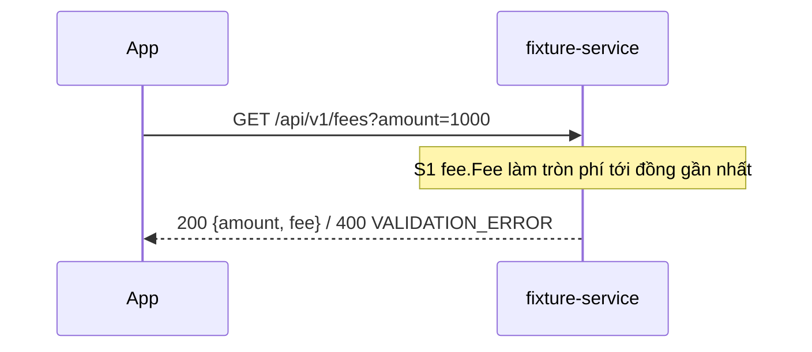

# Thiết kế

## Sequence

## API
- `GET /api/v1/fees?amount=1000`, không đổi request.

| Mã | Khi nào | Body |
|----|---------|------|
| 200 | `amount` ≥ 0 | `{"amount": 1000, "fee": 2}` |
| 400 | `amount` âm | `{"code": "VALIDATION_ERROR"}` |

## DB
- Không đổi.

## Giả định
- Tính bằng số nguyên: `(amount*15 + 5000) / 10000`, không dùng số thực. (tự chọn)

## Câu hỏi mở
- [x] Có đổi handler không? → Không, chỉ hàm `fee.Fee`.
