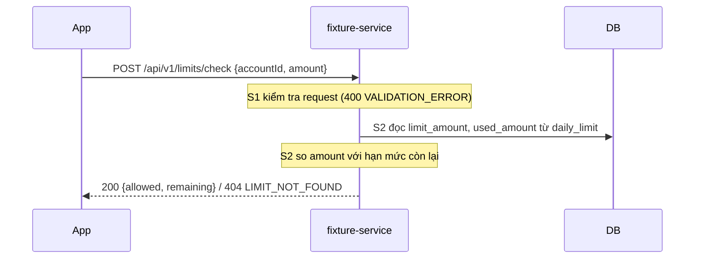

# Thiết kế

## Sequence

## API
- `POST /api/v1/limits/check`, body `{"accountId": "A1", "amount": 200000}`.
- 200 `{"allowed": true, "remaining": 100000}`; 400 / 404 `{"code": "..."}`.

## DB
- `db/00002_daily_limit.sql`: bảng `daily_limit` (khóa `account_id` → `account`), không sửa bảng cũ.

## Câu hỏi mở
- [x] Có cần khóa dòng khi đọc? → Không, API chỉ đọc.
