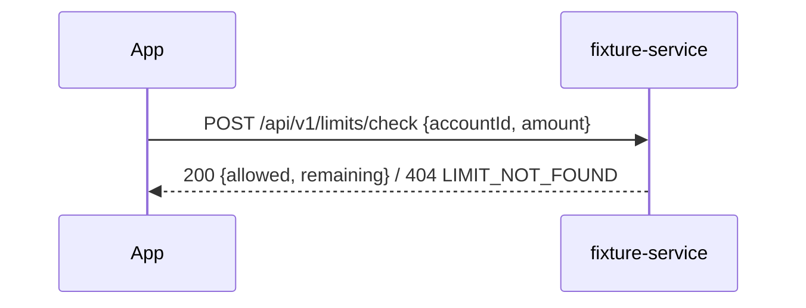

# Design

## Sequence

## API
- `POST /api/v1/limits/check`, body `{"accountId": "A1", "amount": 200000}`.
- 200 `{"allowed": true, "remaining": 100000}`; 400 / 404 `{"code": "..."}`.

## DB
- `db/00002_daily_limit.sql`: table `daily_limit`, no change to existing tables.

## Assumptions
- One limit row per account (own choice)
