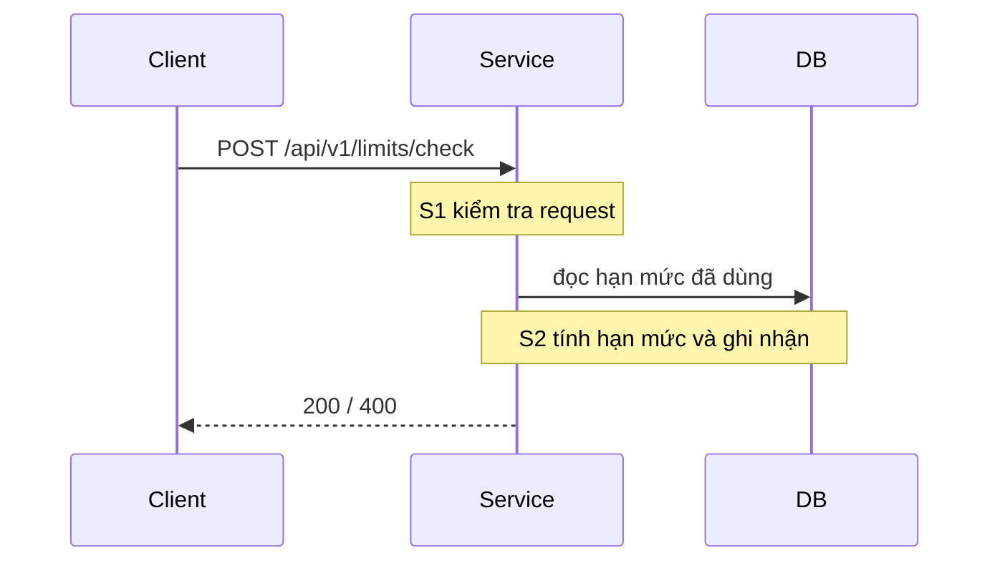

# Thiết kế

## Sequence
<!-- Mỗi bước S1, S2... của design.yaml phải xuất hiện trong sơ đồ. -->

## API
<!-- Một dòng "METHOD /path · body {…}" cho mỗi endpoint, rồi bảng mã trả về. -->
POST /api/v1/limits/check · body {"accountId": "...", "amount": 1000000}

| Mã | Khi nào | Body |
|----|---------|------|
| 200 | trong hạn mức | `{"allowed": true}` |
| 400 | thiếu hoặc sai amount | `{"error": "INVALID_REQUEST"}` |
| 404 | không thấy tài khoản | `{"error": "NOT_FOUND"}` |

## DB
<!-- Migration nằm trong thư mục db/ cạnh file này (ví dụ db/00100_create_usage.sql, theo goose, có `-- +goose Up`). -->

## Giả định
<!-- Mỗi lựa chọn BRD/ticket không ghi (kiểu dữ liệu, đơn vị, múi giờ, mặc định, lỗi hệ thống ngoài, khóa/giao dịch...): "- <quyết định>. (<nguồn>)"
     Nguồn: tự chọn | suy ra từ BRD | câu hỏi mở đã trả lời | ngoài phạm vi -->

## Câu hỏi mở
<!-- Câu hỏi chưa trả lời: "- [ ] Câu hỏi?"; đã có đáp án: "- [x] Câu hỏi? → trả lời" -->
