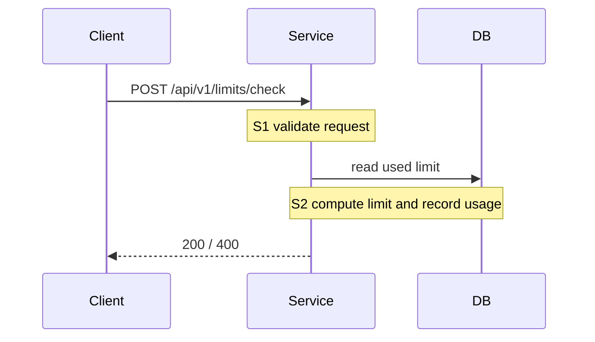

# Design

## Sequence
<!-- Every step S1, S2... of design.yaml must appear in the diagram. -->

## API
<!-- One line "METHOD /path · body {…}" per endpoint, then the table of response codes. -->
POST /api/v1/limits/check · body {"accountId": "...", "amount": 1000000}

| Code | When | Body |
|----|---------|------|
| 200 | within limit | `{"allowed": true}` |
| 400 | amount missing or invalid | `{"error": "INVALID_REQUEST"}` |
| 404 | account not found | `{"error": "NOT_FOUND"}` |

## DB
<!-- Migrations go in the db/ folder next to this file (for example db/00100_create_usage.sql, goose format, with `-- +goose Up`). -->

## Assumptions
<!-- Every choice the BRD/ticket does not state (data type, unit, time zone, default, external system errors, locks/transactions...): "- <decision>. (<source>)"
     Source: own choice | inferred from BRD | answered open question | out of scope -->

## Open questions
<!-- Unanswered question: "- [ ] Question?"; answered: "- [x] Question? → answer" -->
